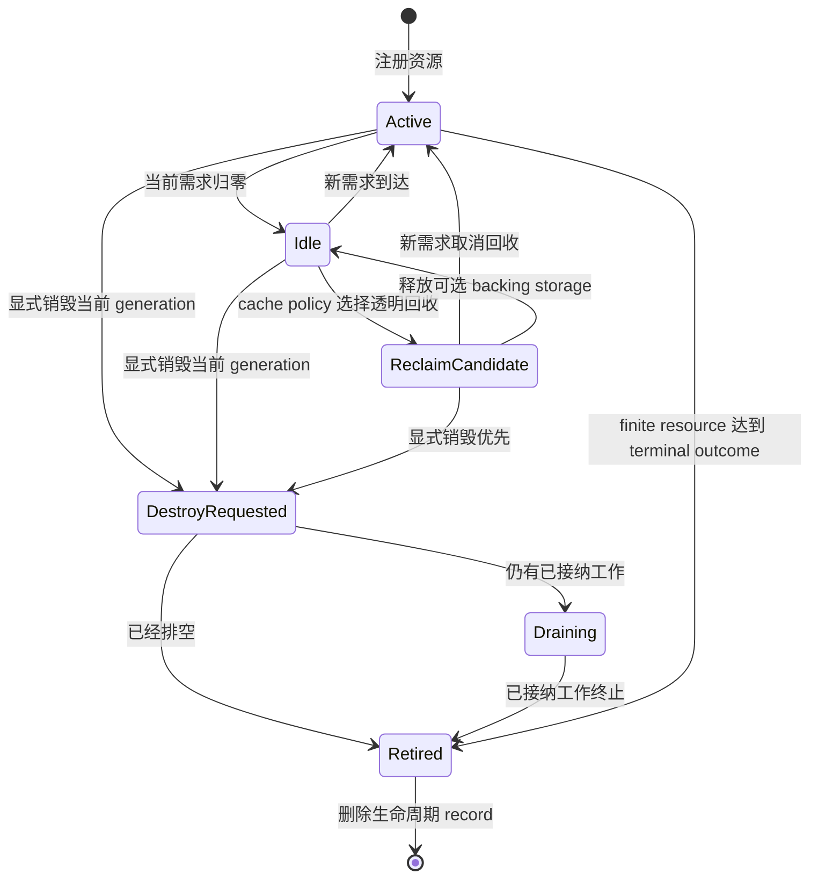
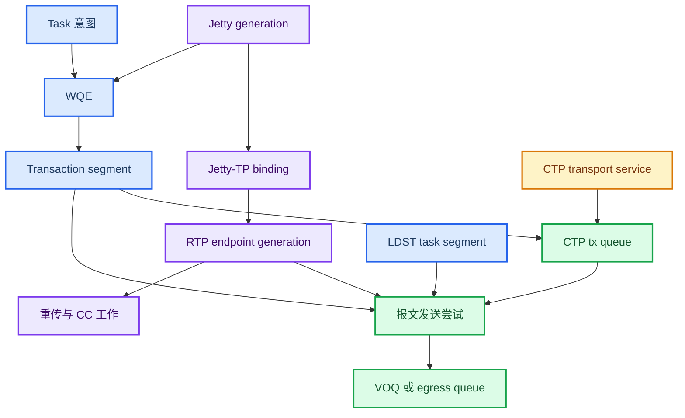
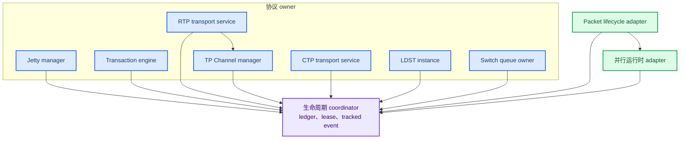
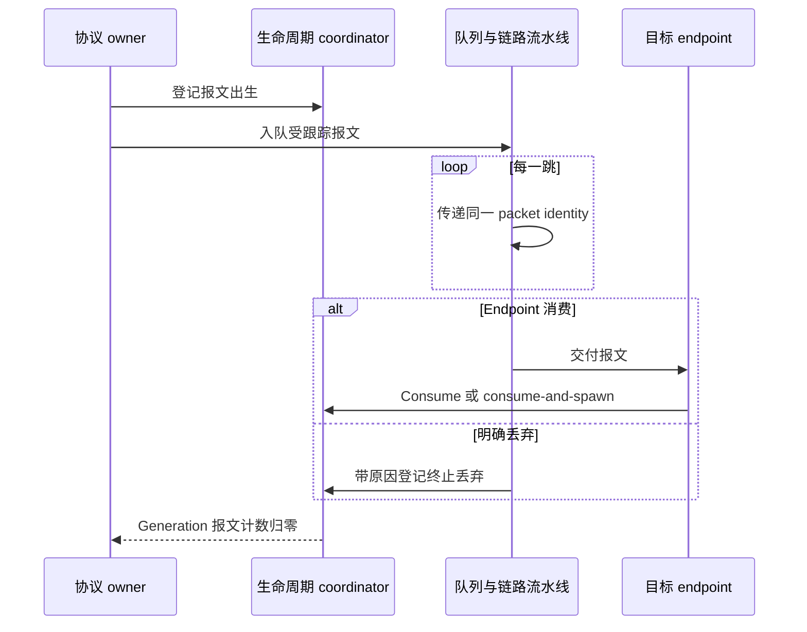
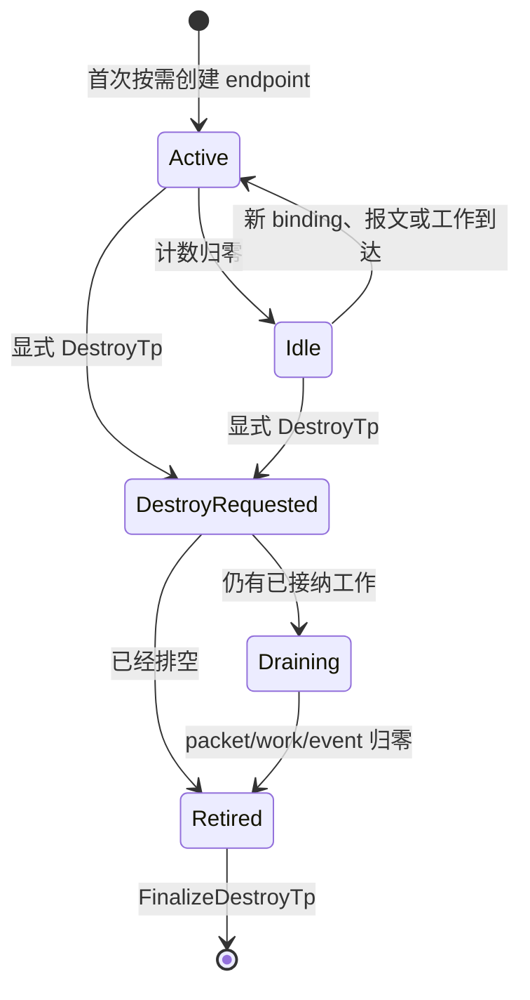

# Unified Bus 仿真资源生命周期架构

_已确认的设计基线，基于 `origin/main@ccf41b5`，重点建立忠实于协议语义、职责清晰、运行高效且可持续扩展的 Unified Bus 建模架构。_

---

## 📋 执行摘要

当前 Unified Bus 模型已经具备实现正确生命周期管理所需的原始信号，但资源所有权和回收逻辑分散在 `UbApp`、`UbFunction`、`UbTransaction`、`UbController`、`TpConnectionManager`、`UbCtpTransportService`、队列、重传、拥塞控制及并行运行时代码中。这种分散状态使清理过程依赖 workload 的先验知识，使若干动态 map 持续增长到仿真结束，也迫使新算法自行记住它创建的每一个隐式引用。

本次重构的首要目标是规范协议层 ownership、module interface、跨层协作和生命周期语义，使新协议机制能够沿稳定 seam 接入并由统一不变量验证。自动回收、内存下降、事件减少和运行效率提升是该架构的结果及验收指标，不是牺牲协议语义或 module 深度去单独追求的目标。

资源创建、排空和 teardown 本身也是实际网络设备中的正常管理行为，可以影响连接建立时延、可用连接数量、TPN 复用和后续操作行为。架构必须能够忠实建模这种语义；释放 C++ 对象、降低 RSS 或复用 backing storage 是语义安全之后的独立实现动作，不能反向定义协议行为。

建议的架构不是一个全局 manager，也不是每层各造一个 manager，而是一个节点级深生命周期 module 协调现有协议 owner 和少数真正的资源 manager：

- 节点持有的 `UbLifecycleCoordinator` 在内部记录 resource generation、typed binding、当前协议工作、tracked event 以及 packet/WQE 记账；
- `UbJettyManager`、`UbTransaction`、`UbTransportChannelManager`、常驻的 `UbCtpTransportService`、`UbLdstInstance` 和现有 queue owner 保留各自协议特有的创建、执行与 drain 规则；
- 所有报文从协议发射开始记账，直到 endpoint 消费或明确丢弃；
- WQE 从 Jetty 接纳开始记账，transaction segment 从 Transaction 层切分时开始记账，分别持续到对应事务完成、失败或取消；
- “未来 workload 是否还会使用”永远不是有限生命周期子资源的终止前提：当前 packet、WQE、timer 或
  queue entry 达到协议终止条件就必须清理，未来新工作创建新的子资源；
- MTP 和 MPI 只允许资源的 execution owner 修改资源，跨 owner 记账通过保持因果顺序的定长控制事件传递。

核心不变量是：

```text
资源可以回收
= 当前没有 binding
+ 当前没有 work item
+ 没有已调度的协议工作
+ 没有保留的协议状态
+ 该 generation 没有在途报文
+ peer 持有的所有部分均已排空
```

该判定直接使用网络仿真中真实的报文和事务进展，而不是要求算法预测“以后永远不会再使用某个实体”。

## 🎯 范围与非目标

### 目标

- 明确 Function、Transaction、Transport、Network、Datalink 与 simulator-local lifecycle module 的 ownership 和 interface。
- 建立统一生命周期词汇和不变量，但不强迫所有实体采用同一种 implementation。
- 让新的重传、拥塞控制、事务、传输、故障或队列机制沿稳定 seam 接入，不自行发明引用计数和销毁流程。
- 将协议状态、operation completion、runtime object lifetime 和 reclamation policy 分离。
- 将 modeled connection/resource lifecycle 与 simulator backing-storage lifecycle 分离，使真实 teardown 行为可以独立观测和验证。
- 在本地单线程、MTP、MPI 和 hybrid runtime 下保持 UB 语义与 owner-local mutation 一致。
- 让实例状态转换和子资源终止依赖可观测的协议进展，而不是 `traffic.csv` 的完整性或算法特有的
  planned-use 计数。
- 通过架构验收、语义回归、CPU/event overhead 和 peak memory 测量共同评估重构结果。

### 非目标

- 本设计不定义新的 UB wire-level TP teardown 协议。Base Specification 要求 RTP 传输前协商并建立 TP Channel、在传输期间维护上下文，但明确将 TP Channel 建立流程的具体实现排除在规范定义之外；规范也没有给出自动回收或 teardown 状态机。[^1]
- 本设计不让节点、交换机、端口、链路、路由表或基础流控对象等拓扑实体参与运行期动态回收。
- 本设计不把 trace 输出作为记账来源。即使关闭所有可选 trace 类别，记账仍必须正确。
- 本设计不要求新算法了解未来 workload 行为。
- 本设计不要求所有 cacheable 资源都必须回收。当回收会造成频繁抖动时，策略可以保留热点资源。
- 本设计不以最小 peak RSS 为唯一目标，也不接受通过削弱协议状态、错误处理或并行因果语义换取内存下降。
- 本设计不因主机 RSS、allocator 压力或 C++ 对象数量直接合成 UB 连接关闭；这些信号只能在语义允许回收的候选之间调整优先级。

### 规范校对结论

以下结论均已用 Zotero 中的中英文 Base Specification 2.0 原文交叉核对。[^1]

| 架构判断 | Base Specification 依据 | 本设计的边界 |
| --- | --- | --- |
| RTP TP Channel 是有状态、可共享的可靠传输上下文 | 6.1、6.3.1：RTP 通过 TPEP、PSN 和重传提供 exactly-once 交付；TP Channel 可由多个 initiator-target pair 共享 | reservation、session generation 和 endpoint runtime 必须分开建模，不能按单个 task 生命周期销毁 |
| TPG 管理多个 TP Channel | 6.5.1.1 描述 TPG 的成员调度和单一 TP 约束；7.3.1 进一步明确 RTP transaction segments 可以分散到不同 TP Channel | 本模型在 segment 边界调用 TPG 选择成员；一个 segment packetize 出来的所有包和重传固定使用所选 TP，一个 operation 可以跨多个成员 TP |
| CTP 和 UTP 不能套用 RTP 生命周期 | 6.1、6.3.2、6.5.2、6.6.2、6.7.2：CTP 是基于 Entity/VL 的常驻 transport mode，不定义 channel instance 或建立/销毁流程；UTP 不建立 TP Channel、不产生 transport response、也不重传 | CTP service 保持 node-scoped，只有 transaction、event、queue 和算法工作按语义终止；UTP 和 TP bypass 不应虚构 TP manager 实体 |
| Jetty 协议状态不等于对象生命周期 | 8.2.2.3：Jetty 有 Reset、Ready、Suspend、Error 四态；应用可从任意状态调用 Jetty 销毁 API | 销毁 API 表达逻辑销毁意图；运行时对象释放必须等待现有工作被完成、flush、失败终止或取消，并完成报文和事件排空 |
| 删除可被网络报文引用的资源前必须处理残留事务 | 8.2.1.1：删除 memory segment 前必须确保相关 memory access transaction 已完成，避免网络内残留报文造成数据不一致 | 精确 packet/WQE accounting 是该原则在仿真器动态实体上的通用化，不是新增 wire-level 协议 |
| WQE 是代码模型术语 | 8.2.3 使用 SQE、RQE、CQE 和 work request；仓库实现使用 `UbWqe` 统一表达 Jetty 工作 | 文档中的 WQE accounting 指 `UbWqe` 及其 transaction segment，不能声称 Base Specification 定义了通用 WQE 实体 |

## ✅ 决策来源与自审结论

本节是整份设计的审查索引。标记含义如下：

- `【用户已确认】`：设计方向或兼容取舍已在评审中明确拍板；它约束后续实现，但不等于代码已经完成。
- `【审查确认】`：已重新对照 Base Specification 2.0 和当前 `main@ccf41b58`，没有发现未解决的协议或现有代码冲突。
- `【待验证】`：设计可行，但正确性或效率只能通过实现审计、characterization test、并行运行或 benchmark 证明。

### 用户已确认的主要决定

| 事项 | 结论 | 对后续实现的约束 |
| --- | --- | --- |
| `【用户已确认】` 重构目标 | 首要目标是完整、规范、高效且可维护的协议栈架构；内存节省是正确释放资源后的副产品 | 不以 RSS 数字反向决定协议生命周期，不为省内存削弱建模语义 |
| `【用户已确认】` 总体所有权 | 采用“协议 owner + 节点级 `UbLifecycleCoordinator`”，不建立理解所有协议的全局 manager | coordinator 只统一 generation、lease、event 和计数不变量；具体 drain 规则留在协议 owner |
| `【用户已确认】` manager 契约 | 持有实例 collection 的 `*Manager` 必须覆盖 create/get/destroy request/drain/finalize 全生命周期 | caller 不得直接 erase manager 私有 container；是否启用某种自动回收 policy 可后置决定 |
| `【用户已确认】` 建模事实来源 | Packet 记账用于阻止 TP 在旧包仍在网络中时回收；WQE/transaction segment 记账用于阻止 Jetty 在工作未终止时回收 | trace 和 workload 先验不参与正确性判定；所有 packet terminal 与 work outcome 路径必须闭合 |
| `【用户已确认】` 第一版 TP 范围 | 默认网络语义不关闭 TP；idle TP 可以透明释放可重建的内部 backing state，但保留轻量 identity、reservation、TPN 和 generation | `DestroyTp()`/`DestroyConnection()` 保留完整显式 drain/finalize interface，但当前 workload/runtime 不自动调用；内部终止资源仍按网络语义立即清理 |
| `【用户已确认】` Jetty 销毁权 | Jetty 是 `UbApp`/URMA 上层可见的协议栈入口，逻辑销毁意图由上层发起 | manager 负责冻结与排空，不能根据 WQE 暂时归零推断应用以后不再使用 Jetty |
| `【用户已确认】` CTP 生命周期 | `UbCtpTransportService` 是 node-scoped 常驻服务，不虚构 CTP Channel generation | CTP transaction、queue entry、event 和 Entity/VL 派生状态仍在语义终止时释放；CTP capability 正向约束 Transaction 切片 |
| `【用户已确认】` TP/TPG 提交 | TA 到 RTP 对 direct TP 和 TPG 使用同一 `SubmitTransactionSegment()` interface；TPG 自己管理成员选择 | direct 与 TPG-selected segment 解析后进入相同 TP admission/backpressure 路径；TP 同时被 direct 使用和作为 TPG member 时共享 capacity、CC 和 queue 状态 |
| `【用户已确认】` TPG 粒度 | operation 可以按 transaction segment 分散到多个 TP；每个 segment 一旦选定 TP，后续 packetization 和重传不再迁移 | 单 segment operation 自然只用一个 TP；禁止按 packet 在 TPG member 间重新选择 |
| `【用户已确认】` 调度复杂度 | 第一版只有 TPG member selection 这一处可变策略；共享 TP 的 source 公平性使用固定兼容调度，不再增加第二套 policy framework | 使用 ready-source deque、合并 capacity wakeup 和成功 admission 后再推进 cursor；不使用轮询 timer |
| `【用户已确认】` 目录与命名 | 按 Function/Transaction/Transport/Network/Datalink 协议域放置实体与 manager；沿用语义正确的现名，只修正会造成概念混淆的名称 | 统一采用 `UbRtpTransportRef`；通用层/实体使用 `Transport` 全称，RTP、CTP、TPG、TPN 等规范缩写保留 |
| `【用户已确认】` 功能迁移基线 | 新架构按干净职责实现，但功能上先逐项对比并接纳当前 `main` 的有效建模 | 重构前先用 characterization test 固定现有 pacing、公平性、completion、重传和输出契约 |
| `【用户已确认】` trace 范围 | trace 使用分级、结构化、高读写效率的 writer；第一版保留现有按 TPN 的文件名和 parser contract | 默认 chunk 64 KiB、每 owner buffer budget 1 MiB、每进程最多 1024 个 trace file；参数仍需 benchmark 验收 |

### 审查确认没有结构性问题的事项

| 事项 | 审查结论 | 证据与边界 |
| --- | --- | --- |
| `【审查确认】` Function 与 Transaction 分层 | `UbFunction`/`UbJettyManager` 管 URMA 入口、Jetty、WQE submission 和 completion delivery；`UbTransaction` 管 TASSN、切片、ordering、response matching 和 operation completion | Spec 8.2.2-8.2.3 把 Jetty 与事务队列放在 Function/URMA；当前 `UbJetty::GenWqeSegment()` 和 CTP-specific transaction context 是需要迁移的反向依赖 |
| `【审查确认】` transaction queue 归属 | 未来 SQ/RQ/CQ/EQ 应放在 `function/urma/`，不属于 `transaction/` | Spec 8.2.3 将其定义为 URMA 异步编程模型的软件-硬件媒介；当前代码尚未形成值得独立建文件的完整 queue module |
| `【审查确认】` Header 归属 | LPH、NTH、RTPH/CTPH/UTPH、BTAH/ATAH 分别归 Datalink、Network、Transport、Transaction；跨层 packet parser 单独组合 | Spec 的协议层次和各 header 章节直接给出归属；不能继续由一个 Transport/common header 文件拥有全部语义 |
| `【审查确认】` Packet adapter 单独存在 | `ub-packet-lifecycle-adapter.*` 是连接 Packet pipeline 与 coordinator 的跨层 adapter，不是 Packet manager，也不拥有 Packet collection | Packet 会跨 queue/link/drop/MPI 边界，birth 与 terminal 不属于同一个协议层；把 Tag/Packet 细节并入 coordinator 会污染其小 interface |
| `【审查确认】` ns-3 Packet identity | `UbPacketLifetimeTag` 必须实现正式 `ns3::Tag`；`Packet::GetUid()` 只用于日志关联，不能代表物理发送 attempt | 当前 `Packet::Copy()`/`CreateFragment()` 保留 metadata UID，`m_globalUid` 是 process-global 非原子计数；Packet serialization 会携带 packet tag |
| `【审查确认】` TPG segment 语义 | segment-level TP 选择符合 Spec 7.3.1；6.5.1.1 的“相同事务操作使用同一 TP”按未切片 operation 或单个 transaction segment 理解 | 7.3.1 更具体地规定 RTP transaction segments 可分散到不同 TP Channel；每个 segment 内仍保持单 TP，需用三组粒度测试固定解释 |
| `【审查确认】` Network 拆分 | `UbRoutingTable` 管 route storage/lookup，`UbRoutingPolicy` 管 HASH/ADAPTIVE selection，`UbRoutingProcess` 保持收包选路 façade | 当前 `UbRoutingProcess` 已同时包含 exact/range table、port-set interning、HASH 和 ADAPTIVE 两类真实行为，拆分后不是空抽象 |
| `【审查确认】` Datalink 与 switch 拆分 | CBFC、shared-credit CBFC、PFC 分别形成 flow-control module；SP/RR/DWRR 留在 `UbSwitchAllocator`；`UbSwitch` 拥有 VOQ，`UbQueueManager` 只管 buffer accounting | 当前 `ub-flow-control.*` 已有三套独立状态与 decision hook；当前 `VirtualOutputQueueStorage` 明确由 `UbSwitch` 持有 |
| `【审查确认】` CTP 不建 channel manager | Spec 没有定义 CTP Channel、TPN 或建立/拆除流程，常驻 service 加有限生命周期子资源比套用 RTP manager 更准确 | Spec 6.1、6.3.2、6.5.2 和 6.6.2 以 Entity、目的 Entity/VL 描述 CTP；transaction segmentation 仍属于 Transaction |
| `【审查确认】` 事件驱动回收 | 生命周期推进可以由 binding release、completion/ACK、packet terminal、event cancel/fire 和 queue transition 直接触发 | ns-3 的 `EventId`、`ScheduleNow()`、`Cancel()` 和 `DoDispose()` 足够承载通知与最终断引用；无需新增生命周期轮询 timer |

### 必须留到实现阶段验证的事项

| 事项 | 当前不能直接确认的原因 | 验收方式 |
| --- | --- | --- |
| `【待验证】` MTP/MPI 记账 | 跨 execution owner 的 control record 尚未实现，无法证明 exactly-once、因果顺序和 teardown completion | 单线程/MTP/MPI/hybrid 对照测试；重复、乱序、延迟 control record 注入；owner sequence 与 balance check |
| `【待验证】` Packet copy/fork 分类 | 现有每个 `Packet::Copy()` 可能分别表示 parser view、ownership transfer、retained template 或真实物理 fork | 审计全部调用点并为每类 wrapper 建 characterization test；覆盖 drop、fragment、clone、retransmission 和 remote link |
| `【待验证】` RTP Tx buffer 重建 | 从“缓存完整 Packet”迁到 `UbRtpTxItem` 后，尚未证明所有 opcode、扩展头、ACK/SACK 和重传模式都能无损重建 | 新旧 packet bytes/headers 对照、loss/reorder/timeout 矩阵和 TCP-style range-retire 单测 |
| `【待验证】` 双端连接销毁 | `DestroyConnection()` 的跨 owner 请求聚合、peer drain 和 callback exactly-once 仍是目标设计 | 两端同时请求、单端请求、旧包晚到、重复请求、peer failure 和 simulator stop 测试 |
| `【待验证】` ready-source 调度 | ready deque 与合并 wakeup 的复杂度较低，但尚未证明完全保持当前短流起点、公平性和吞吐 | 多 Jetty 共享 TP、direct+TPG 混合、容量反复开关和长期饥饿 characterization；测 event rate 与吞吐 |
| `【待验证】` CTP 丢包边界 | Spec 的 CTP 可靠性依赖下层可靠机制，当前仿真在 fault/drop 场景下未必具有 link-layer retry 或统一 error policy | 有/无下层恢复的控制组；确认 operation 是完成、明确失败还是正确保持未排空 |
| `【待验证】` Routing/flow-control 搬迁 | 代码职责拆分有依据，但移动后仍可能改变 route tie-break、threshold、trace 时机或热路径分配 | 新旧 trace/result characterization、route/credit/PFC 单测、allocation count 和 forwarding benchmark |
| `【待验证】` TP idle backing policy | 同一 TP generation 必须保留协议连续性状态，但各 container 可释放多少 capacity 取决于复用概率和峰值 | 长时间 idle 后再次发送的 PSN/CC 行为对照；测立即释放、保留小容量和分块释放的 CPU、allocation 与 peak RSS |
| `【待验证】` 生命周期热路径成本 | compact ledger、16-byte tag 和局部 O(1) 检查是目标，不是已测结果 | 分别测 accounting on/off、deep verification、detail trace 的 wall time、event rate、peak RSS 和 MTP scaling |
| `【待验证】` Trace 参数 | 64 KiB chunk、1 MiB owner budget 和 1024 open-file 上限是已确认的第一版默认值，但还不是性能最优性的证明 | 对 16/64/256 KiB chunk、不同 sink 扇出和 fd 压力测 syscall、wall time、RSS、可见延迟和 parser 兼容性 |

### 自审总评

总体架构可以进入分阶段 implementation plan：协议 owner 与 coordinator 的职责没有循环依赖，Function、
Transaction、Transport、Network、Datalink 和 switch 的目录拆分都有真实状态或算法支撑，没有为了目录
对称预建空 manager。当前主要风险不在模块划分，而在跨 owner 记账闭合、旧 `Packet::Copy()` 语义审计、
重传状态迁移和调度行为保持；这些事项已保留为显式验收项，不能在实现完成前标记为解决。

## 🔍 当前架构发现

### 现有所有权分散在多个协议层

| 协议层 | 动态实体 | 当前 owner 或索引 | 主要生命周期缺口 |
| --- | --- | --- | --- |
| Workload | `RuntimeTask`、phase state | `UbTrafficGen` | task 完成很容易被误用为协议资源生命周期的判定依据 |
| Function | `UbJetty`、`UbWqe` | `UbFunction::m_numToJetty`、`UbJetty::m_wqeVector` | RTP 当前每个 task 创建一个 Jetty，正常完成时没有执行完整的 Jetty 回收；`UbJetty::GenWqeSegment()` 使 Function 层承担了 Transaction 切片 |
| Transaction | WQE 排序、TASSN/TAACK、outstanding segment、Jetty-transport binding、远端请求 | `UbTransaction` 及当前 `UbCtpTransportService` 中的多个 map | CTP-specific transaction engine 放错层，镜像引用需要协同清理；`DestroyJettyTpMap()` 只处理了部分生命周期 |
| RTP | reservation、本地 endpoint、重传、CC | `TpConnectionManager`、`UbController`、`UbTransaction`、allocator | reservation 与 endpoint 已分离，但 TP collection 和子资源终止责任分散在多个 owner 中 |
| CTP | 常驻 service/config、packetization、compact queue、routing/拥塞状态 | `UbCtpTransportService` | `UbCtpEntityState` 混入 Transaction 层状态，空 queue 和 transport event 缺少对称终止路径 |
| LDST | task segment、ACK 计数、worker queue | `UbLdstInstance`、`UbLdstThread` | 已完成 task 和 segment 对应的 map 没有删除 |
| Network | 稀疏 VOQ 对象 | `UbSwitch` 和 allocator | VOQ 按需创建，但变空后仍保持注册 |
| Packet pipeline | 队列、事件、链路和 MPI 消息中的报文 | queue/port/link/event 所有权 | 缺少以协议 generation 为粒度、从产生到终止的完整记账 |
| Algorithms | 重传与 CC timer/state | TP 持有的策略对象 | `EventId` 和保留报文状态没有统一暴露给生命周期判定 |

### 当前代码已经具备有用基础

- `TP reservation` 已与本地 `UbTransportChannel` 物化分离。
- `UbController::CreateReservedTpEndpoint()` 和 `ResolveInboundTp()` 已支持 owner-local 延迟物化。
- 当前 `UbJetty::CheckAndRemoveCompletedWqe()` 已具备 WQE terminal、container erase 和上层通知行为，但
  它通过 Function 层持有的 TASSN 状态判断完成；重构保留行为并把判断权迁回 Transaction 层。
- RTP 已暴露 PSN 状态、重传 timer、ACK/CNP queue、入站事务单元、缓存报文和保留的重传状态。
- CTP 当前已记录 pending/outstanding segment、事务窗口、入站单元和 compact queue；其中前几项提供了可迁入 `UbTransaction` 的现成状态基础，queue/routing/拥塞状态继续由 CTP service 拥有。
- switch admission、egress queue failure、routing failure、fault injection 和 endpoint receive 路径已经暴露了大多数报文终止位置。
- `UbRemoteLink` 会跨 MPI 序列化 packet tag，因此能够携带仅供仿真器使用的生命周期 identity。

### 当前 `main` 功能建模接纳清单

本节固定本设计的功能基线。审计基于 `main` 提交 `ccf41b58`；“接纳”表示重构必须保留对应协议行为和
可观察结果，不表示保留当前类边界、容器或调用方向。后续实现若改变这些行为，必须先给出 Spec 依据或
characterization test 证明这是有意的建模变化。

| 协议域 | 接纳的现有行为 | 当前证据 | 重构边界 |
| --- | --- | --- | --- |
| Composition | `UbController` 作为 node-scoped composition root，惰性装配 CTP service | `UbController::CreateUbFunction()`、`CreateUbTransaction()`、`GetCtpTransportService()` | 保留装配角色；collection ownership 下沉给对应 manager/service |
| Function | `UbApp` 决定 transport mode、Jetty 创建/复用策略和 WQE 提交意图 | `UbApp::SendTraffic()`、`SendCtpUrmaTraffic()` | `UbApp` 是 intent authority，不直接维护 runtime collection |
| Function | bound Jetty 校验源和目的，unbound Jetty 只约束源；CTP 可按完整 Entity key 或 source Entity/VL 复用 | `UbJetty::CanAcceptWqe()`、`UbApp::GetOrCreateCtpBoundJetty()`、`GetOrCreateCtpUnboundJetty()` | 复用 key 行为保留，缓存索引迁入 `UbJettyManager` |
| Function/Transaction | WQE 惰性生成 transaction segment，TASSN window 支持乱序 response 后连续推进，完成 WQE 会从 active collection 删除并回调应用 | `UbJetty::GetNextWqeSegment()`、`ProcessWqeSegmentComplete()`、`CheckAndRemoveCompletedWqe()` | segmentation、TASSN 和 completion 判断迁入 Transaction；惰性物化和回调时机保持 |
| Transaction | ROI 下维护 WQE 顺序；URMA WRITE 等 TAACK、READ 等 READ_RESPONSE，多 packet READ 只生成一次 response | `UbTransaction::IsOrderedByInitiator()`、`ProcessInboundTaRequest()`、`ProcessInboundTaResponse()` 及对应单测 | 保留行为；补全 ROT/ROL/UNO 后再抽 ordering policy |
| Transaction/RTP | 多 TP 下短 operation 起点轮转、共享 TP 上 local Jetty 与 remote response source 做 RR，TP 满或 window 满时不丢 segment | `TriggerScheduleWqeSegment()`、`ScheduleWqeSegment()`、`m_jettyTpNextIndex`、`m_tpRRIndex` | 保留公平性和 backpressure；改成显式 TPG member selection + 单次 TP admission |
| RTP reservation | 先为双端预留 TPN，再按 source use 或 inbound 首包惰性物化 endpoint | `ReserveNewTpConnections()`、`CreateReservedTpEndpoint()`、`ResolveInboundTp()` | 保留 reservation/session/endpoint 三层语义，增加 generation 和完整 destroy flow |
| RTP ingress | inbound 首包必须匹配 reservation 的双端 TPN、IP 和 priority 才能物化 endpoint | `UbController::ResolveInboundTp()` | 保持 fail-closed，不允许迟到 packet 隐式创建新 generation |
| RTP data path | PSN send/receive window、乱序 bitmap、TPACK/TPNAK/TPSACK、wire PSN unwrap 和 response queue 优先级 | `UbTransportChannel`、`UbRetransController` 及 retransmission/wrap 单测 | 协议行为保留；状态 owner 和终止条件标准化 |
| RTP retransmission | GBN 与 selective retransmission、ACK 后 retire、stale retransmission queue 压缩、RTO 和 fast retransmit | `ub-retrans.*` 及 selective/GBN 单测 | 算法保留；完整 `Packet` retained copy 改为 descriptor-based `UbRtpTxBuffer` |
| RTP congestion | CAQM/DCQCN 的 packet feedback、window/rate、pacing/recovery 和 active sender flow accounting | `ub-caqm.*`、`ub-dcqcn.*` 及 CC 单测 | 算法保留；event 和 retained state 纳入 endpoint lifecycle |
| TPG | 一个 RTP operation 可在 transaction segment 边界分散到多个 TP；每个已分配 segment 固定使用一个 TP | 当前 `m_jettyTpGroup` 的多 TP 展开；Spec 7.3.1 | 保留可观察 striping，迁入真实 `UbTransportGroup`；禁止 per-packet 重选成员 TP |
| CTP service | CTP 不创建 RTP TP Channel、TPN、PSN 或 transport ACK/retransmission context | `UbCtpTransportService`、`UbCtpServiceDoesNotCreateRtpTpTest`；Spec 6.3.2 | 保留 node-scoped 常驻 service，不创建 `UbCtpManager` 或 CTP generation |
| CTP Transaction | active path 在 WQE 切片前把 request segment 上限设为 MTU，这是对齐一个 CTP packet 承载一个 segment 的正确方向 | `UbCtpTransportService::PrepareJetty()`；Spec 6.7.2、7.3.1 | 保留 MTU/单包约束，但由 CTP capability 向 Transaction 正向传递；large READ response 另按问题项修正 |
| CTP multipath | Entity 绑定、source/destination port hint、逐流/逐包 LBF、shortest-path policy 和 out-port selection | `UbCtpEntityKey`、`SelectOutPort()`、`NextLoadBalanceSalt()` | 保留路由行为；node owner 和 congestion key 按 Spec 规范化 |
| CTP queue | CNP、TAACK、DATA 使用严格优先级，共享 allocator/flow-control admission | `UbCompactTransportChannel::GetPriorityQueue()`、`RegisterQueueIfNeeded()` | 保留优先级；改名和建模为 CTP tx queue，不伪装成 TP Channel |
| LDST | topology-scoped worker thread、LOAD/STORE 分队列、per-thread outstanding 上限、request/response packet size 建模 | `UbLdstInstance`、`UbLdstThread`、`UbLdstApi` | worker 保持常驻；task、segment、ACK record 按 operation terminal 删除 |
| Routing | exact destination route、连续 node range route、shortest/non-shortest route 和相同 port-set interning | `UbRoutingProcess::m_rtShortest`、`m_rtShortestRanges`、`m_portSetPool` | 接纳当前存储语义；热路径 query 改成无分配访问 |
| Routing policy | per-flow hash、packet spray、adaptive queue-aware route selection和 ingress-port filtering | `GetOutPort()`、`SelectOutPort()`、`SelectAdaptiveOutPort()` | 算法行为保留；移除每 packet 临时容器分配 |
| Switch queue | VOQ 按 `(outPort, VL)` 分组并按 `inPort` 惰性创建，不再预建三维 queue object 矩阵 | `UbSwitch::VoqInit()`、`GetOrCreateVoq()`、`UbSwitchCreatesVoqsOnDemandTest` | 接纳 sparse object allocation；空壳 retention 是 storage policy |
| Packet queue | 首 packet inline 保存，溢出才使用 heap，drain 后释放 heap capacity | `UbPacketQueue`、`UbSmallFifoQueue` 及 inline/release 单测 | 保留，packet entry pop 是 queue child terminal，不等于 packet lifetime terminal |
| Buffer model | ingress processing、VOQ、egress 的字节迁移和 in-port/out-port 双视图；一个 packet 只保存一份 | `UbQueueManager` 及 buffer/PFC 单测 | `UbQueueManager` 继续只拥有 accounting，不拥有 VOQ instance |
| Switch allocator | egress full 时保留 ingress head；RR 保持 ingress slot fairness，DWRR 管 VL deficit 且 VL 内 RR | `UbSwitchAllocator` 及 allocator 单测 | 调度行为保留；registration/event 生命周期补全 |
| Flow control | CBFC、shared-credit CBFC、fixed/dynamic PFC 使用真实 control packet 和独立 decision hook | `ub-flow-control.*`、`UbDataLink::GenCreditPacket()` 及 flow-control 单测 | port/VL context 常驻；每个 control packet 仍有 packet birth/terminal |
| Link/port | local link 用一个 `Packet` 穿过 scheduled receive；port 的 egress/current packet/serialization 状态构成真实 pipeline | `UbLink::TransmitStart()`、`UbPort::TransmitPacket()` | link 是 transfer，不增加 packet birth；event 持有 in-flight packet |
| MPI link | `UbRemoteLink` 序列化 packet bytes/tag，在目标 owner 反序列化后调度 receive | `UbRemoteLink::TransmitStart()`、`NullMessageMpiInterface::SendPacket()` | `Copy()` 是同一 packet instance 的跨 owner transfer，不是 fork |
| Fault model | drop、delay、shutdown、error 和定向 retransmission fault 在 port pipeline 中生效 | `UbFault::FaultCallback()` | 行为保留；drop 必须显式登记 packet terminal，delay event 必须可追踪 |
| Observability | protocol source 通过 `TracedCallback` 发布，trace category gate 可关闭昂贵事件 | 现有 trace source 和 category gate 单测 | producer/sink 分离保留；trace 不承担 correctness ledger |

### 当前 `main` 问题清单

以下“当前问题”来自 `main@ccf41b58` 的代码审计；“目标处理”不是全部都经过用户逐项审核，因此每行同时
标记决策来源和验证状态：

- 来源使用 `【用户已确认】`、`【审查确认】` 或 `【设计建议】`；只有第一种表示用户已经明确拍板；
- 状态使用 `【语义已确认】`、`【待实现验证】`、`【待性能验证】` 或 `【待范围决定】`；
- 来源与状态是两个独立维度。例如一个方案可以是 `【用户已确认】【待实现验证】`。

| 协议域 | 当前问题 | 代码证据 | 目标处理 |
| --- | --- | --- | --- |
| Composition | `UbController` 同时保存 TP、TPG、port 和多个策略索引，只有 destructor 清 container，没有标准 `DoDispose()` 和分层 destroy | `ub-controller.h` 的 `m_numToTp`、`m_tpGroups`、`m_ports`；`ub-controller.cc` | `【用户已确认】【待实现验证】` 收敛为 composition root；TP endpoint collection 迁入 manager，各 service 自己 finalize |
| Jetty manager | `CreateJetty()` 可覆盖同一 Jetty number；`DestroyJetty()` 直接 erase，不冻结新 WQE、不解绑 RTP/CTP、不等 transaction/event drain | `UbFunction::CreateJetty()`、`DestroyJetty()` | `【用户已确认】【待实现验证】` `UbJettyManager` 统一 create/get/destroy/drain/finalize，identity 带 generation |
| Jetty storage | `m_jettyVector` 没有正常插入路径，却仍参与 destroy/dispose，是历史镜像；CTP cache 在 `UbApp` 没有对称 erase | `UbFunction::m_jettyVector`、`UbApp::m_ctp*JettyBy*` | `【审查确认】【待实现验证】` 删除死容器；复用索引归 manager，Jetty retire 时原子删除 |
| Jetty state | `IsValid()`、`IsReadyToSend()` 恒为 true，Reset/Ready/Suspend/Error 没进入 admission | `UbJetty::IsValid()`、`IsReadyToSend()`；Spec 8.2.2.3 | `【用户已确认】【待实现验证】` 协议状态与 lifecycle state 分离，并在 submit 入口共同校验 |
| Submit path | CTP caller 分别调用 `UbTransaction::AddWqe()` 和 `UbJetty::PushWqe()`，失败可产生半提交 | `UbApp::SendCtpUrmaTraffic()` | `【用户已确认】【待实现验证】` 统一 `UbFunction::SubmitWqe()`，验证后原子建立 WQE、operation 和 binding lease |
| Transaction ownership | Jetty/TP 双向 `Ptr` map、remote request map、RR index 和 scheduling flag 镜像同一关系，清理分散 | `UbTransaction::m_jettyTpGroup`、`m_tpRelatedJetties`、`m_tpRelatedRemoteRequests` | `【用户已确认】【待实现验证】` binding 归 Jetty manager；operation/progress 归 Transaction；TPG 归 RTP service |
| Transaction modes | ROT、reliable/unreliable 查询仍是 stub，当前 URMA read/write 强制 ROI | `IsOrderedByTarget()`、`IsReliable()`、`ValidateUrmaServiceModeOrDie()` | `【审查确认】【语义已确认】` 文档明确 implemented subset；形成真实第二套行为后再抽 policy |
| Transaction events | `ScheduleNow()` 直接捕获 Transaction、TP 和 segment，没有统一 event token；TP 销毁只能靠 map lookup 避免部分 stale work | `TriggerScheduleWqeSegment()`、`ApplyScheduleWqeSegment()`、`OnScheduleWqeSegmentFinish()` | `【用户已确认】【待实现验证】` 所有动态 resource callback 使用 tracked event，执行/取消都 release token |
| Cross-layer lookup | Function、Transaction、LDST 和算法通过 `NodeList -> UbController` 反向查彼此 | 多处 `NodeList::GetNode(...)->GetObject<UbController>()` | `【审查确认】【待实现验证】` 只在新的协议 owner seam 注入窄 interface/ref；保留获取本地 Node/Device 的正常 ns-3 lookup |
| Segment type | `UbWqeSegment` 混合 Function WQE、Transaction TASSN/response、RTP TPMSN/PSN 和 Network address | `ub-datatype.h` 的 `UbWqeSegment` 字段 | `【用户已确认】【待实现验证】` 改为 Transaction-owned `UbTransactionSegment`；transport assignment/state 使用独立 record |
| TP destroy | `DestroyTp()` 用 `m_numToTp[tpn]` 隐式插入，随后立即 unregister/erase；没有 freeze、drain、packet/event gate | `UbController::DestroyTp()` | `【用户已确认】【待实现验证】` `UbTransportChannelManager::DestroyTp()` 请求 drain，最终只由 private finalize erase |
| Connection destroy | reservation 没有 generation/destroy state/单 connection destroy；`RemoveUselessTps()` 用 task cleanup 和 binding 猜测网络已排空，并直接销毁双端 | `TpConnectionManager`、`RemoveUselessTps()` | `【用户已确认】【待实现验证】` 增加显式 `DestroyConnection()`，packet/protocol/binding/event 全部归零后 finalize 双端 slot |
| Connection storage | 一个 `Connection` 被复制进 master vector、node view 和多张查询 index；process-global control lock 扩展性差 | `TpConnectionManager::m_allConnections`、`m_nodeConnections`、五张 index、`g_tpConnectionControlLock` | `【审查确认】【待性能验证】` owner 保存一份 record，index 保存轻量 id/ref；锁按 owner/partition 收窄 |
| TPG | `UbTransportGroup` 是空类；实际 multi-TP group、RR 和 binding 藏在 Transaction，`DestroyTpGroup()` 直接 erase | `UbTransportGroup`、`UbController::CreateTpGroup()`、`m_jettyTpGroup` | `【用户已确认】【待实现验证】` RTP service 拥有真实 TPG collection、member lease、RR state 和完整 destroy flow |
| RTP drain | `IsEmpty()` 只表示没有当前 send work，不能证明 unacked packet、timer、inbound unit、retained retransmission 和 peer state 已排空 | `UbTransportChannel::IsEmpty()` 与内部 state | `【用户已确认】【待实现验证】` 用 typed counters/gates 实现 `IsSafeToReclaim()`，不得复用 queue-empty 判断 |
| RTP teardown | `DoDispose()` 直接清 ACK/CNP/WQE/inbound/retrans state，且没有调用 `Object::DoDispose()`；这会掩盖未终止子资源 | `UbTransportChannel::DoDispose()` | `【用户已确认】【待实现验证】` 正常 finalize 前必须已 drain；forced simulation stop 单独报告后清理并调用 base |
| RTP Tx buffer | selective retransmission retained state 保存完整 `Packet::Copy()`，重传再 copy | `UbSelectiveRetransStrategy::OnDataPacketSent()`、`GetNextRetransmissionPacket()` | `【用户已确认】【待实现验证】` `UbRtpTxBuffer` 保存 payload/segment descriptor 和 header 重建所需状态 |
| RTP layer boundary | TP endpoint 保存大量 inbound transaction unit 和 response matching 状态 | `m_inboundTaUnits`、`m_inboundTpMsnReferences`、`m_inboundTaSsnReferences` | `【用户已确认】【待实现验证】` transport 只负责完整接收；operation/response completion 迁回 Transaction |
| CTP ownership | service 把 transaction window、pending/outstanding segment、inbound TA unit、routing 和 queue 混在 `UbCtpEntityState` | `UbCtpTxState`、`UbCtpRxState`、`m_entityStates` | `【用户已确认】【待实现验证】` Transaction work 迁回 `UbTransaction`；service 只留 Entity policy、packetization、queue 和 CC |
| CTP child cleanup | `m_keyJettys`、`m_keyJettyRrIndex`、`m_entityStates`、`m_queues`、`m_registeredQueues`、`m_congestionSignals` 只有创建路径，无正常 retire；service 无 `DoDispose()` | `ub-ctp.h`/`ub-ctp.cc` | `【用户已确认】【待实现验证】` Jetty unbind、transaction terminal、queue unregister 和 entity cache retire 使用对称事件路径 |
| CTP key | congestion key 包含 source node/entity，违反 Spec 6.6.2 的 `{destination Entity, VL}` 粒度；node-scoped entity key 仍重复 source node | `UbCtpEntityKey`、`UbCtpCongestionKey` | `【审查确认】【待实现验证】` entity key 隐含 owner node；CC key 只保留 destination node/entity/VL |
| CTP queue type | `UbCompactTransportChannel` 不是协议 TP Channel，却返回 `IngressQueueType::TP` 并保存 `UbCtpEntityState*` 裸指针 | `GetIngressQueueType()`、`SetCtpEntity()` | `【用户已确认】【待实现验证】` 改为纯 CTP tx queue 类型，入队前完成 packet build，不跨 owner 保存裸 state pointer |
| CTP segmentation | service 仍允许超大 `UbWqeSegment` 二次分成多个同 TASSN packet；READ segment 还继承整个 WQE 的 `responseBytes`，large response 会再次分包 | `UbJetty::GenWqeSegment()`、`UbCtpTransportService::SendSegment()`/`SendResponseSegment()` 和 fragmentation 单测；Spec 6.7.2、7.3.1 | `【用户已确认】【待实现验证】` Transaction 令 request/response 都满足单包约束；发送入口拒绝超 MTU segment，不在 CTP service 二次切片 |
| CTP reliability | 当前 model 没有 link-layer retry；CTP 自身也按 Spec 不重传，因此 fault/drop 下无法提供规范所说的联合可靠服务 | `UbLink`、`UbCtpTransportService`、Spec 6.3.2 | `【用户已确认】【语义已确认】` 本次只明确 lossless-lower-layer 适用边界；link reliability 或 transaction error outcome 属于新增功能建模，拆到独立后续工作 |
| CTP congestion | CNP 到达只累计计数，没有 `{destination Entity, VL}` rate/window 或发送限制 | `RecordCnpForTest()`、`m_congestionSignals` | `【用户已确认】【语义已确认】` 保留接口位置并明确标为未实现模型；完整 CTP CC context 属于新增功能建模，不混入本次生命周期重构 |
| LDST terminal | task 完成后 `m_taskSegmentsMap`、`m_taskToSegmentMap`、`m_taskSegmentCompletedNum` 和 thread `m_waitingAckNum` 都不 erase | `OnTaskSegmentCompleted()`、`UbLdstThread::UpdateTask()` | `【审查确认】【待实现验证】` segment/task 最后 ACK 后原子删除 active record，仅按需保留统计摘要 |
| LDST safety | map `operator[]` 会为未知 ACK 建空项，duplicate ACK 可下溢；thread id 边界使用 `>` 而不是 `>=` | `OnRecvAck()`、`UpdateTask()`、`GetLdstThread()` | `【审查确认】【待实现验证】` 使用 `find` + generation/terminal check；重复 terminal 幂等或 fail-fast |
| LDST modeling | active app 固定使用 thread 0/1，`address` 参数未落入 segment，配置的 thread 数没有参与选择 | `UbApp::SendTraffic()`、`HandleLdstTask()` | `【用户已确认】【语义已确认】` thread selection、地址和访问范围属于独立功能修正；本次只处理 LDST terminal、安全检查、event 和 owner 生命周期 |
| LDST events | Push/Handle/ACK/Update 全部使用未追踪的 `ScheduleNow()`；`DoDispose()` 只清 thread vector且不调用 base | `ub-ldst-instance.cc`、`ub-ldst-thread.cc` | `【审查确认】【待实现验证】` operation event token 归 LDST instance；forced stop 后清 maps 并调用 base |
| VOQ lifecycle | current sparse VOQ 按需创建后永久注册；没有 owner-private 对称 unregister/destroy primitive | `UbSwitch::GetOrCreateVoq()`、`m_voq`、allocator registration | `【审查确认】【待实现验证】【待性能验证】` 增加安全 retire primitive；是否保留空壳由 storage policy 和 benchmark 决定 |
| Allocator events | deadlock scan 每 10 ms 无条件自调度且不保存 `EventId`；allocate event 也不统一追踪 | `UbSwitchAllocator::Init()`、`CheckDeadlock()`、`TriggerAllocator()` | `【审查确认】【待实现验证】` deadlock scan 只记录诊断日志，因此仅在诊断启用时运行；保存/cancel event，active selection 使用 token |
| Switch CC event | switch CAQM 周期 update event 不保存/cancel；`DoDispose()` 只清容器 | `UbSwitchCaqm::ResetLocalCc()`、`DoDispose()` | `【审查确认】【待实现验证】` topology event 仍需保存 `EventId` 并在 dispose cancel，避免 stop 后 stale callback |
| Routing hot path | 每个 packet 创建 shortest、non-shortest、candidate 和 best-port `vector`；adaptive path 可单次迭代完成 | `UbRoutingProcess::GetOutPort()`、`SelectAdaptiveOutPort()` | `【审查确认】【待性能验证】` 返回只读 port-set view 或使用 caller scratch；选择过程不分配 heap |
| Routing pool | route 删除只 erase index，intern pool 持续保留 port set；`VectorHash` 通过 decimal string 构造 hash | `RemoveShortestRoute()`、`RemoveOtherRoute()`、`m_portSetPool`、`VectorHash` | `【审查确认】【待性能验证】` 当前没有 route-delete caller，第一版按 topology-static 保留 intern pool；hash 改为直接组合整数，动态回收以后有真实 caller 再设计 |
| Packet terminal | endpoint consume、route miss、ingress/egress overflow、fault drop、channel failure、forced stop 没有统一 packet terminal | `UbSwitch`、`UbPort`、`UbFault` 各 drop 分支 | `【用户已确认】【待实现验证】` 所有终止点调用一个幂等 terminal helper；queue occupancy 不重复计 packet lifetime |
| Packet copy | parser view、MPI transfer、retransmission retain/fork 仍都写成裸 `Copy()`，无法由 API 审计语义 | UB model 内全部 `Copy()` call site | `【用户已确认】【待实现验证】` 使用 `View/Transfer/Retain/Fork` helper 命名语义；只有 fork 增加 packet instance |
| Fault state | per-task drop/error/shutdown accounting map 没有 task terminal cleanup | `UbFault::dropMap`、`errorDropMap`、`shutdownDropMap` | `【审查确认】【待实现验证】` active rule state 随 task terminal 删除，最终统计保留紧凑 summary |
| Dispose contract | 多个 `DoDispose()` 不取消事件、不清全部 owned child 或不调用父类 | `UbSwitch`、`UbSwitchAllocator`、`UbTransportChannel`、`UbLdstInstance`、CTP service | `【审查确认】【待实现验证】` manager/service 统一 `Dispose`: cancel event、detach callback、forced terminal、release child、调用 base |
| Parallel terminal | MPI/MTP transfer 只有 packet bytes/tag，没有 owner-side terminal acknowledgement contract | `UbRemoteLink`、MPI receive path | `【用户已确认】【待实现验证】` tag 携带 lifetime identity；目标 terminal 通过 adapter 回报 emission owner，转发不改计数 |

### 当前 `Packet::Copy()` 无法定义报文出生

ns-3 的 packet copy 会保留相同的 packet UID 和 packet tag。在当前代码中，`Copy()` 承担了多种不同语义：

- 只读的 parser 或 trace view；
- 同一逻辑 packet instance 的 MPI transfer；
- 当前不在网络中的保留重传 template；
- 新发射的一次重传尝试；
- 新生成的响应候选报文。

因此，`Packet::Copy()` 不能自动增加在途计数。生命周期代码必须显式区分 `view`、`transfer`、`retain` 和 `fork`。

## 📚 规范领域模型

### 资源作用域

| 作用域 | 含义 | 示例 | 生命周期策略 |
| --- | --- | --- | --- |
| Topology | 与配置后的网络共同存在 | `UbController`、`UbSwitch`、`UbPort`、`UbLink`、routing table | 持续到仿真 teardown |
| Session | 可复用的通信 context | RTP reservation、TP endpoint、TPG、可复用 Jetty | 逻辑 identity 由显式 authority 管理；仅可重建 backing state 可 cacheable |
| Operation | 有限的事务工作 | task、WQE、transaction segment、LDST task segment | 在语义终止时回收 |
| Packet instance | 一次物理仿真传输尝试 | DATA、ACK、NAK、SACK、CNP、流控报文 | endpoint 消费或明确丢弃时终止 |
| Algorithm work | 挂在资源上的延迟工作 | 重传 timer、delayed ACK、CNP timer、pacing wakeup | 执行或取消时终止 |

### 生命周期策略

```cpp
enum class UbLifecyclePolicy : uint8_t
{
    PERSISTENT, // Topology 或 node-scoped 对象
    EXPLICIT,   // 仅由建模后的 application/control-plane 动作触发回收
    EPHEMERAL,  // 具有明确 terminal outcome 的有限工作在终止后立即回收
    CACHEABLE   // 排空后可安全回收，未来可重新物化
};
```

生命周期记账、实例 close/destroy 和 container capacity policy 是三个独立问题。所有纳入新架构的动态
资源都必须注册 identity、generation、lease、tracked event、packet terminal outcome，并执行核心
不变量检查。父实例可以保持存在，但已经达到协议终止条件的子资源不能继续滞留在 container 中；
container 是否保留已分配 capacity 则由本地 storage policy 决定。
计数归零只证明资源当前 `Idle`，不自动证明 Jetty、TP 或其他可复用父实例已经语义终止；只有 WQE、
transaction segment 等本身具有明确 terminal outcome 的 finite resource 才可据此进入 `Retired`。

### 建模生命周期与存储生命周期

真实连接关闭与 runtime backing-storage 回收必须保持概念分离。Base Specification 没有定义 TP Channel
建立和 teardown 流程，因此第一版不增加 `AUTO_IDLE_CLOSE`、基于 workload completion 的自动关闭或
wire-level peer close handshake。idle TP 可以透明释放可重建的 queue backing、临时索引和可选算法状态，
但轻量 TP record、identity、reservation、TPN 和当前 generation 继续有效；新需求在同一 generation 上恢复
内部状态，不产生网络断连。simulator-local 的显式 `DestroyTp()` 和 `DestroyConnection()` 仍提供完整
drain/finalize interface，其中只有 `DestroyConnection()` 删除 reservation、结束 session generation 并
释放 TPN。

第一版只实现一个简单关系：

```text
Connection reservation
        |
        +-- 首次需求按需创建 UbTransportChannel
                ACTIVE <-> IDLE
                idle 可透明释放可重建的内部 backing state
                TP identity/generation 保持存在，不产生网络断连

显式 DestroyConnection
        -> DESTROY_REQUESTED
        -> DRAINING
        -> 删除 reservation 并释放 TPN
```

- 沿用 `CreateReservedTpEndpoint()` 和 `ResolveInboundTp()`，在本地或入站需求到达时创建 endpoint；
- endpoint idle 时保持存在，但其已终止的 packet、WQE/segment、timer、queue entry 和 retained state 必须
  在各自协议事件中及时删除；
- idle storage policy 可以释放可重建的内部 capacity/state，但不得删除轻量 TP record、改变 generation 或
  释放 TPN；恢复由下一次合法需求直接触发，不增加 timer；
- `DestroyTp()` 和 `DestroyConnection()` 第一版作为 simulator-local 显式管理接口，不用于 workload
  completion、idle timer 或 memory pressure 驱动的自动清理；
- Jetty destroy 等规范已定义的资源操作仍按各自建模语义执行，不被 TP 第一版边界取消。

未来若获得规范或明确的研究模型，可以在该显式 manager 流程之前增加 wire-level close handshake 和
连接重建时延；它们成为 `DestroyConnection()` 的调用与协调来源，不替换既有 drain predicate。

### 稳定 identity 与 generation

每个可回收实体都使用带 generation 的 identity：

```cpp
enum class UbResourceKind : uint8_t
{
    JETTY,
    WQE,
    TRANSACTION_SEGMENT,
    RTP_CONNECTION,
    RTP_ENDPOINT,
    TPG,
    CTP_CONGESTION_CONTEXT,
    PORT_VL_FLOW_CONTROL_CONTEXT,
    CTP_QUEUE,
    LDST_TASK_SEGMENT,
    VOQ,
    PACKET_INSTANCE
};

struct UbResourceId
{
    UbResourceKind kind;
    uint32_t ownerNodeId;
    uint64_t localId;
    uint64_t generation;
};
```

`localId` 在适用时保留协议或仿真器 identifier，例如 Jetty ID 或 TPN。`generation` 防止旧事件、旧报文或旧 completion 修改语义上重新创建的资源；透明 runtime recreation 保持原 generation。

generation 不要求为每个已经销毁的 `localId` 永久保留 tombstone。每个 execution owner 维护一个 64-bit
单调 generation allocator；创建任意新的逻辑 resource generation 时取下一个值，透明 backing-storage
重建不取新值。这样 retire 后可以删除完整 resource record，只常驻 O(1) allocator 状态。owner-global
generation 也使 packet tag 无需重复携带 `UbResourceKind`：即使 compact slot 后续被另一类资源复用，旧
tag 的 generation 也不会命中新 record。64-bit generation 在单次仿真中禁止回绕；检测到溢出直接
fail-fast。connection generation 只由 canonical reservation owner 分配，再随两端 control record 传播。

`CTP_CONGESTION_CONTEXT` 和 `PORT_VL_FLOW_CONTROL_CONTEXT` 是 simulation-lifetime persistent accounting
domain，不表示 CTP 建立了 TP Channel，也不获得 idle 自动回收语义。它们使用固定的 simulation-lifetime
generation，使发射的 standalone CNP、PFC、CBFC 和 Datalink credit packet 仍能进入统一 packet balance。

### 协议状态与生命周期状态相互独立

Jetty 在规范中定义的 `Reset/Ready/Suspend/Error` 状态描述协议行为，不能复用为对象生命周期状态。一个 Jetty 可以在协议上处于 `Ready`，同时生命周期处于 `Idle`；也可以在协议上处于 `Error`，但仍有生命周期工作阻止其销毁。

coordinator 第一版使用一条最小 simulator-local 生命周期轴，并严格区分可撤销的透明回收候选与不可逆的
显式销毁：



并非每种资源都要经过所有状态。finite WQE 可以在 terminal outcome 后直接从 `Active` 进入 `Retired`；
cacheable backing storage 在 `ReclaimCandidate` 收到新需求时恢复 `Active`，释放 capacity 后仍以同一
generation 回到未物化或轻量 `Idle`。显式 `DestroyJetty/DestroyTp/DestroyConnection` 一旦进入
`DestroyRequested` 就关闭新 application work 和 binding admission，不能因新需求返回 `Active`；此后的
新 WQE/binding 表示 stale handle 或 admission bug。只有销毁前已接纳工作派生的协议响应、重传、错误处理
和 tracked event 可以继续推进 drain。

### 资源依赖图



task 只是输入意图，不是所有后代资源生命周期的权威来源。resource owner 根据子资源自身的记账回收它，再向上游或旁路传播 binding 已释放这一事实。

## ⚙️ 推荐架构

### 总体结构

使用协议层 owner，并由节点持有的深生命周期 module 协调。`UbLifecycleCoordinator` 的外部 interface 应刻意保持小：注册 resource、获取 typed lease、调度 tracked event、登记 packet terminal，以及请求 drain。resource record、ledger、lease 类型和 event bookkeeping 都是其内部 implementation，不分别暴露成浅 module。coordinator 不理解 PSN、TASSN、CTP Entity key、重传算法或队列调度。



### 协议层代码布局

目录按 UB 协议域和 Function 层编程模型划分，不按 `models/`、`managers/` 等技术角色划分。manager 与其拥有的实体同域放置；纯 value type 放进消费它的 module；只有跨协议层的 simulator-local 生命周期内核独立。

```text
src/unified-bus/model/
├── ub-app.*                          # application intent
├── ub-controller.*                   # node composition root
├── ub-port.*                         # port data path
├── ub-link.*
├── ub-remote-link.*
├── ub-fault.*
├── ub-tp-connection-manager.*        # 现有兼容类名和 TypeId
├── lifecycle/
│   ├── ub-lifecycle-coordinator.*
│   ├── ub-packet-lifecycle-adapter.*
│   └── ub-parallel-lifecycle-adapter.*
├── protocol/
│   ├── function/
│   │   ├── ub-function.*
│   │   ├── urma/
│   │   │   ├── ub-jetty.*
│   │   │   ├── ub-jetty-manager.*
│   │   │   └── ub-wqe.*
│   │   └── ldst/
│   │       ├── ub-ldst-api.*
│   │       ├── ub-ldst-instance.*
│   │       └── ub-ldst-thread.*
│   ├── transaction/
│   │   ├── ub-transaction.*
│   │   ├── ub-transaction-segment.*
│   │   └── ub-transaction-header.*
│   ├── transport/
│   │   ├── ub-transport-header.*
│   │   ├── rtp/
│   │   │   ├── ub-rtp-transport-service.*
│   │   │   ├── ub-transport-channel.*
│   │   │   ├── ub-transport-channel-manager.*
│   │   │   ├── ub-transport-group.*
│   │   │   ├── ub-rtp-tx-buffer.*
│   │   │   ├── ub-retrans.*
│   │   │   ├── ub-congestion-control.*
│   │   │   ├── ub-caqm.*
│   │   │   └── ub-dcqcn.*
│   │   └── ctp/
│   │       ├── ub-ctp.*
│   │       └── ub-ctp-tx-queue.*
│   ├── network/
│   │   ├── ub-network-header.*
│   │   ├── ub-routing-process.*
│   │   ├── ub-routing-table.*
│   │   └── ub-routing-policy.*
│   ├── datalink/
│   │   ├── ub-datalink.*
│   │   ├── ub-datalink-header.*
│   │   └── flow-control/
│   │       ├── ub-flow-control.*
│   │       ├── ub-cbfc.*
│   │       └── ub-pfc.*
│   └── packet/
│       ├── ub-upi-eid-header.*
│       └── ub-header-stack.*
└── switch/
    ├── ub-switch.*
    ├── ub-switch-allocator.*
    ├── ub-queue-manager.*
    ├── ub-ingress-queue.*
    └── ub-small-fifo-queue.h
```

这棵树覆盖本次重构涉及的协议、数据路径和生命周期 module；`ub-traffic-gen.*`、trace utility 及纯
identifier/sequence helper 不在此展开。Network 和 Datalink 不是只有 header，职责分配如下：

| 功能 | Owner/module | 边界 |
| --- | --- | --- |
| 路由表存储、exact/range lookup、port-set interning | `UbRoutingTable` / `ub-routing-table.*` | 从当前 `UbRoutingProcess` 拆出数据结构和无分配查询，不执行策略选择 |
| Network 候选路径选择 | `UbRoutingPolicy` / `ub-routing-policy.*` | HASH、packet-spray、shortest/non-shortest、adaptive queue-aware 选择；只消费候选 port view 和轻量队列指标 |
| Network 收包选路 façade | `UbRoutingProcess` / `ub-routing-process.*` | 从 NTH/`RoutingKey` 形成查询，调用 routing table 和 policy，返回 out port |
| RTP 多 TP 负载均衡 | `UbTransportGroup::SelectTp()` | Transport 层按 transaction segment 选择 TPG member，不属于 Network routing |
| CTP 多路径与 LBF | `UbCtpTransportService` | Transport 层按 Entity/VL 生成 routing hint/LBF，再交给 Network 层选择 out port |
| Datalink header、credit frame 编解码 | `UbDataLink` / `ub-datalink.*` | 只处理本跳 Datalink 语义，不保存 routing table |
| CBFC/PFC 流量控制 | `UbFlowControl`、`UbCbfc`、`UbPfc` | 按 port/VL 维护 credit/pause 状态并生成/消费控制帧；读取 queue occupancy，但不拥有 VOQ |
| SP/RR/DWRR 队列仲裁 | `UbSwitchAllocator` | 在 VL 和 ingress queue 之间选择下一待发送报文，是 switch arbitration，不叫 Network load balancing |
| VOQ collection 与 buffer accounting | `UbSwitch`、`UbQueueManager` | `UbSwitch` 拥有 VOQ；`UbQueueManager` 只拥有 reserve/shared/headroom 和 occupancy 状态 |

`UbRoutingTable` 与 `UbRoutingPolicy` 的拆分不是预留空抽象：当前 `UbRoutingProcess` 已同时包含
exact/range route storage、port-set pool、HASH 和 ADAPTIVE 两套真实行为。`ub-flow-control.*` 的拆分同理：
当前已经存在 CBFC、shared-credit CBFC、PFC 及多个 PFC decision hook；base、CBFC、PFC 各自形成可独立
测试的深 module。第一版只移动现有行为，不改变 route result、flow-control threshold 或 allocator 顺序。

`ub-packet-lifecycle-adapter.*` 不拥有 Packet collection，也不决定任何协议实体是否回收。它只把
`ns3::Packet`/Tag、queue/link/drop/consume 路径上的 `birth/fork/terminal` 动作转换成
`UbLifecycleCoordinator` 的类型化记账调用。Packet 会跨越 Transaction、Transport、Network、Datalink、
switch、fault 和并行通信边界，终止位置也不属于单一协议 owner，因此需要一个跨层 adapter；若把这些
`Packet`/Tag 细节并入 coordinator，coordinator 就会依赖 packet parser、queue 和 link 语义。Jetty、WQE、
Transaction segment、TP Channel 和 TPG 的生命周期仍由各自协议 owner 管理，不为每类资源再建一个
同级 lifecycle 文件。

现有 `ub-tp-connection-manager.*` 暂时保留当前位置、类名和 TypeId，由 RTP service 组合使用；不为了
目录外观先重命名再增加兼容 alias。若未来该模块因职责变化需要真正重构，再单独评估
`UbTransportConnectionManager` 或 reservation-specific 名称，不能在本次目录整理中顺手改名。

### 命名规则

命名优先级固定为“当前已有且语义正确的名称 > Base Specification 术语 > 必要的 simulator-local
限定词”。重构不以统一外观为理由重命名可用的类、API 或 TypeId；只有名称与对象真实语义冲突、造成协议
概念混淆，或一个概念存在多个竞争名称时才改名。`Jetty`、`WQE`、`TP Channel`、`TPG`、`RTP`、`CTP`
等现有领域词直接沿用。

具体规则如下：

- 协议实体沿用现名：`UbJetty`、`UbTransaction`、`UbTransactionSegment`、
  `UbTransportChannel`、`UbTransportGroup`；
- 现有且职责准确的 API 继续沿用，例如 `CreateReservedTpEndpoint()`、`ResolveInboundTp()`、
  `CreateTpGroup()`、`GetTpGroup()`、`DestroyTpGroup()`；
- 新增 manager 在没有兼容名称可继承时使用“实体名 + `Manager`”，因此采用 `UbJettyManager` 和
  `UbTransportChannelManager`；
- node-scoped 传输模式 façade 与当前 `UbCtpTransportService` 对称，使用
  `UbRtpTransportService`、`UbCtpTransportService`；
- 非 owning、带 generation 的跨 owner 引用使用 `Ref`：`UbTpChannelRef`、`UbTpgRef`，二者的 RTP
  联合类型为 `UbRtpTransportRef`；
- queue 和 buffer 按实际职责命名，不借用错误的协议实体名；已有且语义清楚的 typed value 保留名称，
  只限制它们不单独形成浅 module；
- 文件名跟随其唯一 public deep module。兼容聚合 header 可以保留，但不为一个 alias、enum 或小 record
  单独建文件。

Transport 采用分层一致的命名，而不是把所有字符串机械展开或缩写：表示通用协议层、实体和新 manager
时统一使用全称 `Transport`，例如 `transport/`、`UbTransportChannel`、`UbTransportGroup` 和
`UbTransportChannelManager`；`RTP`、`CTP`、`UTP`、`TPG`、`TPN`、`TPACK` 等是 Base Specification 的
正式模式或标识符名称，继续使用规范缩写。`TpConnectionManager`、`CreateTpGroup()` 等现有兼容名称保留，
但不作为新类型或新文件的命名模板；新代码不得再创造 `UbTpEndpointManager` 这类把非规范 `TP endpoint`
与 `Transport` 实体名混用的名称。

本轮只保留以下有明确理由的改名：

| 原名称或草案名称 | 最终名称 | 原因 |
| --- | --- | --- |
| `UbTpEndpointManager` | `UbTransportChannelManager` | 直接继承其唯一拥有的 `UbTransportChannel`；避免把 simulator-local channel context 与规范 TPEP 混为一谈 |
| `UbCompactTransportChannel` | `UbCtpTxQueue` | 该对象只保存 CTP DATA/ACK/CNP 待发送报文，不是 TP Channel |
| `UbWqeSegment` | `UbTransactionSegment` | 该对象具有 TASSN、request/response 和 Transaction 层终止语义，不只是 WQE 的内部切片 |
| `UbTransportSelection`/`UbTransportTarget` | `UbRtpTransportRef` | 明确它是 RTP 下对 TP Channel 或 TPG 的非 owning 引用，避免与选择过程、Initiator/Target 和 route 混淆 |
| `ub-identity-header.*` | `ub-upi-eid-header.*` | 直接使用规范 UPIH/EIDH 名称；`identity` 容易与 simulator-local lifecycle identity 混淆 |

以下名称确认沿用，不再为了形式统一而改写：`TpConnectionManager`、`UbQueueManager`、
`CreateReservedTpEndpoint()`、`CreateTpGroup()`/`GetTpGroup()`/`DestroyTpGroup()`、
`UbTransportSegmentationConstraints`、`UbLifecycleParticipant`、`UbUsageCounters`、
`UbTransportSubmission`、`UbTpSelectionPolicy`、`UbTpCandidate`、`UbTpSelectionResult`、
`UbTpSelectionMetrics`、`UbJettyRtpBinding`、`UbJettyCtpBinding`、`UbBindingLease`、`UbWorkLease`、
`UbRetainedStateLease`、`UbTrackedEvent`、`UbWorkOutcome` 和 `UbRtpTxItem`。这些名字在当前上下文中已经
明确；相关 value/record 可以放在 owner header 内，但不因实现位置改写类型名。

`Transaction queue` 虽然名称中包含 transaction，但 Base Specification 第 8.2.3 节将 SQ、RQ、CQ 和 EQ 定义为 URMA 异步编程模型的软件-硬件接口，并要求 Jetty、JFC、JFCE 与其绑定。因此它属于 Function/URMA，而不是 Transaction 层内部 context。

当前仓库还没有完整建模 SQ、RQ、CQ 和 EQ，因此目录树不预先创建 `ub-transaction-queue.*`。等这些队列形成真实状态、行为和不变量时，再在 `function/urma/` 下引入一个深 module。

`UbFunction` 是 Function 层 façade 和子模块装配入口，不再直接持有 Jetty collection，也不实现 Jetty drain 判定。`UbJettyManager` 是 Jetty runtime 的唯一集合 owner，负责 identity、创建、查找、协议状态转换入口、冻结新 work request、Jetty group/transaction-queue binding，以及满足 drain gate 后的最终 retire。`UbFunction` 只把 URMA、LDST 等编程模型请求路由到对应子模块，并向上提供稳定 API。

WQE 只通过 `UbFunction::SubmitWqe(jettyNum, wqe)` 提交。该 façade 先让 `UbJettyManager` 验证 Jetty
generation、admission state 和 mode-specific binding；RTP binding 再获取 operation transport-use lease，由
`UbTransaction` 建立 operation context，最后提交 manager-owned WQE record 并启动 segment scheduling。
前置验证失败时不得修改任何 container；成功后 WQE、operation context 和 transport lease 同时可见。
`UbApp`、RTP 和 CTP caller 不得再分别调用 `UbJetty::PushWqe()` 与 `UbTransaction::AddWqe()`。

`UbTransaction` 保持 Transaction 层 façade 和协议引擎入口，不增加职责含糊的 `UbTransactionManager`。
operation、completion 和 per-initiator/target context 先作为其内部类型和 implementation；
`UbRtpTransportRef` 是 RTP operation 使用的 typed value。`UbTransactionSegment` 具有独立的 TASSN、
response 和生命周期状态，因此单独成 module。TASSN allocation、admission/window、outstanding segment、
TAACK/READ_RESPONSE matching 和 completion 对 RTP、CTP、UTP 或 TP bypass 都属于 Transaction 层；当前
`UbCtpTransactionContext` 应迁入这里并去掉 CTP-specific 命名，不能让 transport mode 各自维护平行
transaction engine。ROI/ROT/ROL/UNO 真正形成多套可替换 ordering 行为后，`UbTransactionOrdering` 才成为
独立策略 module。

Spec 没有为“TP Channel 或 TPG”定义统一名词，因此 simulator 使用 `Ref` 后缀表达非 owning C++ 引用，
同时保留 RTP、TP Channel 和 TPG 的规范术语：

```cpp
struct UbTpChannelRef
{
    UbResourceId resource;
};

struct UbTpgRef
{
    UbResourceId resource;
};

using UbRtpTransportRef = std::variant<UbTpChannelRef, UbTpgRef>;
```

两个 Ref 都必须携带 owner、identity 和 generation；不得持有 `Ptr`、manager iterator 或 lifecycle lease。
`UbRtpTransportService` 在使用时执行 Resolve 和 generation 校验，stale Ref 不能解析到新 generation。
该 alias 先放在 `ub-rtp-transport-service.h` 的公共声明区，不单独建文件；只有真实 include cycle 出现后才
抽取 `ub-rtp-types.h`。CTP 使用自己的 key/binding，不得塞入 `UbRtpTransportRef`。

Transaction 层拥有切片算法和 segment 生命周期，但切片必须受选定 transport 的能力约束。Function
只提交 WQE/operation intent；`UbTransaction` 先解析 mode-specific binding，RTP 下消费
`UbRtpTransportRef`，再从对应 transport façade 获取一个小型 typed value：

```cpp
struct UbTransportSegmentationConstraints
{
    UbTransportMode mode;
    uint32_t maxPayloadBytes;
    bool onePacketPerSegment;
    bool responseMustFitOnePacket;
};
```

`UbTransaction` 将该值与 TAOpcode、transaction service mode 和 request/response direction 联合使用。
RTP segment 可大于一个 packet，并由 RTP 按 MTU packetize；CTP 和 TP bypass 要求一个 segment 对应
一个 packet。Write 在 CTP 下可切成多个单包 segment；Read request 可切分但对应 response 必须单包；
Send/Send_with_immediate 在 CTP 下整个 transaction 必须单包。operation-specific 规则属于
`UbTransaction`，transport 只报告 mode/MTU/capability 并校验输入，不反向修改 Jetty。

`UbTransportSegmentationConstraints` 先作为 `UbTransaction` 与 transport façade 之间的内部 value，不
单独建文件。当前 `UbCtpTransportService::PrepareJetty()` 调用 `SetTaSegmentBytes()` 的反向依赖应删除；
`UbJetty::GenWqeSegment()` 中的 Transaction 切片职责迁入 `UbTransaction`，而 Jetty 继续拥有 WQE
submission 和 completion delivery。

segment generation 保留当前按 transport capacity 推进的惰性行为。`SubmitWqe()` 只在
`UbTransaction` 创建轻量 operation progress，不预创建全部 segment：

```cpp
struct OperationProgress
{
    uint64_t nextOffset;
    uint64_t remainingBytes;
    uint64_t nextTassn;
    uint32_t outstandingSegments;
};
```

当 TA window 和 transport admission 都有容量时，Transaction 才物化下一个
`UbTransactionSegment`、解析 concrete TP 并调用 `SubmitTransactionSegment()`。只有 submission 成功后
才能推进 offset/TASSN cursor；暂时无容量时保留 cursor，referenced transport generation 永久失效时按
operation error policy 终止。operation 的 TPG-use lease 保持到最后一个 segment 成功完成 TP assignment，已分配
segment 则各自持有 TP work lease。

active/outstanding segment 数由 TA window 与各 transport pipeline bound 共同限制，内存规模与当前活跃
窗口成正比，而不是与 operation 总 segment 数成正比。当前 `GetNextWqeSegment()` 按 TP capacity 一次只
生成一个 segment 的可观察 pacing、公平性和吞吐行为必须用 characterization test 保留；迁移只把
segmentation cursor/TASSN 状态从 Jetty 移到 Transaction，不改成 eager materialization。

`UbJettyRtpBinding` 先作为 `UbJettyManager` 内部 RTP-specific record，不单独建文件；CTP binding 保持
独立并使用：

```cpp
struct UbJettyCtpBinding
{
    UbCtpEntityKey entity;
};
```

TPG 出现至少两种真实成员选择算法时，在 `UbTransportGroup` 内形成唯一的
`UbTpSelectionPolicy` 策略 seam；在此之前，成员 TP
选择仍是 group 的内部行为。共享 TP 上多个 transaction source 的接纳顺序不是第二个协议策略 seam。

Jetty RTP binding 与 transaction scheduling 必须分开。`UbJettyManager` 拥有 Jetty 的
`UbJettyRtpBinding` record 和 binding lease，负责 bind/unbind，并向一次 WQE admission 提供稳定的
`UbRtpTransportRef`；它不选择某个 transaction segment 的具体路径。`UbTransaction` 消费该 Ref、维护
transaction ordering/progress，但不再保存 `Jetty -> vector<Ptr<TP>>`、`TP -> vector<Ptr<Jetty>>` 双向
map。`UbTpChannelRef` 直接交给对应 endpoint；`UbTpgRef` 由
`UbTransportGroup` 内部选择成员 TP。

当前 `m_jettyTpGroup`、`m_tpRelatedJetties` 和 `m_jettyTpNextIndex` 混合了 binding、reverse lookup 和轮转
调度。迁移时先以 characterization test 固定随机起点、短 operation 展开和多 TP 轮转等可观察行为，再
分别落到 binding record、Transaction operation progress 和 `UbTransportGroup` member selection。
Base Specification 7.3.1 明确允许 RTP transaction segments 分散到不同 TP Channel。重构必须保留这种
operation 内 segment-level striping，但把当前“唤醒整个 TP vector 后由各 TP 隐式抢 segment”的行为改成
`UbTransactionSegment` 创建时的显式、可复现选择。随机起点和轮转作用于不同 segment；每个 segment
一旦选定 TP，其 packetization 和 retransmission 都固定使用该 endpoint generation。coordinator 的
binding edge 取代反向 `Ptr` map，既为 Jetty/TP drain 提供计数，也避免跨 owner 强引用。
当前多 TPN binding 在迁移后创建或解析为一个 `UbTransportGroup`，由 group 统一持有 member set 和选择
state；单 TPN binding 保存 `UbTpChannelRef`。Jetty binding 不再保存裸 `vector<TP>`。

Header 按规范所有权拆分：LPH 属于 Datalink，NTH 属于 Network，RTPH/UTPH/CTPH 属于 Transport，BTAH/ATAH 及其扩展属于 Transaction。`packet/ub-header-stack.*` 只负责跨层解析顺序；UPIH/EIDH 等跨层 envelope 单独放置，不能让 Transport 层拥有其他层的 header 语义。迁移期可保留 `ub-header.h` 作为兼容聚合头，但新代码直接 include 所属协议层 header。

当前 `ub-datatype.h` 同时保存 Function、Transaction、Transport、Datalink 和 LDST 类型，也应按 owner 拆分。`UbWqe`、`UbTransactionSegment`、transport opcode/retransmission mode、datalink config 分别迁入所属协议目录；只有确实被多层共同使用且语义稳定的 identifier/enumeration 才保留在小型 `ub-protocol-types.h` 中，避免形成新的 `common` dump。`UbWqe` 继续作为仓库的 simulator-local URMA 工作项名称，不再额外引入同义的 `UbWorkRequest`。

### 文件拆分判定

| 候选概念 | 最终形态 | 判定原因 |
| --- | --- | --- |
| lifecycle ledger、lease、usage counter、tracked event | `UbLifecycleCoordinator` 内部类型 | 只服务一个外部 interface，拆开会产生浅 module |
| `UbPacketLifetimeTag` 与 packet terminal bookkeeping | `ub-packet-lifecycle-adapter.*` | 多个 protocol/queue/link/drop caller 复用同一 Track/Fork/Terminal interface |
| MTP/MPI accounting transport | `ub-parallel-lifecycle-adapter.*` | 单线程、MTP、MPI 存在多种真实 adapter |
| `UbRtpTransportRef` | `ub-rtp-transport-service.h` 中的 variant alias | 跨 Jetty/Transaction/RTP façade 使用，但无独立行为、所有权或生命周期 |
| `UbTransportSegmentationConstraints` | `UbTransaction`/transport façade interface 内部 typed value | 只传递 mode、MTU 和单包约束，无独立行为或生命周期 |
| `UbJettyRtpBinding` | `UbJettyManager` 内部 RTP-specific record | 表达 manager 持有的 RTP binding lease，不是独立 module |
| `UbJettyCtpBinding` | `UbJettyManager` 内部 CTP-specific record | 保存 CTP Entity/VL key 和 binding accounting，不把 CTP key 伪装成 generation-aware Ref |
| `UbWqe` | `function/urma/ub-wqe.*` | 已有明确语义和复杂状态，无需为了贴近 work request 再造同义类型 |
| transaction completion/context | `UbTransaction` 内部 implementation | 当前没有独立 interface，删除后复杂度不会扩散到多个 caller |
| `UbTransactionSegment` | 独立 module | 持有 TASSN、request/response 状态和终止语义 |
| `UbTpSelectionPolicy` | 有两种真实 TPG member-selection 策略后再独立 | 在此之前由 `UbTransportGroup::SelectTp()` 内部实现 RR |
| `UbRtpTxBuffer` | 独立 deep module | 统一拥有 sent-PSN item、ACK/SACK/lost 状态、重传选择与 retire，不缓存完整 wire packet |
| `UbRtpTransportService` | node-scoped RTP façade | 装配 TP Channel manager、拥有 TPG collection，并向 Transaction 暴露稳定 RTP capability/reference interface |
| `UbCtpTransportService` | 保持常驻的深 module | 规范没有 CTP channel/context 的建立或销毁语义；service 拥有 CTP 配置和有限生命周期子资源，不再增加 manager |
| `UbIngressQueue`、`UbPacketQueue` | 独立 `ub-ingress-queue.*` | 实际 queue instance 与 switch buffer accounting 不应混在 manager 文件中 |
| `UbRoutingTable` | 独立 `ub-routing-table.*` | route storage、range lookup 和 port-set interning 已形成独立不变量，并可由不同 routing policy 复用 |
| `UbRoutingPolicy` | 独立 `ub-routing-policy.*` | 当前 HASH 与 ADAPTIVE 已是两种真实 out-port selection 行为，不再继续塞进 route storage |
| `UbFlowControl` | `datalink/flow-control/ub-flow-control.*` | 保留 port-local flow-control interface、事件上下文和公共 factory/配置边界 |
| `UbCbfc`、`UbCbfcSharedCredit` | `datalink/flow-control/ub-cbfc.*` | credit 记账、piggyback 和 control-return 状态形成独立协议模块 |
| `UbPfc` 及 decision hooks | `datalink/flow-control/ub-pfc.*` | pause/resume、threshold decision 和 PFC frame 状态与 CBFC 不共享核心状态机 |
| dynamic VOQ lifecycle | 现有 `UbSwitch`/allocator owner 内部能力 | `UbSwitch` 已持有 `VirtualOutputQueueStorage`，不另造第二个 VOQ manager |
| `TpConnectionManager` | 保留并收窄职责 | 沿用现名，继续拥有 `Connection` reservation、TPN 分配和查询 index |
| `UbTransportChannelManager` | 独立 manager | 接管 `UbController::m_numToTp` 和现有 TP Channel 创建、解析、销毁流程 |
| `UbController` | 节点 composition root | 装配 façade/manager 并路由入口，不承担协议 drain 判定 |
| `UbLdstInstance` | 直接作为 lifecycle participant | 已拥有 LDST operation collection，无需再包一层 manager |
| `UbQueueManager` | 保留类名、文件名和 TypeId | 管理 topology-scoped switch buffer、admission 和 occupancy；不拥有 VOQ instance |

### Manager 完整生命周期契约

凡是命名为 `*Manager` 且持有实例集合的 helper，都必须是该实例类型的唯一 collection owner，并提供完整
生命周期；不允许只实现 `Create/Get`，再让 caller 直接 erase manager 内部 container。

每个 manager 至少提供以下能力，具体 API 保留现有实体名称：

| 能力 | 要求 |
| --- | --- |
| Create/Register | 分配或验证 identity/generation，建立 manager-owned record |
| Get/Resolve | 返回稳定 handle 或受控访问，不暴露可跨生命周期保存的 mutable container reference |
| GetState | 查询 `Active/Idle/ReclaimCandidate/DestroyRequested/Draining`，`Destroyed` 由 record 不存在或 tombstone 表达 |
| Destroy request | 显式接收 identity、generation 和 reason；不得直接绕过 drain 删除对象 |
| Drain inspection | 交叉验证 ledger 与 manager/protocol container，区分正常 busy 与记账矛盾 |
| Finalize destroy | 由 manager 私有执行 callback detach、allocator unregister、binding release 和最终 erase |
| Dispose all | simulation teardown 时对全部实例生成明确 outcome，不静默丢弃 active child resource |

公共销毁类型保持小而稳定：

```cpp
enum class UbDestroyReason : uint8_t
{
    EXPLICIT,
    PROTOCOL_COMPLETE,
    ERROR,
    SIMULATION_STOP
};

enum class UbDestroyStatus : uint8_t
{
    COMPLETED,
    PENDING,
    NOT_FOUND,
    REJECTED
};

using UbDestroyCallback = Callback<void, UbResourceId, UbDestroyStatus>;
```

`UbDestroyReason` 表示销毁由什么触发，供语义记录和观测使用；manager 内部再将其映射为三种清理模式，
该 mode 不作为跨模块公共 API：

| Trigger reason | 内部清理模式 | 未完成工作的处理 |
| --- | --- | --- |
| `PROTOCOL_COMPLETE` | Graceful | 让已经接受的工作自然完成并排空 |
| `EXPLICIT` | Graceful | 冻结新工作，让已经接受的工作自然完成并排空 |
| `ERROR` | Abort | 通过 failed、canceled 或 flushed outcome 主动终止工作，再排空旧报文和事件 |
| `SIMULATION_STOP` | Force | 不再等待未来协议进展，记录 active residue 后执行 simulator disposal |

同一 pending destroy 流程只允许从 `Graceful -> Abort -> Force` 单调升级。后到达的弱模式不能覆盖当前
模式，后到达的强模式可以改变未完成工作的终止方式，但不创建第二条 drain/finalize 流程。
`PROTOCOL_COMPLETE` 和 `EXPLICIT` 的行为级别相同，只保留不同的触发来源；后续增加 peer reset、admin
shutdown 等原因时也必须映射到这三种行为之一，不扩展 manager 状态机。

manager 的 typed API 沿用现有命名，例如 `DestroyTp(tpn, reason)` 和
`DestroyJetty(jettyNum, reason)`；它们内部再转换成 `UbResourceId` 与 coordinator 协作。不要为了统一而把
所有 caller 改成含义模糊的 `Destroy(resource)`。每个 destroy API 同步返回 `UbDestroyStatus`，并可接收
一个 optional `UbDestroyCallback`；callback 使用规范化 `UbResourceId` 报告完成的 resource generation，
不要求 caller 保存 manager 内部对象或 container iterator。第一版不引入 Future、Promise 或额外的
destroy ticket。

统一流程为：

```text
Destroy request
  -> manager 验证 identity/generation/reason
  -> 标记 DestroyRequested，停止接纳新的 application binding/work
  -> 按协议让现有工作完成、失败或取消
  -> packet/work/event/retained-state 子资源各自在原始终止路径归零
  -> coordinator 通知 drain ready
  -> manager InspectDrain 交叉验证
  -> manager 按实体特有顺序 FinalizeDestroy
  -> coordinator 标记 Retired，manager erase record，报告 completion
```

没有 pending 子资源时同步完成并返回 `COMPLETED`，不调用 completion callback；`NOT_FOUND` 和
`REJECTED` 同样只通过同步返回值报告。只有返回 `PENDING` 的已接受请求才登记 optional callback；资源在
后续 drain 并 finalize 后，以 `COMPLETED` 恰好调用一次已经登记的 callback。callback 在 manager 完成
内部 erase 后调用，且不得持有 manager 的内部锁或正在销毁对象的 raw pointer，从而允许 caller 安全发起
后续控制动作。callback 只能登记和执行在 manager 所属的 execution owner；owner-local finalize 后直接在
当前 owner context 调用，不额外创建一次本地仿真事件。

生命周期 trace 只旁路观察 request、pending 和 completion，不能代替 callback，也不能驱动
`FinalizeDestroy`。关闭 trace 不改变销毁进度。重复 destroy request 共享同一个 pending destroy 状态，
必须返回 `PENDING`，不能重复冻结、释放 binding、取消 event、执行 finalize 或创建第二个销毁流程。
不同请求方可以在该 pending record 上追加 callback；manager 按需保存一个小型 callback 列表，唯一一次
finalize 完成后将每个已登记 callback 恰好调用一次，再删除 pending record。一次带 callback 的 destroy
request 表示一次完成通知注册；已经收到 `PENDING` 的请求方不得通过重复注册同一 callback 轮询状态，
只查询进度时使用 `GetState()`。这一规则不要求 manager 识别或去重语义相同的 callback。

第一版 manager 审计至少覆盖：

| Manager | 唯一拥有的实例 | 显式生命周期 API |
| --- | --- | --- |
| `TpConnectionManager` | `Connection` reservation 和 TPN index | `Add/ReserveConnection`、`DestroyConnection`、`Clear` |
| `UbTransportChannelManager` | `UbTransportChannel` collection | `CreateReservedTpEndpoint`、`ResolveInboundTp`、`DestroyTp` |
| `UbJettyManager` | Jetty 和 Jetty binding record | `CreateJetty`、`GetJetty`、`DestroyJetty` |
| `UbQueueManager` | 每个 switch 的 buffer pool、admission state 和 occupancy record | `Init`、对称 Push/Pop accounting、`DoDispose` |

现有名字带 `Manager` 但只做 accounting/index/facade 的类必须二选一：深化为真实 collection owner 并补齐
生命周期，或改为 `Registry/Accounting/Facade` 等符合职责的名称。不能因历史名字而豁免该规则。

`UbCtpTransportService` 不是上述 manager，也不需要伪造 `DestroyCtpState()` 来满足 manager 契约。它是
node-scoped 的常驻 transport-mode owner，在 `DoDispose()` 时随节点释放；其 transaction work、tracked
event、compact queue 和算法 retained state 仍分别具有对称的 terminal/erase 路径。

`UbQueueManager` 是一个有依据的例外澄清，不是规则豁免：它管理的实例不是 `UbPacketQueue`，而是每个
`UbSwitch` 的 topology-scoped buffer resource model，包括 reserve/shared/headroom pool、admission state、
in-port processing、VOQ/egress occupancy record 和 PFC threshold view。其生命周期从 `Init()` 开始，在
正常 `DoDispose()` 时要求所有 occupancy/balance 归零；forced stop 则记录残留 outcome 后清理二维数组、
总计数和 `ownerNode` reference。

第一版保留 `UbQueueManager` 名称和 `ns3::UbQueueManager::*` TypeId。该 TypeId 已被大量
`network_attribute.txt`、测试、trace 和参数目录使用，当前重命名的兼容成本高于架构收益。类注释、文档和
owner contract 必须明确它是 switch buffer manager，不是 VOQ collection owner。

### ns-3 Object 存活规则

生命周期协议状态与 C++ object memory lifetime 分开处理。对继承 `ns3::Object` 的动态实体，同步上层
callback 可能让 manager erase 当前对象时，使用 ns-3 自带的 intrusive reference counting 保证当前调用栈
安全，不增加通用 callback pin：

```cpp
Ptr<UbJetty> keepAlive(this);
NotifyUpperLayerLast();
```

调用 callback 前必须先完成本轮所有 owner-local container mutation、Transaction/Transport progress 和
后续协议触发；callback 是该处理函数的最后阶段，返回后不再依赖对象仍处于 active lifecycle state。
manager 正常 finalize 只标记 `Retired`、解除外部 binding/callback 并从 collection erase，不主动调用
`Dispose()`；当前栈和其他合法 `Ptr<T>` 释放后，由 ns-3 在最后一次 `Unref()` 自动调用 `DoDispose()`。

延迟 event 不采用同样的强引用方式。把 `Ptr<DynamicResource>` 作为远期 event 参数会形成 coordinator
不可见的 owner，而且 ns-3 `Cancel()` 只标记事件取消，event 及其参数可能保留到原过期时间；使用
`Remove()` 虽能立即删除，但 scheduler 操作通常为 O(log n) 或更高。可回收资源的 delayed work 因此只
携带 `UbResourceId`、work kind 和 tracked-event token，并由 persistent owner/manager 在 fire 时
`Resolve(id)`：

```cpp
ScheduleTracked(resourceId, delay, [manager, resourceId] {
    Ptr<UbTransportChannel> tp = manager->ResolveTp(resourceId);
    if (tp != nullptr)
    {
        tp->HandleTrackedEvent();
    }
});
```

同步 `Ptr<T>` guard 只解决当前进程调用栈上的内存存活；它不能替代 packet/WQE/binding/event accounting、
generation 校验、connection 双端 drain 或 MTP/MPI owner 协调。普通 connection/endpoint-slot/VOQ index
record 也不因其引用了 `Object` 而自动获得生命周期语义。

### Coordinator 职责

- 分配或注册 `UbResourceId` generation；
- 保存生命周期 policy 和当前生命周期 state；
- 记录类型化 parent-child edge 和 binding edge；
- 精确维护当前 binding、work item、scheduled work、retained protocol state 和 packet instance 计数；
- 将状态转换请求路由到 owner；
- 拒绝计数下溢、可检测的重复终止事件和回收后的修改；
- 暴露不变量快照与低开销聚合指标；
- 计数满足公共门槛后通知所属 owner 该资源已经 idle；具体清理仍由协议 owner 决定。

### Coordinator 不负责的事项

- 解析 packet header 或 UB 协议状态；
- 判断 TPACK 是否推进 PSN 状态；
- 判断 TAACK 是否完成 WQE；
- 选择 TP/TPG 路径；
- 管理 CTP routing policy；
- 在没有显式 tracked-event handle 时取消算法的私有 timer；
- 销毁其他 node、LP 或 MPI rank 持有的对象。

### Lifecycle participant 契约

只有需要接收 idle 通知的协议 owner 才实现一个小型内部接口；仅参与记账的协议层不需要
额外 manager 或空 participant：

```cpp
class UbLifecycleParticipant
{
  public:
    virtual void OnResourceIdle(UbResourceId id) = 0;
    virtual UbDestroyStatus RequestDestroy(UbResourceId id, UbDestroyReason reason) = 0;
    virtual UbDrainSnapshot InspectDrain(UbResourceId id) const = 0;
};
```

`OnResourceIdle()` 只是零值跃迁通知，不承诺资源一定被销毁；若 manager 已记录 destroy request，则在
这里执行 `InspectDrain()` 并进入私有 finalize。TP owner 也可用它验证所有有限生命周期子资源已经终止
并进入 `Idle`。container 与账本矛盾时 fail-fast。新机制通常应注册 typed lease 和 tracked event，使
公共账本天然能够看到其工作。

### 记账记录

```cpp
struct UbUsageCounters
{
    uint64_t bindingCount;
    uint64_t workItemCount;
    uint64_t scheduledEventCount;
    uint64_t retainedStateCount;
    uint64_t inFlightPacketCount;
    uint64_t childResourceCount;
};
```

每次计数增加都必须有类型匹配的终止路径。通用 `Increment()` 和 `Decrement()` 不应公开，因为它们允许不匹配的语义配对。

## 🌐 报文生命周期记账

### 必须满足的语义

在途报文从协议发射一次物理仿真报文尝试时开始计数，直到且仅直到发生一次终止动作：

- 被目标 endpoint 消费；
- 因路由失败而丢弃；
- 因 ingress 或 egress admission 失败而丢弃；
- 被 fault model 丢弃；
- 因格式错误或无效而拒绝；
- 被显式协议决策丢弃；
- 在仿真 teardown 时强制终止。

报文经过 in-port processing event、VOQ、allocator、egress queue、本地 link、remote link 或 MPI message 时，计数保持不变。

### 仅供仿真器使用的报文 identity

```cpp
class UbPacketLifetimeTag : public Tag
{
  public:
    static TypeId GetTypeId();
    TypeId GetInstanceTypeId() const override;
    uint32_t GetSerializedSize() const override;
    void Serialize(TagBuffer buffer) const override;
    void Deserialize(TagBuffer buffer) override;
    void Print(std::ostream& os) const override;

  private:
    uint32_t accountingOwnerNodeId;
    uint32_t resourceSlot;
    uint64_t resourceGeneration;
};
```

它必须是正式的 `ns3::Tag`，而不是只在本地调用栈使用的普通 struct；这样 `Packet::Copy()` 和当前
`UbRemoteLink` 的 Packet serialization 才能保持该元数据。默认 tag payload 固定为 16 bytes，不包含
动态容器；深度检查使用的 `lifetimeInstanceId` 通过独立可选 debug tag/control record 携带，不扩大大型
正常仿真的默认 tag。该 tag 是仿真器元数据，不进入 UB wire format。默认模式下 owner ledger 不为每个 packet 建立 map
record，只按 resource generation 维护 `inFlightPacketCount`；birth/fork 增加计数，consume/drop 减少计数。
关联的 RTP endpoint、transaction segment、LDST operation 或 persistent port/VL 通过 owner-local
`resourceSlot + resourceGeneration` 定位。

每个物理 packet instance 恰好只有一个直接 accounting owner，不同时给 TP、transaction segment、WQE
或 Jetty 等多个 ledger 增减 `inFlightPacketCount`。上层资源通过 binding、work lease 和 child relation
间接阻塞回收；coordinator 校验这些边，不复制各协议层的内部账本。直接 owner 映射为：

| Packet kind | 直接 accounting owner |
| --- | --- |
| RTP DATA、TPACK、TPNAK、TPSACK、CNP | 发射报文的 RTP endpoint generation |
| CTP DATA、transaction response | 对应 transaction segment |
| CTP standalone CNP | persistent CTP congestion context |
| UTP DATA、transaction response | 对应 transaction segment |
| LDST request、response | 对应 LDST operation generation |
| PFC、CBFC、Datalink credit frame | persistent port/VL flow-control context |
| multicast、fault-injection physical fork | 继承 parent packet 的直接 owner，每个物理 fork 独立增加一次计数 |

该映射遵循 layer-owned accounting：Function 层记录 Jetty/WQE，Transaction 层记录 operation/segment，
Transport 层记录 endpoint、transport retained state 和其发射的 packet，Datalink/port owner 记录本层控制
packet。packet terminal 只路由回 tag 指定的直接 owner，不能沿祖先链逐层扣减计数。

ns-3 已提供 64-bit `Packet::GetUid()`：高 32 bit 包含 system ID，低 32 bit 来自进程内静态计数器，且
Packet serialization 会保留它。该 UID 适合日志关联，但 `Packet::Copy()` 和 `CreateFragment()` 都保留
原 UID；当前 retransmission、parser view、MPI transfer 和 switch copy 因而可能共享 UID。MTP 下该计数器
还是非原子的 process-global static，也不保证跨 runtime 的确定性。因此 `GetUid()` 不能作为物理在途
attempt 的正确性 identity，也不能代替 resource generation tag。

深度检查模式可额外为每次物理 birth/fork 分配 owner-local `lifetimeInstanceId`，维护 active packet
identity registry，并同时记录 `GetUid()` 便于与现有 trace 对照。该 registry 和 debug ID 不进入大型正常
仿真的默认热路径。

### Copy 语义分类

| 操作 | 含义 | Packet identity | 在途计数变化 |
| --- | --- | --- | ---: |
| `View` | 无修改地解析或 trace | 保留 ns-3 UID 和 lifecycle tag | `0` |
| `Transfer` | 在 queue/link/MPI owner 之间移动同一报文 | 保留 ns-3 UID 和 lifecycle tag | `0` |
| `RetainTemplate` | 为潜在重传保存报文字节 | 保留 template 关系，但不代表活跃报文所有权 | `0`，retained-state `+1` |
| `Fork` | 从现有 packet 派生 multicast 分支、故障注入副本或其他并行物理副本 | `GetUid()` 可能相同；深度模式分配新 lifetime ID | `+1` |
| `Terminal` | 消费或丢弃一个活跃 instance | 消费当前 lifecycle tag | `-1` |

直接调用 `Packet::Copy()` 无法表明适用哪一类语义。Unified Bus 代码应逐步统一到 `CopyPacketView()`、`TransferPacket()`、`RetainPacketTemplate()` 和 `ForkTrackedPacket()` 等具名 wrapper。

### 原子 consume-and-spawn

Endpoint 处理经常会消费一个报文并创建另一个报文，例如 DATA 触发 ACK，或者重传超时触发一次新尝试。回收逻辑不能在两个动作之间观察到虚假的零值，因此账本需要提供类似事务的操作：

```cpp
packetLifecycle.ConsumeAndSpawn(parentPacket, terminalReason, children);
```

账本必须在 parent 终止之前或与之原子地登记 child birth，同时 endpoint 在 handler 调用期间保持一个 protocol-work lease。

### 报文流转



### 丢包路径覆盖

迁移审计至少必须覆盖：

- `UbSwitch::ForwardDataPacket()` 中 RTP、CTP 和 LDST 的 route failure 与 ingress-buffer failure；
- `UbEgressQueue::DoEnqueue()` 失败；
- `UbPort::TransmitPacket()` 和 `TransmitPacketDetached()` 的 channel failure；
- 每一种 `UbFault` drop mode；
- 重传策略丢弃 malformed 或 duplicate packet 的决策；
- unknown/invalid endpoint 拒绝；
- MPI send/receive failure 或 teardown；
- 对象 disposal 或仿真 teardown 期间取消的队列内报文。

缺少终止路径属于生命周期不变量失败，不能因此使用 timeout 强行将计数置零。

## 📚 WQE 与事务记账

本节中的 WQE 是仓库 `UbWqe` 的模型术语，用于统一关联 Jetty 提交的工作和 transaction segment。Base Specification 在 URMA transaction queue 中使用 SQE、RQE、CQE 和 work request；实现时必须保留二者的映射，不能把 simulator-local `UbWqe` 当成新的 wire-level 或 API-level 协议实体。

### 分层工作记账

```text
Jetty generation
  -> WQE
     -> Transaction segment
        -> 报文发送尝试
```

- `SubmitWqe` 创建一个由 Jetty generation 持有的 WQE work item。
- Transaction 层先解析 mode-specific transport reference/capability，再按 TAOpcode、service mode、direction 和 transport
  constraints 切分 child transaction segment，并为其分配 TASSN。
- packetization 在 segment 和 transport context 下创建 packet instance。
- packet terminal event 本身并不表示 segment 完成；之后仍可能需要重传或事务响应。
- TAACK、READ_RESPONSE、error completion 或 cancellation 按事务语义终止 segment。
- 所有 segment 达到终止结果后，WQE 才终止。
- 所有 WQE 终止后，Jetty 才进入 `Idle`；仅计数归零不会自动产生显式销毁意图。

当前 RTP 路径按 `Jetty::PushWqe -> UbTransaction::AddWqe -> TriggerScheduleWqeSegment`，CTP 路径则按
`UbTransaction::AddWqe -> Jetty::PushWqe` 分别修改两层。统一 façade 必须用 characterization test 保留
现有成功路径的 scheduling/completion 时序，同时增加前置失败测试，证明不会留下只有 Jetty WQE 或只有
Transaction context 的半提交状态。

### WQE 终止结果

每个 WQE 必须以且仅以一个类型化 outcome 终止：

```cpp
enum class UbWorkOutcome : uint8_t
{
    COMPLETED,
    FAILED,
    CANCELED,
    FLUSHED
};

struct UbWqeCompletion
{
    uint32_t jettyNum;
    uint32_t wqeId;
    UbWorkOutcome outcome;
};
```

`UbWqeCompletion` 与 `UbWqe` 同属 Function/URMA module，是上层 completion interface 的小型 typed
value，不单独建文件。当前正常路径全部产生 `COMPLETED`，保持现有 task completion 行为；error、cancel
和 flush 路径必须分别产生 `FAILED/CANCELED/FLUSHED`，`UbApp` 不得再把所有 terminal event 都映射为
成功。WQE completion 描述工作结果，`UbDestroyCallback` 描述 runtime instance 销毁完成，两者不能合并。

WQE completion 使用两级权威而不是让一个层跨越全部职责：

```text
UbTransaction
  -> 根据所有 child transaction segment 的 terminal outcome
  -> 产生 {jettyId, wqeId, UbWorkOutcome}

UbJetty / UbJettyManager
  -> 验证该 WQE 仍属于当前 Jetty generation
  -> 终止并删除 manager-owned WQE record
  -> 更新 Jetty idle/lifecycle accounting
  -> 最后向 UbApp 发出 UbWqeCompletion
```

`UbTransaction` 是 transaction operation/segment 是否完成的权威，但不拥有 WQE container，也不直接回调
`UbApp`。`UbJetty` 是 WQE terminal 与上层 completion delivery 的权威，但不持有或检查 TASSN/TAACK
window。每个 `{jetty generation, wqeId}` 只能接收一个 terminal outcome；duplicate 或 stale transaction
outcome 必须 fail-fast。这样保留当前 WQE 完成、erase 和应用通知功能，同时消除 Function 层对 Transaction
状态的反向所有权。

启用重传时发生 packet drop，不是 WQE 的终止结果。禁用重传时，packet drop 最终可能产生建模后的 task failure，但生命周期层不能自行发明这个失败。在协议错误策略解决该 WQE 之前，所属 Jetty 保持未排空是正确行为。

### 已调度事务工作

每个捕获 Jetty、transaction segment、TP、LDST task segment 或动态队列的 `ScheduleNow()` 或 delayed event，都必须持有一个类型化 tracked-event token。事件执行或取消时，token 必须且只能释放一次。

## 🔗 Function 层生命周期

### Jetty 策略

Jetty 是 Function/URMA 层向上层 client 暴露的通信对象。仿真中的 `UbApp` 代表该上层 client，因此它是
Jetty lifecycle intent authority：决定何时创建、是否按 key 复用，以及何时请求 `DestroyJetty()`。
`UbJettyManager` 则是 runtime collection owner：验证 generation、冻结 admission、协调 drain 并执行
finalize。manager 和 lifecycle coordinator 都不能仅根据 WQE 计数归零替 `UbApp` 推断“以后不再使用”。
Transaction、Transport、CC 和 retransmission 模块只能释放自己持有的 Jetty binding/work，不能反向
销毁 Jetty。

当前实现已经由 `UbApp` 直接创建 Jetty、选择 RTP/CTP binding、提交 WQE，并用 CTP key map 决定 Jetty
复用，因此功能上的 lifecycle authority 已经位于上层；缺口是 `DestroyJetty()` 没有实际 caller，且当前
实现只直接 erase Function container，没有 manager-owned drain。重构保留这条上层控制关系，只补齐受控
销毁接口和完整 owner 流程。

| Jetty 角色 | 建议策略 | 回收权威来源 |
| --- | --- | --- |
| RTP 单 task Jetty | Ephemeral | `UbApp` 已知 operation 结束并发出销毁意图后，最后一个 WQE 终止且 event/binding 计数归零 |
| 可复用 source Jetty | Cacheable | 所有 WQE 排空后由 idle policy 决定 |
| CTP Entity/VL source Jetty | Cacheable | `UbJettyManager` 根据 WQE/transaction、event 和 CTP binding 记账排空 |
| 已知 target Jetty 或外部发布的 Jetty | Explicit | 仅由 application/control-plane 动作触发 |
| JFR/JFS/Jetty group | 除非另有建模，否则为 Explicit | `UbJettyManager` |

### Jetty 回收顺序

Base Specification 允许应用从 Jetty 的任意协议状态调用 destruction API。该调用应先把 Jetty 置为逻辑不可再接纳新工作，而不是立即释放承载旧事务和迟到报文的运行时对象。建议顺序如下：

1. application/control-plane 或拥有该 Jetty 的明确 operation policy 发出销毁意图；不能仅由计数归零推断未来不会再提交 WQE。
2. Jetty manager 冻结新的 WQE admission。
3. 已分发工作按协议状态完成，或通过 flush、error completion、cancel 形成明确终止结果，使 WQE 记账归零。
4. tracked-event 和 response-reference 计数归零。
5. `UbTransaction` 删除 ordering state 和 remote response reference。
6. Jetty manager 释放所有 Jetty-TP 或 Jetty-CTP binding。
7. RTP endpoint 独立进入 `Idle`；CTP service 保持常驻，其有限生命周期子资源各自终止。
8. 完成本轮内部协议动作后，以 `Ptr<UbJetty>` 保活并最后调用上层 completion callback；manager erase
   collection reference，最后一个 `Ptr` 释放时由 ns-3 自动执行 `DoDispose()`。

当前 `UbFunction::DestroyJetty()` 只删除 function 层 container。它应成为完整、由 manager 持有的回收操作中的最后一个私有步骤。

### 与 Jetty 状态机的关系

规范定义的 Jetty 状态转换仍然具有权威性。生命周期策略只增加以下约束：

- 只有生命周期状态为 `Active` 时，`Ready` 才能接纳新 WQE。
- `Suspend` 保留当前全部 WQE 和 event 记账，直到完成或 flush。
- `Error` 必须等待 error CQE/reporting 工作和关联 WQE 全部终止后才能回收。
- 外部可见 Jetty 即使运行时对象已经 idle，其逻辑销毁仍必须由 application/control-plane 显式触发；收到销毁意图后，物理释放仍遵守 drain gate。

## 🔗 RTP 生命周期

### RTP façade 与资源 owner

`UbRtpTransportService` 是 node-scoped 的 RTP façade，随节点常驻。它向 `UbTransaction` 和
`UbController` 提供 RTP segmentation constraints、`UbRtpTransportRef` resolution，以及
`CreateTpGroup()`/`GetTpGroup()`/`DestroyTpGroup()`；内部装配 `UbTransportChannelManager`。它不持有
WQE/transaction state，不判断 Jetty
completion，也不替 lifecycle coordinator 决定资源是否排空。

TA 到 RTP 只使用一个 submission interface，不为 direct TP 和 TPG 暴露两套调用路径：

```cpp
UbTransportSubmission UbRtpTransportService::SubmitTransactionSegment(
    const UbRtpTransportRef& transport,
    Ptr<UbTransactionSegment> segment);
```

`transport` 持有 `UbTpChannelRef` 时直接解析为该 endpoint generation，不调用选择策略；持有 `UbTpgRef`
时才由 `UbTransportGroup::SelectTp(segment)` 选择成员。service 随后通过同一个内部路径获取 selected TP
work lease、提交 segment，并返回包含 `resolvedTp` 的 `UbTransportSubmission`。`UbTransaction` 不根据 Ref
alternative 分裂后续 data path，只保存 resolved TP identity 供 response matching 和 lifecycle 关联；
packetization、Tx buffer、retransmission 和 queue admission 全部从 resolved TP 开始共用一条路径。

一次 `SubmitTransactionSegment()` 必须在 RTP service/endpoint owner context 中原子完成 referenced
transport generation 校验、TPG member selection、selected TP generation 校验、TP work lease 获取和
enqueue。不能先返回 raw TP pointer，再让 Transaction 稍后入队；否则 referenced resource 可能在
resolution 与 admission 之间进入
`DestroyRequested`。提交失败返回类型化状态，由 `UbTransaction` 按 operation error policy 处理，不能
静默改选或重建已关闭 generation。

`UbTransportChannelManager` 继续作为 `UbTransportChannel` collection 的唯一 owner。`UbRtpTransportService`
直接拥有数量较小的 `UbTransportGroup` collection，并对该 collection 提供完整 create/get/destroy/drain
流程；第一版不为尚无独立复杂行为的 collection 再创建 `UbTransportGroupManager`。`UbTransportGroup`
本身拥有 member TP binding、member generation 和选择行为。当前 `UbController::m_numToTp`、
`m_tpGroups` 及相关 API 迁入这两个 owner，`UbController` 只保留迁移期 forwarding 和节点装配。

### TPG lifecycle 与选择粒度

TPG 是 explicit transport resource。上层 management/control client 决定 create/destroy intent，
`UbRtpTransportService` 作为 collection owner 执行冻结、drain 和 finalize。`DestroyTpGroup()` 只
结束 group generation 和成员 binding，不销毁成员 TP endpoint 或 reservation：

```text
DestroyTpGroup
  -> 冻结新的 RTP transport resolution
  -> 协调 UbJettyManager 解除 Jetty-to-TPG binding
  -> 等待 selectionInProgressCount 归零
  -> 释放 member TP binding lease
  -> erase TPG record
```

“冻结新的 RTP transport resolution”只针对新接纳的 WQE/operation。operation admission 时先获取当前 TPG
generation 的 TPG-use lease；已经持有该 lease 的 operation 即使随后收到 TPG destroy request，仍可
继续创建剩余 segment 并调用 member selection。最后一个 segment 完成 TP assignment 后释放 TPG-use
lease；每个 segment 此后只持有所选 TP work lease。新 operation 在 `DestroyRequested` 后不能获取 lease。

TPG 在每个 `UbTransactionSegment` 创建或 admission 时选择一次成员 TP。一个 transaction operation 可以
按 Base Specification 7.3.1 切成多个 segment，并由 TPG 将这些 segment 分配到不同成员；一个 segment
packetize 出来的所有 TP Packet、response tracking 和 retransmission 固定持有所选 TP generation，不再
重复查询 TPG。round-robin、congestion-aware 或当前兼容策略的选择粒度都是 segment。选择完成后，
segment 持有 TP work/binding lease，不再阻塞 TPG 销毁。

这里采用“具体条款优先”的规范解释：6.5.1.1 对 TPG 使用“single transaction operation 使用同一 TP”的
概括描述，7.3.1 则明确规定 RTP 下一个 transaction operation 可切成多个 segment，且 segments 可以提交
到不同 TP Channel。本模型将 transport scheduling unit 解释为 transaction segment：未切片 operation
自然只使用一个 TP；已切片 operation 可以跨 TP，但每个 segment 内保持单 TP。该解释必须由
single-segment、multi-segment/direct-TP 和 multi-segment/TPG 三组测试固定，避免未来再次混淆 operation、
segment 和 TP Packet 粒度。

### TPG selection 与共享 TP admission

Base Specification 6.5.1.1 和 6.7.1.1.1 定义的可配置选择行为，是 `UbRtpTransportRef` 持有 `UbTpgRef`
时从其成员中选择具体 TP Channel。`UbTpChannelRef` 已经指定 concrete TP，不再经过选择策略。若需要 round-robin、
weighted round-robin、queue-depth 或 congestion-aware 等多种真实实现，只增加一个
`UbTpSelectionPolicy`：

```cpp
UbTpSelectionResult UbTpSelectionPolicy::Select(
    std::span<const UbTpCandidate> candidates,
    const UbTransactionSegment& segment);
```

候选 TP 的 capacity、queue depth、window 和 lifecycle admission 状态通过普通只读 value 传入，不增加
多态 `UbTpStateView` 框架。选择结果只能是 selected member、temporarily deferred 或 permanently rejected；
策略不能直接 enqueue segment、创建 TP 或改变 lifecycle state。

策略输入使用固定字段的轻量 `UbTpSelectionMetrics`，不暴露 `UbTransportChannel` pointer 或任何内部
container：

```cpp
struct UbTpSelectionMetrics
{
    UbResourceId tpId;
    uint64_t generation;
    uint32_t configuredWeight;
    uint64_t queuedWireBytes;
    uint64_t outstandingWireBytes;
    uint64_t availableWindowBytes;
    Time nextSendTime;
};
```

`queuedWireBytes` 和 `outstandingWireBytes` 必须聚合 direct 与 TPG-selected traffic；
`availableWindowBytes` 表示当前 CC/window/pipeline 约束合成后的可发送字节预算；`nextSendTime` 表示 pacing
或 rate limit 下最早可再次发送的仿真时间。所有字段必须由 TP 维护的 O(1) counter/state 直接读取，禁止
为了成员选择遍历 packet queue、retransmission table、CC container 或历史 trace。

`configuredWeight` 属于 `UbTransportGroup` 持有的 member binding record，而不是
`UbTransportChannel`。它描述该成员在当前 TPG policy 中的配置份额，默认值为 1，在 create/add-member
时写入，并在 remove-member 或 group finalize 时随 binding 一起销毁。direct traffic 不读取该 weight，
weight 也不能改变 TP 的物理 capacity、CC context 或 direct admission 行为。虽然规范限制一个 TP Channel
最多属于一个 TPG，仍应把 weight 建模为关系属性，避免将选择策略配置污染 endpoint 本身。

第一版只实现 `UbTransportGroup::SelectTp()` 内部的 segment-level round-robin，不创建 policy base class、
factory 或算法 TypeId。`UbTpSelectionPolicy` 是第二种真实 TPG member-selection 算法出现时才提取的唯一
扩展点；未来 queue-depth、congestion-aware 或 weighted policy 都必须复用相同 candidate/result 契约。

当前 active code 没有真正工作的 TPG policy。`UbTransportGroup` 只有空的 `Object` 壳，`UbController`
只提供 collection create/get/erase，既不持有 member，也不执行选择。`UbApp` 的 RTP 路径调用
`TpConnectionManager::GetTpns()`：`EnableMultiPath=false` 时由 connection manager 从候选 connection 中随机
物化一个 TP，之后应迁移为 `UbTpChannelRef`；`EnableMultiPath=true` 时物化全部候选 TP，再由
`UbTransaction` 保存 `Jetty -> vector<TP>` 和 `TP -> vector<Jetty>`，轮转触发多个 TP 各自 pull segment。
这是一套隐式 multi-TP compatibility path，不是 Base Specification 定义的 TPG entity 或显式 per-segment
member selection。迁移必须以 characterization test 固定其必要的可观察行为，再由 TPG 的显式 RR assignment
替代“多个 TP 抢同一 source”的实现结构。

项目中其他 RR/DWRR 或 adaptive 行为不属于 TPG policy：CTP 在一个 Entity context 内以 RR 从多个 Jetty
取 work；switch allocator 在 VL/ingress queue 间使用 SP、RR 或 DWRR；network routing 在候选 out-port 间
使用 hash、packet spray 或 queue-load adaptive selection。这些算法保留在各自协议层，不能注册到
`UbTpSelectionPolicy`。

`UbTransportGroup` 按 member 数量预留并复用 candidate scratch vector，每次选择只填充上述标量后以
`std::span<const UbTpCandidate>` 同步调用 policy；policy 不得保存 span、candidate reference 或 TP pointer。
该路径不创建 ns-3 event、不分配逐 packet 状态，选择成本为 O(TPG member count)，RR 等不读取动态指标
的策略可只使用 identity 和 weight。`UbTpChannelRef` 不构造 candidate snapshot。

每次选择先由 `UbRtpTransportService` 依据当前 segment 的实际长度和语义过滤 eligible members：member
binding 与 generation 必须有效，endpoint 必须允许新 work，且 transport window/pipeline 必须能接纳该
segment。策略只在 eligible set 中选择；只要存在 eligible member，就不能因为首选成员暂时满而直接
defer。所有有效成员都暂时无容量时返回 `DEFERRED`，等待任一 member 的 capacity transition 触发一次
合并后的重试；所有 member 都永久失效时才返回 `REJECTED`。direct TP 使用相同的 admission 判定，但没有
备选成员。

member selection、selected generation revalidation、TP work lease 获取和 enqueue 必须在同一 RTP owner
context 中原子完成。RR/WRR cursor 以及任何 selection accounting 只在 admission 成功后提交；
`DEFERRED`/`REJECTED` 不推进选择状态、operation offset 或 TASSN cursor，也不产生 packet/work lifecycle
记录。一旦 admission 成功，segment 的 `resolvedTp` 即固定，之后即使其他成员恢复容量或所选 TP 变拥塞，
其 packetization、response 和 retransmission 也不得迁移到其他 TP。

Base Specification 6.3.1 允许多个 Initiator/Target pair 的 transaction operations 共享 TP Channel，但没有
规定这些 transaction source 之间必须使用 RR、WRR 或 DWRR。7.3.2.1 只定义同一 transaction queue 内的
ordering，并明确不同 transaction queue 之间没有规范顺序。因此第一版不增加 `UbWorkSchedulingPolicy`
或 `UbTpAdmissionScheduler`。direct segment 和 TPG-selected segment 解析到 concrete TP 后，共用固定的
内部 admission/backpressure 路径：容量不足时保留 operation cursor 并返回 deferred，容量恢复事件触发
重试；同一 owner 对重复唤醒只保留一个 pending `ScheduleNow` event，不使用 timer。

任何队列都必然需要一个确定的 dequeue order。迁移期先以 characterization test 保留当前多个 Jetty 和
remote response 共享 TP 时的 RR 可观察行为，但它只是 `UbTransaction` 内部固定的 compatibility discipline，
不形成公开策略、独立 manager 或新算法框架。未来只有明确要建模共享 TP 的硬件服务质量时，才把
WRR/DWRR 作为 simulator-local queue discipline 单独设计；不得把它描述为 Base Specification 的 TPG
能力。第 8 章 Jetty Group 的 hint、RR 和 RQ-depth 选择属于 Target 侧接收 Jetty 分发，与共享 TP admission
无关。

固定 RR 使用 unique ready-source deque，而不是每次扫描全部 binding：

```text
source NotReady -> Ready
  -> queued flag false 时 push_back(source key)，并设置 queued=true

pop_front(source key)
  -> generation 无效：丢弃 stale entry
  -> 取出一个 segment 后仍 Ready：push_back，同一 entry 轮转
  -> source 为空：queued=false，等待下一次 Ready transition
  -> transport 无容量：停止，等待合并后的 capacity event
```

deque 只保存 `source kind + UbResourceId + generation`，不保存 `Ptr<UbJetty>`、container iterator 或每个
segment 的重复 entry。local Jetty 和每个 remote origin Jetty 各占一个 source slot；remote source 自身使用
`std::deque<Ptr<UbTransactionSegment>>` 保持 FIFO，使 `pop_front()` 为 O(1)。`queued` flag 提供 O(1) 去重，
禁止用 `std::find` 扫描 ready deque。每释放一个 admission slot，push/pop/rotate 都是摊销 O(1)，storage 为
O(ready source count)，而不是 O(all bindings) 或 O(total segments)。

所有 Ready/NotReady 转换集中在 `UbTransaction` 的少量 helper 中；generation validation 让 source destroy
后最多留下一个可惰性跳过的 bounded stale entry。重复 work/capacity 通知只设置一次 pending
`ScheduleNow`，不创建逐 source event。这样既保留当前 fixed RR 的可观察公平单位，也删除当前
`std::map + std::advance + vector front erase + TP vector copy` 的线性热路径。该 deque 是内部数据结构，
不是可替换 scheduler，也不单独建 manager。

ready deque 按 `UbRtpTransportRef` 指向的 admission domain 分开维护，而不是设置一个 node-global deque：
`UbTpChannelRef` 对应 direct TP domain，`UbTpgRef` 对应 TPG domain。source 只进入其 binding Ref 对应的
deque；TPG domain 在 source 出队后调用 member selection，direct TP domain 直接尝试 endpoint admission。
内部通过 manager-owned compact slot + generation 定位 deque，不在热路径对 variant 做通用 hash lookup。

TP capacity 从 blocked 转为 available 时，只通知该 TP 的 direct domain；若该 TP 是 TPG member，再通知其
唯一 TPG domain。Base Specification 规定一个 TP Channel 最多属于一个 TPG，因此一次 capacity transition
最多影响两个 admission domain。每个 domain 自己合并重复 wakeup，避免遍历与该 TP 无关的 Jetty、TPG 或
operation。不同 Ref domain 之间没有新增公平性策略；它们在同一 owner event order 下原子竞争 concrete TP
admission，必要的当前可观察顺序由 characterization test 固定。

因此 TPG 的最小 drain predicate 是：

```cpp
bool IsTpgDrained(const UbUsageCounters& counters)
{
    return counters.bindingCount == 0 &&
           counters.workItemCount == 0; // operation TPG-use + in-progress selection
}
```

成员 TP 上已经接受的 segment、packet、ACK 和 retransmission 继续由 endpoint 自身记账和排空。TPG
销毁不等待这些 packet 全部终止，也不能连带调用 `DestroyTp()`。

### TPG 动态成员变更

第一版允许 owner-local `AddMember()` 和 `RemoveMember()`。`AddMember()` 仅在 TPG 为 `Active`、目标 TP
generation 可接纳 binding、且该 TP 不属于其他 TPG 时成功；它获取 membership lease、插入包含 weight 的
member record，并从下一次 selection 开始可见。TPG 已进入 `DestroyRequested` 后拒绝新增成员。

`RemoveMember()` 使用固定流程：

```text
mark member RETIRING
  -> 立即从 eligible candidate set 排除
  -> 等待该 member 的 selectionInProgressCount == 0
  -> 释放 membership lease
  -> erase member record
```

member selection、lease 获取和 enqueue 位于同一 owner context 且同步完成，所以正常 ns-3 路径中的
`selectionInProgressCount` 不跨 event 存活；它是 reentrancy/drain correctness guard，不产生 polling、timer 或
额外延迟事件。Add/remove 属于低频管理路径，允许 member vector 在成员数量增长时扩容；segment selection
热路径仍复用已预留的 candidate scratch storage。

成员移除只终止 TPG membership binding。已经成功 admission 的 segment 持有独立 TP work lease，继续在
原 `resolvedTp` 完成 packetization、response 和 retransmission；不迁移、不回滚，也不阻塞 member removal。
TP endpoint 的 direct binding、queue、CC 和 packet lifecycle 不受影响。`DestroyTpGroup()` 复用同一
remove-member primitive 批量退休全部成员，不维护第二套解绑流程。

移除最后一个 member 需要额外保护尚未完成 segment assignment 的 operation。若 TPG 仍有
`tpgUseLeaseCount > 0`，`RemoveMember(last)` 返回 `PENDING`，先冻结新的 operation TPG-use admission，
但不能立即把最后一个 member 标记为 `RETIRING`；该 member 继续只服务已持有 TPG-use lease 的
operation，直到它们完成剩余 segment assignment 并释放 lease。随后再执行标准 retire/erase 流程。否则先
摘除 member 会使既有 operation 永远无法完成 assignment，形成 drain deadlock。

当 `tpgUseLeaseCount == 0` 时可同步移除最后一个 member。此后 TPG 保持 `Active` 的空配置状态，不自动
销毁；新 operation admission 返回类型化 `NO_MEMBER`，而不是无限期 `DEFERRED`。`NO_MEMBER` 由
`UbTransaction` 按 operation error policy 处理。若管理方要求立即移除最后一个 member，则必须显式使用
abort mode 终止相关 operation，不能把 graceful removal 偷换成隐式失败。

最后成员 removal 为 `PENDING` 时仍允许 owner-local `AddMember(newTp)`。new member 的 generation 校验、
membership lease 获取和 record 插入全部成功后，它立即可供既有 TPG-use lease holder 选择；此时 old
member 才标记为 `RETIRING` 并完成标准移除，随后恢复新 operation TPG-use admission。已 resolved 到 old
member 的 segment 不迁移，尚未 assignment 的后续 segment 可以选择 new member。若 add 任一步失败，
old member 继续只服务既有 operation，pending removal 和 admission freeze 保持，不能留下半创建 binding。
该组合复用 `AddMember()` 与 `RemoveMember()`，第一版不增加 `ReplaceMember()` API。

### TPG membership 与 direct use

一个 TP Channel 按 Base Specification 6.5.1.1 最多绑定一个 TPG，但成为 TPG member 不排斥该 TP 同时
被 `UbTpChannelRef` 直接引用。direct segment 与 TPG-selected segment 在 resolve 后进入同一个
`UbTransportChannel` context，共享 PSN space、`UbRtpTxBuffer`、ACK/NAK/SACK、retransmission、CC、
allocator registration、queue 和 packet accounting。`selectionOrigin` 只作为可选 trace/归因元数据，
不能创建第二套 queue、PSN 或 congestion state。

coordinator 对同一 endpoint generation 使用不同 binding kind 区分 `TPG_MEMBERSHIP`、
`DIRECT_JETTY_BINDING` 和 active segment work，但 drain 统一检查其总和。TPG 的 queue-depth 或
congestion-aware policy 必须读取 member TP 的 aggregate load，包括 direct traffic；不能只统计经该 TPG
选择的 segment。

- `DestroyTpGroup()` 只释放 membership binding；direct binding 和已选择该 TP 的 segment 保持；
- 从 TPG 移除成员后，已经 resolved 的 segment 不迁移，继续在原 TP 完成；
- 独立 `DestroyTp()` 在 membership、direct binding、segment work、packet 或 event 任一未归零时不能
  finalize；若仍为 TPG member，先由 RTP service 协调 member removal；
- `DestroyConnection()` 可以协调 TPG member removal 和两端 endpoint drain，但不能绕过已接受 segment
  的 terminal path。

因此 TP/TPG 的差异只存在于“如何解析 concrete TP”；resolve 之后的传输语义和生命周期路径完全一致。

### Reservation、session 与 endpoint

RTP 需要区分三个概念：

| 概念 | 内容 | 生命周期 |
| --- | --- | --- |
| TP reservation | 已验证的 node、port、TPN pair、priority、metric | 默认持续存在；仅显式 `DestroyConnection()` 结束 |
| RTP session generation | 成对 endpoint 的 generation 与协调状态 | 默认持续存在；仅显式 `DestroyConnection()` 结束 |
| RTP endpoint (`UbTransportChannel`) | 轻量 identity record，以及按需存在的 PSN、queue、重传、CC、allocator state | 默认在 `Active/Idle` 间转换；idle 可释放可重建的内部状态但不销毁 endpoint generation |

reservation 不是当前正在使用的证据，而是允许 owner-local 创建 endpoint 的授权依据。

“轻量 TP record”不能只保留一个 TPN。只要仍是同一 endpoint/session generation，下一次发送必须延续同一
协议上下文；idle backing-state reclamation 的边界如下：

| 状态类别 | Idle 时处理 | 原因 |
| --- | --- | --- |
| identity/config | 保留 TPN、generation、peer、port、priority、mode 和 negotiated/configured parameters | 继续表示同一 TP Channel |
| PSN/receive continuity | 保留 `sndNxt`、send/receive window base 和必要的 compact scalar/bitmap summary | 新流量不能把同一 generation 当成全新 PSN space |
| congestion state | 保留算法规定跨 idle 延续的 rate/window 标量；取消已无工作支撑的 event，释放可重建 history/scratch | 静默重置 CC 会改变下一次 burst 的网络行为 |
| sent/retransmission work | ACK、失败或取消后删除 item、selection entry 和 packet template；空容器只按 storage policy 保留小容量 | 已终止 work 不属于持续 TP context |
| receive/transaction work | 完成上交或失败后删除 reorder record、inbound unit 和 response matching entry | 已完成 transaction 不能因 TP 常驻而滞留 |
| queue/event/scratch | queue entry 按原始 terminal path 清除；取消无效 event；可释放额外 capacity 和临时 candidate buffer | 这些是可重建的 simulator backing state |

如果某个算法没有定义 idle reset 语义，runtime reclamation 就不得把其持久协议状态重置成初始值。需要
模拟 reset 时必须走显式 endpoint reset/destroy 流程，并使该行为在 trace 和结果中可见。

`TpConnectionManager` 保留现名，继续管理当前 `Connection` reservation、TPN 分配和查询 index，不持有
`UbTransportChannel`。新增的 `UbTransportChannelManager` 接管当前散落在 `UbController` 中的 `m_numToTp`、
`CreateReservedTpEndpoint()`、`ResolveInboundTp()`、`GetTp()` 和 `DestroyTp()` 实现；迁移期间
`UbController` 保留同名 forwarding API，避免一次性修改所有 caller。

每条 `Connection` reservation 具有唯一的 reservation owner。`ownerNodeId` 在创建 reservation 时确定，
当前动态创建路径使用 `node1`；静态配置导入也将 record 中的 `node1` 解释为 canonical owner。两端各自的
`TpConnectionManager` 可以保留 owner-local 查询视图和本地 TPN reservation，但只有 owner manager 维护
该 connection generation 的 `DestroyRequested/Draining` 状态、聚合两端 endpoint completion，并最终
授权删除两端视图和释放 TPN。任意一端都可请求 `DestroyConnection()`；非 owner 请求通过 parallel
lifecycle adapter 路由到 owner，不能在本地启动第二条销毁流程。

当前代码已经具备可复用的功能骨架：reservation 先于 endpoint 建立、源端分配双方 TPN、两端保存本地
查询视图、endpoint 按需物化，源端删除入口也会定位并操作两端 TP。但它还没有显式
`ownerNodeId`、connection generation、`DestroyConnection()` 状态或 completion 聚合；跨端修改依赖
`NodeList` 直接访问和 process-global mutex。因此重构应保留上述 reservation/lookup/lazy-materialization
行为，将直接跨端修改替换为 canonical owner 和类型化控制事件，而不是照搬当前并发与销毁结构。

每个 connection generation 从 reservation 创建时就固定拥有两个轻量 endpoint slot，对应当前
`Connection` 中的 `{node1, port1, tpn1}` 和 `{node2, port2, tpn2}`。slot 是 manager 内部 lifecycle
record，不单独建 module，也不表示 `UbTransportChannel` 已经物化：

```cpp
enum class EndpointSlotState : uint8_t
{
    UNMATERIALIZED,
    ACTIVE,
    DRAINING,
    RETIRED
};
```

物化 endpoint 时只把 runtime object 绑定到已有 slot，不动态改变 connection 的 child 集合。connection
只在两个固定 slot 都进入 `RETIRED` 后 finalize。packet 仍只记在 emitting endpoint generation 上，不为
connection generation 再维护第二份逐包计数；只要 endpoint 仍有 packet/work/event，它所属 slot 就不能
进入 `RETIRED`，connection 因而也不能提前销毁。

`UbTransportChannelManager` 负责 TP Channel collection、创建、查找、协议状态转换和显式管理 teardown。
第一版不增加 idle queue、cleanup timer 或透明 destroy/recreate 状态机；内部 backing-state reclamation 由
已有的 idle/capacity transition 事件触发，在同一 endpoint generation 内完成。

TP 提供两级显式销毁流程：

- `UbTransportChannelManager::DestroyTp(tpn, reason, onComplete)`：同步返回 `UbDestroyStatus`；标记本地
  endpoint `DestroyRequested`，停止新的 application binding/work，等待本地 packet、WQE/segment、timer、retained
  state 和 allocator ownership 排空后，私有
  `FinalizeDestroyTp()` 执行 `TpDeinit()`、allocator unregister 和 endpoint map erase；稳定 `Connection`
  reservation 默认仍保留。返回 `PENDING` 时，endpoint erase 完成后才调用 optional callback。
- `TpConnectionManager::DestroyConnection(connectionKey, reason, onComplete)`：同步返回
  `UbDestroyStatus`；阻止该 reservation 再创建 endpoint，请求两端各自的 `DestroyTp()`；两端完成后才从
  全部 connection index 删除 record 并释放对应 TPN，然后调用 optional callback。它聚合 endpoint destroy
  completion，但不依赖 lifecycle trace 判断两端是否完成。

正常可复用连接不会因为当前没有 WQE、Jetty binding 或 packet 就调用 `DestroyTp()`；endpoint 保持
轻量 `Idle`，其已经终止的 Tx item、timer、queue entry 和 transaction child 仍按语义及时释放，可重建的
内部 backing state 可以按 storage policy 释放。当前项目的
`RemoveUselessTp` 默认也是关闭状态，重构不得把它变成默认回收策略。独立 `DestroyTp()` 主要服务于
`DestroyConnection()` 的本地步骤、明确的 endpoint reset/error 模型、测试和 simulator teardown，而不是
算法对未来 workload 的预测。

若独立 `DestroyTp()` 完成而 parent reservation 仍然有效，固定 slot 回到 `UNMATERIALIZED`，结束的是
当前 endpoint generation；未来一次明确的合法需求仍可在同一 reservation/TPN 上创建新的 endpoint
generation。这是接口的完整性与恢复语义，不代表正常数据路径应先销毁再重建。若调用方已经知道连接还会
继续使用，就不应发起 `DestroyTp()`。

`DestroyTp()` 是受控 management interface，不是 transport algorithm extension point。允许的 caller
限于 `DestroyConnection()` 协调器、明确建模的 endpoint reset/error、simulator teardown、生命周期测试和
未来显式管理面。重传、拥塞控制、TPG 调度、workload/task completion 以及“当前没有 binding”的局部判断
不得直接调用它；这些机制只能终止自己拥有的 Tx item、lease、tracked event 和 retained state。迁移期
`UbController::DestroyTp()` 保留 forwarding API，最终销毁实现和 endpoint collection 只存在于
`UbTransportChannelManager`。

这里的“阻止再创建 endpoint”只针对新的应用工作、binding 和主动发送需求，不能阻止旧 generation 的
合法入站报文完成协议处理。connection 进入 draining 后，两端保留 closing reservation 及其入站校验
能力；若旧报文到达时本地 endpoint 尚未物化，`ResolveInboundTp()` 可以为该 reservation generation 创建
一个 drain-only endpoint。它创建时直接处于 `DestroyRequested/Draining`，不经过可接纳新需求的
`Active`。该 endpoint 拒绝新应用工作，只处理旧 DATA、ACK/NAK/SACK/CNP、事务响应及其必要协议状态。
旧报文到达会正常增加或维持相关 work/packet accounting，并延后 completion；只有两端
endpoint、在途报文和协议工作全部排空后，owner 才删除 reservation view 并释放 TPN。不得先删除
reservation，再依靠 tombstone 丢弃本应由旧 TP 处理的合法报文。

在处理该旧报文之前，本地 manager 必须先把对应固定 slot 从 `UNMATERIALIZED` 转为 `DRAINING` 并绑定
drain-only endpoint。单线程下这是同一 handler 内的调用顺序；MTP/MPI 下 slot-state control event 必须在
因果上先于该报文产生的 terminal、response 和 endpoint-completion event 到达 connection owner。这样
connection owner 永远不会先看到旧发送端完成、后看到接收端 endpoint 出现。

第一版将这两个接口定义为 simulator-local 的显式管理动作，不声称它们是 Base Specification 规定的 wire
procedure，也不由当前 workload completion、idle、timer 或 memory pressure 自动调用。TP idle 时释放
内部 backing state 不经过这两个 interface。后续若建立规范化或研究用的 control-plane teardown model，
只需成为 `DestroyConnection()` 的 caller，不重写 manager 流程。

### RTP endpoint 计数器

```cpp
bool IsRtpEndpointIdle(const UbUsageCounters& counters)
{
    return counters.bindingCount == 0 &&
           counters.workItemCount == 0 &&
           counters.scheduledEventCount == 0 &&
           counters.retainedStateCount == 0 &&
           counters.inFlightPacketCount == 0 &&
           counters.childResourceCount == 0;
}
```

协议内部校验还要检查：

- ACK 和 CNP queue；
- transaction segment 和 remote request queue；
- 入站 transaction unit 和缓存的乱序报文；
- `sndUna == sndNxt`；
- retransmission state 和 timer；
- congestion-control delayed work；
- allocator registration 和当前 transmit ownership。

### 统一 RTP Tx buffer

RTP 首次发送和重传采用与 ns-3 TCP `TcpTxBuffer` 相同的结构原则：缓存有协议意义的发送数据范围和
状态，不缓存已经封装完成的 wire packet。新增 `UbRtpTxBuffer` 作为每个 RTP endpoint 的内部 deep
module，统一替代当前 GBN 的 segment-progress rewind 和 Selective 的完整 `Packet::Copy()` cache。

```cpp
struct UbRtpTxItem
{
    uint64_t logicalPsn;
    Ptr<UbTransactionSegment> segment;
    uint32_t segmentOffsetBytes;
    uint32_t payloadBytes;

    bool acknowledged;
    bool lost;
    bool retransmitPending;
    uint32_t transmitCount;
    Time lastSent;
};
```

`UbRtpTxItem` 是 `UbRtpTxBuffer` 的内部 record，不单独建文件。它保存能够重新构造 DATA packet 的最小
immutable 描述和协议进展，不保存 RTPH/NTH/LPH 已封装 packet。`segment` 在 transaction response、
failure 或 cancellation 前本就需要保持 active；Tx buffer 只增加明确的 retained-state lease，不接管
Transaction 层 completion ownership。

首次发送和重传共用一条发送路径：

```text
Select Tx item
  -> BuildRtpDataPacket(item, attemptContext)
  -> 写入固定协议字段：PSN、TPMSN、TASSN、payload offset/length
  -> 按当前有效 policy 生成允许逐次变化的 routing/LBF/CC/Datalink 信息
  -> 创建新的 ns-3 Packet
  -> TrackPacketBirth()
  -> 交给 queue/port
```

哪些字段必须跨重传保持不变、哪些字段允许由当前 policy 重新生成，应由 RTP packet builder 的 typed
input 明确列出，不能通过复制旧 wire packet 隐式决定。每个 retransmission 都是新的物理 packet attempt，
即使 PSN 相同，也必须产生新的 birth；深度检查模式为其分配新的 `lifetimeInstanceId`。

GBN 和 Selective 只保留选择策略差异：

- GBN timeout/NAK 将从指定 PSN 开始的未确认 item 标记为待重传；
- Selective 根据 TPSACK/bitmap 标记具体 missing item；
- 两者都从 `UbRtpTxBuffer::NextRetransmission()` 取得 item，并调用同一个 packet builder；
- cumulative ACK、selective acknowledgement、operation failure/cancel 分别按协议规则 retire item；
- timer 只在 Tx buffer 仍有需要协议响应的 item 时存在。

`sndNxt` 表示第一个从未发送过的 PSN，保持单调推进；重传 cursor/queue 独立存在，不能像当前 GBN
实现一样通过回退 `m_psnSndNxt` 表达重传。这样 first-send frontier、in-flight window 和 retransmission
selection 不会混用同一个变量。

`UbRtpTxBuffer` interface 不暴露底层 container。UB 的 active PSN window 有界且通常稠密，可以优先
评估 ring/deque；大量 idle TP 或异常大窗口场景再比较 lazy chunk/sparse backing。storage policy 必须用
sequential、loss、selective-loss 和多 TP workload 测量 CPU、allocation、peak RSS 后决定，不改变上述
协议接口和 item terminal 语义。

### TP Channel 与内部资源生命周期



第一版没有 `Idle -> ReclaimCandidate` 的 TP endpoint 自动销毁策略；storage policy 可以在 `Idle` 内部释放
可重建 backing state，轻量 endpoint record 和 generation 保持不变。`Idle -> Active` 只适用于尚未收到
显式销毁请求的 endpoint；进入 `DestroyRequested` 后，新 application work 或 binding 必须被拒绝，不能取消销毁。
独立 `DestroyTp()` finalize 后，parent connection slot 回到 `UNMATERIALIZED`；只有
`DestroyConnection()` 才使两个 slot 进入 `RETIRED` 并结束 reservation generation。

TP Channel 是否保留不影响其子资源按语义终止。owner 必须在产生终止事实的原始事件路径立即更新状态：

| 子资源 | 创建/保留条件 | 语义终止条件 | 必需动作 |
| --- | --- | --- | --- |
| RTP Tx item | DATA 首次发送且仍需要协议响应 | PSN 被协议确认，或 operation 失败/取消 | 从 `UbRtpTxBuffer` retire，并释放 segment retained-state lease |
| retransmission selection entry | PSN 被策略判定需要重传 | 重传发出、被确认或不再有效 | 从 selection queue/bitmap 移除；失效项不得永久堆积 |
| retransmission timer | 仍有未确认 DATA | ACK 推进至无 outstanding DATA，或 operation 终止 | 立即 cancel 并 resolve tracked event |
| receive reorder record/packet | 收到 gap 之后的 DATA | gap 闭合并完成上交，或 transaction 失败 | 删除 record 并 terminal/transfer packet ownership |
| ACK/NAK/CNP queue entry | 协议决定生成 response | 发出、合并、取消或明确 drop | 从 queue 移除并登记 packet terminal/transfer |
| WQE/transaction segment reference | TP 正在执行该 operation | completion、failure 或 cancel | 从 TP/Transaction container 对称删除 |
| CC delayed work | 算法仍需 rate/window/pacing 更新 | 算法定义的 idle/reset/cancel 条件 | 执行或取消 event；只保留算法规定的持续状态 |

当前 Selective retransmission 已有正确的 terminal 基础：`RetireAckedStateBeforeSendUna()` 会从
`m_sentPsnState` erase 已确认 PSN，`CompactRetransmissionQueue()` 会移除失效 queue entry；但完整
packet cache 应迁移成 `UbRtpTxItem`。当前 GBN 的 `SetPsnSndNxt(psn)` 和
`ResetSegmentSendProgressFromPsn(psn)` 应迁移成 Tx buffer item 标记与独立 retransmission cursor。新架构
要求 GBN/Selective 共用 record、builder、ACK retire 和生命周期记账，而不是等整个 TP idle 或销毁时才
统一 `Clear()`。

### 容器存储策略

“逻辑元素已经删除”与“容器是否归还 capacity”是两个问题：

- 有界、持续复用且位于热路径的窗口/ring，可以预留或固定容量，换取稳定的 O(1) 访问和较少分配；
- 数量随流量突发变化的 RTP Tx item、remote request、WQE/segment map 应动态分配，并在每个元素语义
  终止时删除；
- `vector/deque` 等容器在 `clear()` 后是否保留 capacity，按复用概率和峰值大小决定，不在每次 ACK 后
  调用昂贵的 shrink；
- 长期 idle、曾出现异常大峰值的可复用容器，可以在 owner 已有状态转换事件上释放 capacity，不增加
  独立 timer 或周期扫描；
- 配置关闭的重传、CC 或 optional feature 不应为每个 TP 预分配其完整运行时数据结构；
- 只有两个以上 owner 需要相同容器行为时才提取公共 helper，避免建立通用 memory manager。

每个动态 container 的设计必须同时写明：逻辑元素终止条件、最大/典型规模、访问频率、是否有界、
capacity 保留策略和对应性能/内存验收。选择预留还是动态分配属于数据结构设计，不属于生命周期正确性。

### 现有 `RemoveUselessTp` 配置

现有 `RemoveUselessTps(jettyNum, ...)` 将 Jetty/task 完成误当成 TP Channel 终止条件，第一版应删除该
planned-use 销毁路径。`RemoveUselessTp` 不能控制重传 record、WQE reference、timer 等子资源清理：这些
动作由协议语义强制执行，始终开启。由于默认 runtime 不触发 TP close，该 attribute 不应被重新解释为
内部 storage cleanup 开关。第一版保留 attribute 解析和默认值 `false`；若配置为 `true`，启动时 fail-fast，
明确报告：`RemoveUselessTp requires an explicit TP teardown model; task-driven TP destruction is unsupported.`

这不删除显式 `DestroyTp()` API。`UbTransportChannelManager::DestroyTp(tpn, reason)` 仍按统一 manager 流程处理
一个明确的销毁请求，只是第一版 workload 和 runtime policy 不会自动调用它。当前 `UbController::DestroyTp()`
中的 allocator unregister、`TpDeinit()` 和 `m_numToTp.erase()` 应下沉为 manager 的私有
`FinalizeDestroyTp()`，只能在 drain 验证完成后执行。

### TPN 复用

默认运行路径和 TP runtime state reclamation 都不释放或复用 TPN，也不结束 session generation。独立
`DestroyTp()` 只结束当前本地 endpoint generation，parent reservation 和 TPN 仍然有效。只有显式
`DestroyConnection()` 在两端 endpoint、在途 packet、protocol work 和 event 全部 drain 后结束 reservation/
session generation 并释放双方 TPN；TPN 后续可以重新分配，但必须属于新的 connection generation。
generation tag 用于拒绝 stale control event 和旧 generation 记账错误，不为已结束 connection 永久保留
逐资源 tombstone。

### TPG 生命周期

- TPG 持有指向成员 TP session 的 binding lease；
- 只要 TPG 仍可能向成员 endpoint 调度新流量，该 binding lease 就不能释放，TP 也不能进入 `Idle`；
- 删除成员时，必须等 TPG scheduling event 排空后才能释放其 lease；
- 空 TPG 仍是 active explicit resource，保持到上层调用 `DestroyTpGroup()`；可以释放内部 member scratch/
  capacity，但不能因此结束 TPG generation；
- 一个 TP channel 最多绑定到一个 TPG，与 Base Specification 保持一致。[^1]

## 🔗 CTP 常驻服务与子资源生命周期

CTP 不使用 RTP TPN、PSN、TPACK、TPNAK、TPSACK 或 RTP TP reservation。Base Specification 将 CTP
定义为基于 Entity 负载均衡、按 `{destination Entity, VL}` 粒度拥塞控制的 transport mode；规范没有定义
CTP channel/context instance，也没有 CTP 建立、销毁或重建流程。因此模型中不存在需要公开
`CreateCtp()`、`DestroyCtpState()` 或 generation 的 CTP 根实体。

`UbCtpTransportService` 是 node-scoped 的常驻协议 owner。Entity/port 配置、routing policy 和按
`{destination Entity, VL}` 维护的拥塞控制状态可随 service 保持，或在不改变协议可见行为的前提下采用
内部 cacheable storage policy；这类缓存回收不代表网络上的 CTP teardown。

`UbCtpEntityKey` 保持 value-key 语义，但在 node-scoped service 内删除冗余 `srcNodeId`，由
`{srcEntityId, dstNodeId, dstEntityId, vl}` 唯一定位有向通信域；local source node 由 service owner 隐含。
它不带 generation，不持有 service state，也不表示一个可独立 teardown 的 CTP channel。`UbJettyManager` 以内部
`UbJettyCtpBinding { UbCtpEntityKey entity; }` 保存 Jetty 的 CTP binding，并登记对应 binding accounting；
Jetty 销毁时释放 binding，但不销毁常驻 service。key-specific queue、transaction work 和 event 仍按各自
terminal condition 清理，之后相同 key 可以透明重建 cacheable state。

当前 `UbCtpCongestionKey` 与 `UbCtpEntityKey` 字段相同，会把规范要求的 CTP congestion context 按 source
错误拆分。Base Specification 6.6.2 的粒度是 `{destination Entity, VL}`，因此改为：

```cpp
struct UbCtpEntityKey
{
    uint32_t srcEntityId;
    uint32_t dstNodeId;
    uint32_t dstEntityId;
    uint8_t vl;
};

struct UbCtpCongestionKey
{
    uint32_t dstNodeId;
    uint32_t dstEntityId;
    uint8_t vl;
};
```

Jetty binding、routing hint 和 source-specific ready state 使用 `UbCtpEntityKey`；CTP rate/window/CNP
aggregation 只使用 `UbCtpCongestionKey`。不同 source Entity 指向同一 `{dstNodeId, dstEntityId, vl}` 时必须
共享一个 CC context，但仍保留各自 binding 和 transaction work。inbound/reverse packet 在进入 owner-local
service 时先规范化为 local-owner perspective；MTP/MPI control envelope 另行携带 owner node，不能为了跨
owner 定位重新把 `srcNodeId` 放回 key。

迁移测试至少覆盖：两个 source Entity 到同一 destination/VL 共享 CC state；相同 destination Entity 的不同
VL 不共享；不同 destination node 上数值相同的 Entity ID 不共享；正向和反向 packet normalization 不串 key。

### 对 Transaction 切片的约束

CTP service 常驻不代表它拥有 transaction segmentation。它向 `UbTransaction` 报告 transport MTU 和
`onePacketPerSegment=true`，并在发送入口验证每个 segment 的 payload 不超过 MTU。`UbTransaction`
根据 TAOpcode 执行第 7.3.1 和 7.4 节的 operation-specific 规则：Write 可形成多个单包 segment；Read
request 可切分但每个 response 必须单包；Send、Send_with_immediate 和规范要求单包的 operation 不得
通过 CTP 拆成多个 segment。CTP 不分配 TASSN，也不通过 `PrepareJetty()` 修改 Function 层切片大小。

### 有限生命周期子资源

CTP service 常驻不等于其所有 map 内容常驻。Transaction 层和 CTP service 分别在自己的终止路径清理子资源：

- `UbTransaction` 在 TAACK、READ_RESPONSE、失败或取消后终止 transaction window entry、
  outstanding segment 和 inbound transaction unit；
- `UbTransaction` 完成 segment/WQE accounting 后通知 Function 层，不由 CTP service 判定 WQE 完成；
- compact DATA、ACK 和 CNP queue 变空且不再注册于 allocator 时删除 queue object 和 registration；
- delayed TAACK completion event 归 `UbTransaction`；CNP、pacing 和 queue wakeup event 归 CTP service；
  所有 event 执行或取消后释放 tracked-event token；
- CTP DATA、CNP 和承载 transaction response 的 packet 在 endpoint 消费或明确丢弃时终止 packet
  accounting；
- Jetty 销毁时释放 Jetty 到常驻 CTP service 的当前 binding，但不销毁 CTP service。

当前 `UbCtpEntityState` 同时聚合 routing/port 状态和 Transaction 层工作。第一版应拆开 ownership：
`UbCtpTransactionContext`、`pendingSegments`、`outstandingSegments`、
`segmentOutstandingPackets` 和 `inboundTaUnits` 迁入 `UbTransaction` 的 per-initiator/target context；
`UbCtpTransportService` 只保留常驻或 cacheable 的 Entity/VL policy、packetization、compact queue、
routing 和 congestion state。transport service 不得持有已完成 transaction，Transaction 层也不得管理
port/queue。无需为此引入 `UbCtpManager`，也不得把整个 `m_entityStates` record 的删除当作 transaction
完成条件。

当前 `UbCompactTransportChannel::SetCtpEntity()` 把 `m_entityStates` 中 map value 的裸
`UbCtpEntityState*` 保存到 queue，随后 `BuildDataPacket()` 通过该指针读取 `state.Tx().routing`。现有代码
没有在运行期 erase `m_entityStates`，所以该指针目前依赖 `std::map` value 稳定性而暂时有效；但这会阻止
任何安全的 cacheable Entity state 回收，一旦增加 erase 就产生悬空指针。它是待重构的 ownership 风险，
不能描述成当前已经触发的 use-after-free。

拆分后不再保留公开的 `UbCtpEntityState` 聚合类：

```text
UbTransaction
  -> transaction window / TASSN
  -> pending and outstanding segments
  -> inbound transaction units
  -> segment completion accounting

UbCtpTransportService
  -> internal EntityRecord: key / routing / outPorts / hints / binding and queue counts
  -> CongestionContext[UbCtpCongestionKey]
  -> compact queue collection

UbCtpTxQueue
  -> key / outPort / destination hint
  -> DATA / ACK / CNP packet queues
```

当前 `UbCompactTransportChannel` 改名为 `UbCtpTxQueue`，并收窄为纯 packet queue module：删除
`UbCtpEntityState* m_state`，
`SetCtpEntity(..., UbCtpEntityState*)` 改为不接收 state 的 queue configuration；删除 queue 上的
`BuildDataPacket()`、`BuildResponsePacket()`、`EnqueueDataPacket()` 和 `EnqueueResponsePacket()`。
`GetIngressQueueType()` 返回新增的 `IngressQueueType::CTP`；`IngressQueueType::TP` 只供真正的
`UbTransportChannel` 使用。
`UbCtpTransportService` 在 enqueue 前解析 `EntityRecord`、选择 outPort/load-balance salt、构造完整 Packet、
登记 packet birth，再调用 `EnqueueData(packet)`、`EnqueueAck(packet)` 或 `EnqueueCnp(packet)`。packet 入队后
queue 不再访问 service/Transaction state，因此 dequeue 热路径不增加 lookup 或 callback。

这样 Transaction work 可在 TAACK/READ_RESPONSE/error/cancel 后独立删除；compact queue 在为空且解除
allocator registration 后独立删除；`EntityRecord` 只在 binding、queue、routing event 和 retained transport
state 均归零后按 cache policy 保留或删除。三个终止条件互不替代，也不通过裸指针互相延长生命周期。

### 未来 UTP 与 TP bypass

公共账本不要求每种 transport mode 都拥有 channel：

| 模式 | Lifecycle owner | 工作权威来源 | 报文权威来源 |
| --- | --- | --- | --- |
| RTP | `TpConnectionManager` + `UbTransportChannelManager` | WQE 与 RTP 协议进展 | RTP generation packet accounting |
| CTP | 常驻 `UbCtpTransportService`；work 由 `UbTransaction` 拥有 | Transaction segment 与 response outcome | CTP packet accounting；无 CTP root generation |
| UTP | 无，除非实现增加可复用 context | 事务结果或显式失败策略 | 仅 packet ledger |
| TP bypass | 无 | Function/LDST operation outcome | 仅 packet ledger |

这样可避免生命周期框架错误地为 connectionless 或 bypass 模式发明 TP channel。

## 🔗 网络层与数据链路层生命周期

### 持久结构实体

以下实体保持 topology-scoped：

- `UbSwitch`、`UbPort`、`UbLink` 和 `UbRemoteLink`；
- routing table 和 routing policy；
- `UbQueueManager` switch buffer resource model；
- switch allocator 实现；
- per-port flow-control object；
- switch-level congestion-control object。

它们参与报文记账，但不在仿真运行期间自动回收。

### 动态 VOQ 生命周期

`UbSwitch` 是 `VirtualOutputQueueStorage` 和 `UbPacketQueue` 的唯一 collection owner；`UbQueueManager` 只
记录对应 buffer occupancy，不创建、查找或删除 VOQ。当前 `GetOrCreateVoq()` 已具备按需创建和 allocator
registration，但运行期缺少对称删除 primitive。

VOQ 不是 Spec 定义的 connection，也没有对端可观察的 teardown 语义。packet dequeue 时必须立即删除
queue entry、更新 occupancy，并让 `UbSmallFifoQueue` 释放已排空的 overflow storage；这些是协议进展和
子资源 terminal。空 `UbPacketQueue` 对象及其 allocator registration 是否继续保留，则属于 switch-local
storage policy。当前 sparse VOQ + inline packet storage 已使空壳成本有限，频繁流量下保留空壳通常比每次
empty 都 unregister、erase、allocate 和 register 更高效，因此第一版不要求自动销毁每个刚变空的 VOQ。

VOQ 只有同时满足以下条件才能销毁：

- packet count 为零；
- 没有 in-port-processing event 会继续向其入队；
- allocator 当前没有持有 active selection/event token；
- 该 key 对应的 flow-control 和 queue-manager occupancy 为零；
- 没有 algorithm lease 引用该 queue。

`UbSwitch` 应提供 owner-private `TryDestroyEmptyVoq(key)`，供 explicit switch teardown、测试和未来有界
runtime retention policy 复用：先从 `UbSwitchAllocator` 注销队列，确认 `UbQueueManager` 对应 occupancy
为零，再删除 `VirtualOutputQueueEntry`。如果 runtime policy 决定回收，候选由 dequeue、allocator token
release 和 in-port-processing event resolve 等已有事件加入有界 candidate queue，不增加 VOQ idle timer
或周期扫描；如果 policy 保留空壳，则不进入 candidate queue。无论选择哪种 storage policy，安全 gate 和
最终删除实现只有这一份。

`UbIngressQueue` 和 `UbPacketQueue` 从 `ub-queue-manager.*` 拆到 `ub-ingress-queue.*`，只改变文件职责，
不改变类名或 packet queue 行为。`UbQueueManager` 的 TypeId、attributes 和 trace source 保持兼容。

### Egress queue 与 link 语义

Egress queue 和 port 是 persistent 的，但从中离开的每个报文仍保持 active，直到 endpoint consume/drop。link transmission 是 transfer，不是新的 packet birth。用于 MPI serialization 的 remote-link `Copy()` 保留 packet instance ID。

### 流控报文

PFC 和 CBFC control frame 都是 packet instance。即使它们不关联 RTP session，也需要正常的 birth/terminal accounting。其 owner resource 是对应的 port/VL flow-control context，该 context 为 persistent，因此这类记账主要用于保障全局报文平衡和动态队列 drain。

## 🔗 LDST 生命周期

LDST 绕过 RTP TP management，但仍适用相同的 operation 和 packet accounting：

- `UbLdstTaskSegment` 是 operation resource；
- request 和 response packet 是 child packet instance；
- `m_waitingAckNum` 表示协议进展，不是唯一的对象回收机制；
- completion 必须从 worker queue、`m_taskSegmentsMap`、`m_taskToSegmentMap`、`m_taskSegmentCompletedNum` 和 `m_waitingAckNum` 中删除对应 segment；
- 已调度的 `PushTaskSegment`、`HandleLoadTask`、`HandleStoreTask`、`OnRecvAck` 和 `UpdateTask` 调用必须持有 tracked-event token。

worker thread 保持 topology-scoped；task 和 segment record 则不是。

## 🔄 并行执行下的所有权与记账

### 单写者规则

每个 resource generation 都有且只有一个权威 owner node。只有该节点的 execution owner 可以修改生命周期记录或销毁运行时对象。

- 本地单线程：直接 owner-local 调用；
- MTP：在所属 LP 上调度 node-context event；
- MPI：向所属 rank 发送定长 accounting control event；
- 混合模式：先路由到 rank，再路由到 owner LP。

销毁 callback 不是可跨 owner 传输的数据。跨 LP 或 rank 的 destroy request 由 parallel lifecycle adapter
编码为类型化控制事件；远端 owner 完成 drain/finalize 后，以 completion 控制事件返回结果，请求方 owner
收到后再调用本地 callback。`DestroyConnection()` 可以用该 completion 聚合两端 endpoint 状态，但不能将
捕获本地对象的 C++ callback 直接传到远端。该路径复用 runtime 已有的因果事件传输，不为 owner-local
callback 额外调度事件。

### 分布式报文记账

每个物理 packet instance 都在 emission owner 处记账。如果它在另一个 rank 或 LP 终止，默认 terminal
adapter 将 `{ownerNodeId, resourceSlot, resourceGeneration, outcome}` 发回 owner，并要求底层 control
event exactly-once delivery；深度检查模式额外携带 `lifetimeInstanceId`，用于精确拒绝 duplicate terminal。

每个 RTP endpoint owner 跟踪自己发射的报文。跨 owner terminal adapter 让发送端最终看到报文已经被
对端消费或明确丢弃，不需要 process-global atomic counter，也不表示执行网络语义的 close handshake。

### 因果顺序

- packet birth 必须在报文暴露给网络前登记；
- terminal event 通过承载因果可见 UB 事件的同一并行通信抽象跨 owner 传递；
- closing reservation 上的 drain-only endpoint slot 必须先报告 `UNMATERIALIZED -> DRAINING`，再处理使其
  物化的旧报文；该 slot-state event 不能被同一报文派生的 terminal、response 或 completion 越过；
- child-resource terminal event 不能越过同一 owner path 上尚未处理的 packet/work accounting event；
- 跨 owner 状态转换使用已建立的正依赖可见延迟，而不是经验性的 cleanup timeout；
- Null Message MPI 或任何不能传输 lifecycle control event 的未来 runtime，必须显式拒绝需要跨 owner
  terminal confirmation 的生命周期功能。

### 跨 owner terminal

- 只有 execution owner 修改 resource generation 的 ledger 和 container；
- 远端 consume/drop 通过 `{ownerNodeId, resourceSlot, resourceGeneration, outcome}` 回传 terminal；
- 默认模式使用 generation 拒绝 stale message，并依赖 exactly-once control delivery；深度检查模式再用
  `lifetimeInstanceId` 幂等拒绝 duplicate；
- owner 收到 terminal 后，在同一协议路径推进 ACK/work/retained-state cleanup，不等待 TP idle；
- 永远不直接修改 peer 持有的协议对象。

## 🔌 面向未来算法的接入接口

### 类型化生命周期工具

新机制应使用少量类型化操作，而不是自定义计数器：

```cpp
UbBindingLease BindResource(parent, child, bindingKind);
UbWorkLease TrackWork(resource, workKind);
UbRetainedStateLease RetainProtocolState(resource, stateKind);
UbTrackedEvent ScheduleTracked(resource, context, delay, callback);
void TrackPacketBirth(resource, packet, semanticKind);
Ptr<Packet> ForkTrackedPacket(parentPacket, resource, forkReason);
void ConsumeTrackedPacket(packet, terminalReason);
void DropTrackedPacket(packet, dropReason);
```

lease 表示当前需求，绝不表示“该算法以后永远不会再使用资源”。释放最后一个 lease 只会让资源进入
`Idle`；是否进入可撤销的 `ReclaimCandidate` 或不可逆的 `DestroyRequested`，必须由对应 policy/owner
另行决定。

协议报文仍由 RTP、CTP、Transaction、Datalink 等所属 layer 的 builder 构造；packet lifecycle adapter 只在报文暴露给 queue/link 前登记 birth、在物理副本产生时登记 fork、在消费或丢弃时登记 terminal。它不接收通用 `packetSpec`，也不理解各层 header，因此不会演化成全局 packet factory。
RTP 重传由 `UbRtpTxBuffer` descriptor 驱动 packet builder 创建新的 attempt，并直接登记 birth；只有从
某个仍存在的 packet 派生并行物理副本时才使用 `ForkTrackedPacket()`。

### 算法接入示例

| 新机制 | 必需的生命周期接入 |
| --- | --- |
| 重传算法 | `UbRtpTxBuffer` item 状态转换、tracked timer、由公共 builder 创建的新 packet attempt |
| 拥塞控制算法 | TP binding、受跟踪的 delayed CNP/rate/pacing event、CNP packet birth |
| 新 transaction ordering mode | WQE 与 transaction-segment work lease、ordering-state lease、类型化终止结果 |
| 新 CTP policy | Jetty-to-CTP binding、受跟踪 queue/transport event、packet birth；transaction state 仍接入 `UbTransaction` |
| 新 flow-control mode | persistent port/VL owner、受跟踪 control-frame birth；若队列动态创建，还需 queue binding |
| 新 fault model | terminal drop 或显式 delayed-transfer ownership；注入副本时使用 packet fork |
| 新 queue scheduler | queue binding 和 tracked scheduling event；lease 释放后不得保留 raw pointer |

### 由评审和测试强制执行的规则

- 每个物理 UB 报文在暴露给 queue/link 前必须调用 `TrackPacketBirth()`，协议专用 builder 不得绕过该登记；
- UB 协议路径中不得出现语义不明的 `Packet::Copy()`；每次 copy 都使用具名语义 wrapper；
- tracked scheduling helper 之外，不得用原始 `Simulator::Schedule*()` 捕获可回收资源；
- 动态 container 插入必须有对称的 terminal/erase 路径；
- lifecycle owner 不得假设 `traffic.csv` 包含未来所有 task 并据此决策；
- transport/CC/retransmission/TPG/workload 算法不得直接调用 `DestroyTp()`，只能释放自己登记的
  lifecycle work；
- 可选 trace switch 不得控制记账正确性；
- 不得跨 owner 销毁对象；
- 每个新生命周期计数器都必须有 underflow test 和 non-zero blocking test。

### 最小贡献者检查表

1. 确认哪个 resource generation 持有新状态。
2. 将每个 retained reference 分类为 binding、work、scheduled event、retained state、child resource 或 packet。
3. 使用与分类匹配的 typed lease 或 tracking helper。
4. 定义所有 terminal path，包括 error、cancel、drop 和 simulation teardown。
5. 增加 drain-blocking test，证明资源或子资源不能提前终止。
6. 增加 terminal-balance test，证明每个有限生命周期工作都有且只有一个终止结果。
7. 如果状态可以跨 execution owner，增加 MTP/MPI owner test。

### 生命周期契约模板

每个新的可回收实体都应在实现前，在其设计旁填写以下契约：

```markdown
实体：
规范资源 key：
Execution owner：
生命周期策略：persistent | explicit | ephemeral | cacheable
物化触发条件：
当前使用 lease：
子资源：
报文出生路径：
报文终止路径：
已调度事件路径：
保留的协议状态：
动态 container：
container 中每类元素的终止条件：
container 是否有界及典型/峰值规模：
分配方式：预留 | 动态 | 分页/分块
空闲 capacity 策略：保留 | 释放 | 条件释放
本地 drain 条件：
Peer/global drain 条件：
回收动作及顺序：
重新物化行为：
失败与取消结果：
MTP/MPI 传输要求：
平衡与提前回收测试：
```

只要任何适用字段缺失，评审就应拒绝引入新的动态实体。该契约用于记录协议所有权，不是重复的 runtime configuration format。

## 📊 可观测性与不变量

生命周期管理启用后，最小记账和核心不变量检查始终启用。实例是否具有 close/destroy 语义，不影响其
有限生命周期子资源及时终止：已确认重传 record、完成的 WQE、已消费 packet 和已执行/取消 event 都
必须在原始协议路径立即清理。详细事件历史和昂贵的跨容器检查仍保持可选。

### 常开低开销指标

- 按资源类型统计 active、idle、reclaim-candidate、destroy-requested、draining 和 retired 数量；
- 按 owner 和 resource generation 统计当前及峰值 packet instance 数量；
- 当前 work、binding、event 和 retained-state 计数；
- 被每类计数器阻塞的生命周期转换数；
- 各类子资源的创建、当前、峰值和终止数量；
- 按 consume/drop 原因分组的报文终止结果；
- forced simulation stop 时仍然 active 的资源数量和类型。

### 常开核心在线不变量

每次 lifecycle mutation 都执行局部、近似 O(1) 的检查：

- resource identity 已注册，且 generation 与当前 generation 一致；
- lifecycle state transition 合法；
- counter delta 不会下溢，同一个 packet object 的 lifecycle tag 只能消费一次；
- retired resource 不再接受 binding、work、event、packet 或 retained-state mutation；
- normal teardown 时不存在 active operation；
- forced simulation stop 使用显式 `SIMULATION_STOP` outcome，不伪装成正常完成。

实例 destroy/close 前必须执行 owner-local drain 检查；子资源则在 ACK、completion、cancel、consume、
drop 或 event fire 等语义终止路径立即删除。任一时刻 container 实际元素与 lifecycle ledger 不一致都
必须 fail-fast，不能等父实例销毁时再掩盖或批量修正。

unknown resource、stale-generation mutation、retired-resource mutation、检测到的 duplicate terminal 和
counter underflow 都是模型正确性错误，必须始终 fail-fast，不受 trace、diagnostic 或自动回收开关影响。

### 可观测性分层与 ns-3 原生机制

正确性记账、可选 trace 和诊断检查是三个独立平面：

```text
协议/生命周期事件
  ├── correctness ledger          始终执行，决定协议状态和回收安全性
  ├── typed trace source          可选，只发布已经发生的事件
  └── diagnostic verification     可选，检查 ledger 与协议容器是否一致
```

关闭 trace 不得关闭记账，开启详细 trace 也不得自动开启全局深度交叉检查。trace preset 只组合各类
可观测性级别，不改变仿真中的网络语义。

trace category 固定为：

```text
TASK
PACKET
PORT
QUEUE
FLOW_CONTROL
CONGESTION_CONTROL
LIFECYCLE
```

每个 category 独立配置以下 level：

| Level | 行为 | 逐事件 I/O |
| --- | --- | --- |
| `OFF` | 不连接该 category 的 sink | 无 |
| `SUMMARY` | 只保留结束时所需的内存聚合值 | 无 |
| `EVENT` | 记录协议状态转换和关键操作 | 有，分块写入 |
| `DETAIL` | 记录逐包、逐跳或逐次计数变化等高密度证据 | 有，分块写入 |

`minimal`、`balanced`、`detailed` 和 `custom` 是 category-level 组合。现有
`UB_*_TRACE_ENABLE` boolean 继续作为兼容配置入口，加载配置时一次性映射到 category level；热路径不应
反复查询 `GlobalValue`。

目标架构中的 `LIFECYCLE` preset 映射已确认为：

| Preset | `LIFECYCLE` level | 保留内容 |
| --- | --- | --- |
| `minimal` | `SUMMARY` | 结束时读取常开 ledger，不产生逐事件 I/O |
| `balanced` | `SUMMARY` | 与 minimal 相同，不因常用诊断 preset 增加生命周期事件流 |
| `detailed` | `EVENT` | create、destroy request、draining、retired 等实例级状态转换 |
| `custom` | 用户指定 | 可显式选择 `DETAIL`，记录 packet、binding、event pin 等逐次变化 |

普通 `detailed` 不自动打开 `LIFECYCLE DETAIL`。`DETAIL` 的事件规模可能接近逐包 trace，只能通过
`custom` 显式选择；任何 observability preset 都不自动改变独立的 diagnostic level 或开启 `DEEP`
verification。

复用 ns-3 原生机制的边界如下：

| ns-3 机制 | 用途 | 不承担的职责 |
| --- | --- | --- |
| `TypeId::AddTraceSource` + `TracedCallback` | 发布类型化 `EVENT/DETAIL` 事件 | category/level 策略、写文件、正确性记账 |
| `TracedValue<T>` | 简单标量或枚举状态的 before/after 变化 | 多字段生命周期事件 |
| `Attribute` / `EnumValue` / `GlobalValue` | 配置 level、preset 和兼容开关 | 每个事件的动态策略判断 |
| stats calculator | 聚合 ledger 尚未维护的 count、min/max/avg | 逐包事件历史、重复维护 lifecycle ledger |
| `EventId` + `Cancel/Remove` | 终止实例持有的重传、延迟 callback 等 event pin | 触发生命周期轮询 |
| `Simulator::ScheduleDestroy` | 仿真结束时 balance check、summary 和 writer flush | 运行期 TP/Jetty teardown |
| `Object::Dispose` / `DoDispose` | 最终断引用、取消残留事件、打破引用环 | 网络语义 drain 和 logical closure |
| `NS_LOG` | 开发日志和错误上下文 | 实验 evidence、结构化 trace、正确性来源 |

`SUMMARY` 优先直接读取常开的 lifecycle/packet ledger，避免为了输出相同计数再接一套 callback。只有
ledger 没有维护的统计分布才接 calculator；第一版不应仅为已有 summary 给 `unified-bus` 核心模块增加
`stats` 依赖。

实例持有的普通 event 默认使用 O(1) 的 `EventId::Cancel`；只有 profiling 证明大量远期 canceled event
滞留 scheduler 已成为显著内存问题时，才按 event 类型评估复杂度更高的 `Remove`。`ScheduleDestroy`
callback 由 node composition root 在初始化阶段注册一次，MTP worker 热路径不得动态注册仿真结束回调。

静态实体可以通过 `Config::Connect*` 或初始化代码连接 sink。动态 TP、TPG、Jetty 等实例由其协议 manager
在创建时连接已经启用的 sink，在 `FinalizeDestroy` 时断开。不能依赖一次启动期全拓扑扫描发现未来创建的
实例。

### 可选详细生命周期 trace

```text
# schema=ub.lifecycle.v1,timeUnit=ns
time,ownerNode,ownerSequence,recordType,resourceKind,localId,generation,
subjectKind,subjectId,event,before,delta,after,outcome,reason,siteId
```

`LIFECYCLE EVENT/DETAIL` 使用版本化固定列文件，不使用自由文本作为 parser contract。schema metadata 只在
文件头写一次，不在每条记录重复；parser 遇到不支持的 schema version 必须明确报错，不能按相似列名猜测。
字段语义如下：

- `time` 是整数 simulation time，单位由文件头声明；第一版使用 ns；
- `ownerNode`、`resourceKind`、`localId` 和 `generation` 完整对应 `UbResourceId`，不得用裸 TPN、指针地址或
  `Packet::GetUid()` 代替 generation-aware resource identity；
- `ownerSequence` 是 execution owner 内单调递增的记录序号，用于 MTP/MPI 离线稳定归并和缺口检测；
- `recordType` 区分 resource state、ledger delta、identity lifetime 和 terminal outcome 等固定记录族；
- `subjectKind` 与 `subjectId` 标识 packet instance、binding、work item、tracked event 或 retained state；
- `event`、`outcome`、`reason` 和 `siteId` 是稳定数值枚举，parser 负责转成人类可读名称；
- `before`、`delta` 和 `after` 使用固定宽度整数表达计数变化或状态码；不适用字段使用 schema 定义的
  sentinel，不能输出含义不明的自由文本。

协议实体继续暴露各自的强类型 `TracedCallback`，不接收通用 variant/envelope；只有 lifecycle trace sink
将已经发布的事件归一化为固定文件 record。现有 Task、Packet、Port、Queue 和算法 trace 的格式与 parser
契约第一版保持不变，不把 lifecycle schema 迁移扩大成全量 trace 重写。

启用 lifecycle trace 时，每进程由 composition root 在初始化阶段额外生成一次
`LifecycleTraceSchema.json`，内容包括 `schema`、`timeUnit` 以及 `recordTypes`、`resourceKinds`、
`subjectKinds`、`events`、`outcomes`、`reasons` 和 `sites` 的数值到名称映射。枚举注册表以 C++ 定义为唯一
来源，writer 只在初始化时序列化该表；事件热路径不访问 JSON DOM、不查字符串 map，也不重复写映射。

parser 必须读取该 metadata 解释数值。MTP worker 共享进程文件，不分别生成；MPI rank 生成带 rank 的
副本，归并前校验 schema version 和所有枚举映射一致。缺失 metadata、未知 version 或 rank 间映射不一致
都应明确报错，不能退回 parser 内的猜测表或自由文本正则。

详细历史记录的是已经发生过的状态转换，例如某个 lease 从哪里 acquire/release、某个 packet UID 或
debug lifetime identity 在哪里 birth/fork/terminal、某个 tracked event 在哪里 schedule/cancel/fire，
以及计数器变更前后的值。
它用于在 fail-fast 后重建因果链，空间和写入成本随 lifecycle event 数增长，因此可以关闭或按 identity
选择。关闭它不影响当前 per-generation counter；active packet identity registry 只在深度检查模式存在。

`LIFECYCLE DETAIL` 禁止逐事件随机采样。采样单位是完整 resource generation 或 packet lifetime
identity：一个 identity 被选中后，必须保留其 birth/create、全部中间变化以及 terminal/retired 事件；未
选中的 identity 完全不记录。node、resource kind、exact resource ref/generation 和 identity selection 在
可选 payload 构造与格式化之前完成。这样减少的是被追踪的完整因果链数量，而不是从每条链中随机删事件。

第一版不实现独立 lifecycle ring buffer。过滤后的 `LIFECYCLE DETAIL` 作为完整事件流通过 bounded chunk
持续写出，fail-fast 只需 flush 当前未满 chunk。若后续需要“故障前最近 N 条事件”，应增加明确命名为
`TAIL` 的独立非完整诊断模式，并在输出中记录 `firstRetainedSequence` 和 `overwrittenCount`；`TAIL` 不得
作为 birth-to-terminal 平衡或完整因果链的 evidence。
该 trace 应与 packet-path trace preset 独立控制。

### Trace I/O 路径与开销控制

当前 `UbUtils` 已经按文件维护 16 KiB `pending` buffer，但每条记录仍会通过文件名查找共享
`files` map、获取全局 mutex、获取单文件 mutex，并且不少 sink 会先使用 `ostringstream` 或
`to_string` 构造整行字符串。这减少了 `write()` 系统调用，却没有消除热路径查表、加锁、格式化和大量
小字符串追加。新架构保留批量写入思路，但将数据路径调整为：

```text
typed trace source
  -> category/resource filter
  -> 已解析的 sink handle
  -> execution-owner-local record buffer
  -> chunk encoder
  -> batched write
```

第一版采用以下约束：

- source 只传递定长数值、枚举、`Time`/tick、resource ID、generation 和必要的 `Ptr<const Packet>`；不在
  source 中构造文件名、自由文本、JSON、CSV 或通用 variant envelope；
- 只有非空 `TracedCallback` 才构造可选 payload；node、resource、event 和 identity selection 在格式化
  之前完成；
- sink handle 在实体创建或 trace 连接时解析一次。逐事件路径不再调用 `GetTraceFile(fileName)`，全局文件
  registry 锁只用于 writer 注册和最终关闭；
- 每个 execution owner/LP 使用独立的有界 chunk buffer。普通 append 不获取跨 owner mutex；只有完整
  chunk 交给共享文件时才进行一次同步和一次批量 `write()`；
- 时间写为整数 simulation tick 或整数纳秒，事件类型和 reason 写为稳定枚举值。文本输出使用
  `to_chars`/定长 encoder 直接追加到 chunk，禁止逐记录 `ostringstream`、`std::endl` 和显式 flush；
- buffer 达到字节阈值时立即执行一次批量 `write()` 和 stream `flush()`，使完整 chunk 在仿真运行期间
  可见；正常 simulation teardown 只写出并 flush 未满的尾部 chunk。检测到 fail-fast 错误时，诊断路径
  在 abort 前同步刷出当前 owner 的有界尾部记录；不增加周期性 flush timer；
- 新的 lifecycle trace 不按 TP、Jetty 或 packet instance 建文件，按稳定的 category 与 owner 范围聚合。
  现有 packet、port、queue 和算法 trace 第一版保持已有最终文件名与 parser 输入契约；owner-local chunk
  只在提交到同一最终文件时获取一次文件锁。记录携带 timestamp、owner 和 owner-local sequence；MTP 下
  不为获得宿主机逐记录写入顺序而使用全局锁，需要全局顺序时由 parser 离线稳定归并；
- `SUMMARY` 只在 teardown 输出一次；`EVENT` 保持当前文本/CSV parser 所需的兼容格式；`DETAIL` 第一版
  也先使用分块文本 encoder。只有 benchmark 证明格式化或文件体积仍是主要瓶颈后，才增加版本化二进制
  trace 或压缩，避免一开始引入双格式维护成本；
- 第一版不引入常驻异步 I/O 线程。若分块同步写仍被 profiling 证明是主要瓶颈，再在 writer 后增加有界
  chunk queue；队列满时完整 trace 必须 backpressure。只有明确声明为 approximate 的非生命周期 trace
  才能显式丢弃并记录 dropped count；已经选中的 lifecycle identity 事件禁止中途丢弃，禁止无记录地
  丢失 evidence。

chunk 大小不写死为协议语义。实现时以当前 16 KiB 为基线，对候选大小测量 wall time、系统调用次数、
peak RSS、trace bytes 和 MTP scaling。第一版默认使用 64 KiB，只有 benchmark 证明收益明确时才提高到
256 KiB。stream `flush()` 只把用户态流缓冲交给操作系统，不调用每 chunk `fsync()`；在线压缩默认
关闭，压缩放到仿真后处理阶段。

chunk buffer 在 sink 第一次实际产生记录时惰性创建，trace 关闭、没有订阅者或从未产生记录的 sink 不
分配。每个 owner/sink 最多保留一个未满 chunk，不允许累积无界 completed-chunk queue。仅计算 chunk
payload 时，保守峰值上界为：

```text
execution owner 数 × active sink 数 × chunk size
```

例如 16 个 LP、每个 LP 有 4 个 active sink、chunk 为 64 KiB，payload 上界约为 4 MiB；该数字不包含
writer metadata、`ofstream` 内部 buffer 和 allocator overhead。

由于兼容期仍存在按 TPN 输出的 trace file，`active sink 数` 可能随 TP 数增长，因此还必须设置
execution-owner-local aggregate buffer budget。owner 总 buffered bytes 达到预算时，writer 立即写出一个
或多个尚未满的非空 chunk 来释放额度；该动作由当前 append 事件触发，不需要 timer。这样内存硬上限由
owner budget 决定，而不依赖仿真中最终创建了多少 TP 或 trace file。buffer 实现按需增长到 chunk 上限，
不在首次写入一个低流量 sink 时立即预留完整 64 KiB。

第一版默认每个 execution owner 的 aggregate buffer budget 为 1 MiB，高低水位分别为 1 MiB 和
512 KiB。达到高水位后，writer 按当前 buffered bytes 从大到小批量写出非空 sink，直到降到低水位；这样
一次 pressure flush 至少释放约 512 KiB，避免预算刚释放少量空间后下一条记录再次触发小写入。16 个 LP
时 chunk payload 的硬上限为 16 MiB，另加 writer metadata、流缓冲和 allocator overhead。该默认值允许
最多 16 个 64 KiB 等效 chunk 在一个 owner 内并存，比 256 KiB/owner 更能容纳现有 category、port 和
按 TPN trace 的稀疏扇出，同时仍保持较小且可计算的内存上限。

“运行中可见延迟最多一个 chunk”是字节量而不是 wall-clock 时间保证：高流量 sink 每生成一个完整 chunk
即可被外部读取；始终未达到阈值的低流量 sink 可能直到 teardown 才刷出。若某个调试场景需要时间点上的
中间快照，应由显式 checkpoint 调用 writer flush；默认架构不为此增加周期性仿真事件。

已确认第一版不合并现有按 TPN 生成的拥塞控制/debug 文件，只优化内部 writer。文件聚合属于后续
artifact contract 迁移，只有在 profiling 证明文件数量或文件描述符是主要瓶颈，并同步更新 trace parser、
工具参考文档和兼容测试后才能进行；不能为了减少文件描述符而静默改变已有输出路径。

第一版配置的每进程 trace open-file 上限为 1024；MTP worker 共享进程级上限，MPI rank 各自维护自己的
上限。实际生效值不能直接假定操作系统允许 1024 个 trace fd，而应取配置值与进程 file-descriptor soft
limit 扣除 128 个保留 fd 后的较小值。保留额度供输入文件、日志、MPI/MTP runtime 和其他 ns-3 组件使用；
若平台无法查询 soft limit，则使用 256 个 open trace file 的保守兼容值，而不是占满平台常见上限。

超过 open-file 上限时，writer 在 chunk 提交路径按 LRU 关闭已经 flush 的文件，后续以 append 模式重新
打开。LRU 只在文件 open、chunk write 和 close 时更新，不进入逐记录 append 热路径。关闭文件不删除其
sink metadata 或未满 owner-local chunk；打开、写入、flush 或关闭失败必须报告明确错误，不能静默丢失
已经启用的 trace evidence。

该 I/O 优化只改变宿主机 wall-clock、文件体积和后处理成本，不改变仿真时间、协议状态或吞吐语义。任何
trace level 下生成的网络结果都应一致；若不一致，应视为隐藏依赖或并发错误。

### 可选全局交叉检查

这里的“全局交叉检查”不包含各协议终止路径上的 owner-local 检查。它不依赖历史 trace，
而是在选定 checkpoint 或 simulation teardown 扫描 participant 的当前
container、active-record registry 和跨 owner pending set，重建一份事实快照，再与 coordinator 账本比较：

- `UbJettyManager` 的实际 Jetty/TP binding record 与 ledger edge、binding count 一致；
- WQE、transaction segment 和 LDST operation container 与 work-item count、terminal outcome 一致；
- 启用 packet identity registry 时，它与各 owner 报告的 packet count 一致，且终止记录都有对应 birth；
- tracked-event registry 与 participant 当前 pending event record 一致；
- retired resource 的计数为零，且 allocator/container 中没有悬空引用；
- cross-owner accounting message 已应用，或仍以可见 pending 状态存在；
- normal teardown 下 persistent resource 可以保留，但 operation resource 和非 forced packet 必须平衡。

这类检查通常是 O(资源数 + container 元素数)，MTP/MPI 下还可能需要跨 owner 汇总或同步，所以不放在
每次 packet/event mutation 的热路径上。它主要捕获“某条新算法路径完全忘记调用记账 API”这类错误；
诊断模式可以决定执行频率和检查范围，但一旦发现不一致仍然 fail-fast。

### 仿真效率边界与默认检查级别

生命周期架构不得依赖周期性全表扫描。binding 解除、ACK/completion、event resolve、packet terminal
等现有离散事件直接完成对应子资源的 ledger terminal 和 container erase。实例级状态转换也由计数器
归零或显式 destroy intent 触发，不做 idle polling。

热路径遵守以下约束：

- 普通 switch forwarding、queue transfer、link transfer 和 MPI ownership transfer 不改变 packet lifetime
  count，也不访问 coordinator；只有 birth、physical fork 和 terminal 修改报文账本；
- owner-local resource 使用 compact slot + generation 定位，避免全局 hash lookup 和跨 LP 锁；
- counter mutation 只做定长状态检查，不格式化字符串、不生成 trace record；
- completed history 及时聚合，只有 active identity 保留精确记录；
- MTP/MPI 跨 owner 更新使用定长、可批处理的 control record，资源状态仍只由 execution owner 修改。

默认执行级别为：

| 场景 | 常开在线检查 | owner-local terminal check | teardown ledger balance | 全局深度交叉检查 | 详细历史 |
| --- | --- | --- | --- | --- | --- |
| 大型正常仿真 | 开 | 每个语义终止路径 | 开 | 关 | 关 |
| CI / 新算法接入 | 开 | 每个语义终止路径 | 开 | checkpoint 或 teardown 开 | 按失败资源开启 |
| 生命周期问题复现 | 开 | 每个语义终止路径 | 开 | 开 | 按 node/resource 过滤开启 |

teardown ledger balance 只遍历仍 active 或不平衡的 ledger entry，不等同于扫描全部协议 container。
全局重建式检查属于 deep verification，默认不进入大型性能仿真。实现验收必须分别测量 lifecycle
accounting、各 container storage policy、deep verification 和 detailed trace 的 wall time、event rate、
peak RSS 与 MTP scaling，
不能用某个诊断级别的开销代表默认架构开销。

## 📊 备选方案比较

| 方案 | 优点 | 问题 | 决策 |
| --- | --- | --- | --- |
| 单一全局 lifecycle manager | 集中检查，易做全局计数 | 会成为必须理解所有协议和算法的 God object | 拒绝 |
| 协议 owner + 生命周期 coordinator | 保持协议局部性，统一不变量，扩展面小 | 要求严格执行类型化记账和 owner routing | 推荐 |
| 仅使用 C++/ns-3 引用计数 | 新接口最少 | 无法区分网络报文、template、view、event 或语义完成 | 拒绝 |
| 从 workload 推导 planned-use | 所有 task 静态已知时简单 | 会遗漏动态算法和未来 task，并将 workload 知识泄漏到协议生命周期 | 拒绝 |
| 仅使用 idle timeout | 易于选择候选 | 无法证明 queue、link、retransmission 或 peer state 已排空 | 拒绝作为正确性门槛 |
| trace 驱动垃圾回收 | 适合离线诊断 | trace 可选且开销大，发生时也太晚，无法控制内存 | 拒绝 |

idle duration 或 memory pressure 可以决定优先回收哪个已安全排空的候选，但都不能替代记账门槛。

## 🔧 迁移策略

### 功能基线优先

本次重构以当前 active path 的已实现功能作为迁移基线，以本设计定义的干净 ownership、module boundary 和
lifecycle contract 作为目标结构。每个模块开始改造前，必须先列出当前创建、查询、按需物化、协议推进、
错误处理、销毁、trace、配置和 MTP/MPI 行为，再逐项映射到新 owner；不能只根据目标类图重写。

除非代码、测试和 Base Specification 共同证明现有行为错误，架构清理不得顺带改变功能语义。确需修正的
行为必须作为独立的显式变更记录，给出旧行为、新行为、规范依据和回归证据。可以借鉴现有算法与数据流，
但不得照搬 process-global lock、跨 owner `NodeList` 直接修改、无 drain erase 或 ownership 不明的
container 等结构性技术债。

每个迁移阶段至少建立三份对应关系：

1. 当前功能与 active call path；
2. 新架构中的唯一 owner、façade 和 lifecycle seam；
3. 证明功能保持或有意变化的测试与 trace evidence。

### 阶段 0：冻结语义并增加诊断

- 为 RTP reservation/endpoint、Jetty/WQE、Transaction、CTP、LDST、VOQ 和 packet pipeline 建立当前
  功能清单与 call-path baseline；
- 记录资源 identity、owner 和 terminal outcome；
- 先通过 façade 和 owner interface 建立真实 seam，再做目录移动；纯文件移动、类型改名与行为修改分开提交；
- 迁移期保留 `ub-header.h` 聚合 include 和 `UbWqeSegment` 兼容 alias，新代码只使用分层 header 与 `UbTransactionSegment`；
- 以 accounting-only 模式加入常开账本：完整登记最小生命周期事实，但暂不驱动资源回收；
- 增加核心 balance assertion；详细历史和昂贵交叉检查由诊断开关控制；
- 盘点每一条 packet birth、transfer、fork、retain、consume 和 drop 路径；
- 盘点每个捕获可回收对象的原始 scheduled event。

### 阶段 1：报文与事件记账

- 引入 packet lifetime tag 和 packet semantic wrapper；
- 为 endpoint consumption 和所有显式 drop 路径插桩；
- 为 retransmission、CC、delayed ACK、transaction、switch-processing 和 LDST event 增加 tracked scheduling；
- 验证 trace 开关不影响记账结果。

### 阶段 2：WQE 与 Jetty 生命周期

- 将 `UbJetty::GenWqeSegment()` 的 Transaction 切片职责迁入 `UbTransaction`；
- 引入内部 `UbTransportSegmentationConstraints`，由 transport façade 提供 mode/MTU capability；
- 让 `UbTransaction` 成为 transaction outcome 的权威来源，让 `UbJettyManager` 成为 WQE terminal、erase
  和上层 completion 的唯一 owner；
- 在 `UbJettyManager` 后实现完整 Jetty 回收；
- 将 `DestroyJetty()` 改为显式 request、异步 drain 和 manager-private finalize；
- 用相同 operation pattern 清理 LDST terminal map。

### 阶段 3：RTP TP Channel 与子资源生命周期

- 从 `UbTrafficGen` 中移除 planned-use tracking；
- 保持现有 `TpConnectionManager` reservation 与 `UbTransportChannel` endpoint 分离；
- 将 `UbController` 的 TP runtime collection 和相关实现收进 `UbTransportChannelManager`，保留同名 forwarding API；
- 移除 `RemoveUselessTps(...)` 的 planned-use TP 销毁路径，第一版不自动 destroy idle TP Channel；
- 为 idle TP 增加同 generation 的内部 backing-state reclamation seam；它只能释放可重建状态，不得删除
  轻量 endpoint record、结束 reservation/session generation 或释放 TPN；
- 实现显式 `DestroyTp()`、`DestroyConnection()`、drain completion 和 private finalize；
- 保留 `RemoveUselessTp=false` 兼容默认，配置为 `true` 时因缺少显式 teardown model 而 fail-fast；
- 审计并补齐 retransmission record、queue entry、timer、receive reorder state、WQE/segment reference、
  ACK/NAK/CNP queue entry 和 CC delayed work 的语义终止路径；
- 引入 `UbRtpTxBuffer`，将 GBN progress rewind 和 Selective full-packet cache 迁移成统一 sent-PSN item；
- 保持 `sndNxt` 单调，使用独立 retransmission cursor/selection queue；首次发送和重传统一经 RTP packet
  builder 创建新的 packet attempt；
- 为每个 TP container 明确预留、动态、分页/分块及空闲 capacity 策略；
- 在单线程模式验证 retransmission、CC、loss、长期 TP 复用和每类子资源 terminal balance。

### 阶段 4：MTP/MPI 生命周期记账

- 增加 owner-routed accounting transport；
- 证明不存在 remote owner mutation 和 control-event overtaking；
- 验证跨 owner packet terminal、event resolve 和 child-resource balance；
- 对不支持的并行通信模式保持 fail-fast。

### 阶段 5：CTP 常驻服务与动态队列

- 保持 `UbCtpTransportService` node-scoped，不增加 CTP root destroy 或 generation；
- 将 `UbCtpTransactionContext`、TASSN/TAACK window、outstanding segment 和 inbound transaction unit
  迁入 `UbTransaction`；
- 删除 `UbCtpTransportService::PrepareJetty()` 对 `SetTaSegmentBytes()` 的反向修改，改由
  `UbTransaction` 使用 CTP segmentation constraints；
- CTP service 只保留常驻/cacheable policy、packetization、routing/CC、compact queue 和 transport event；
- transaction completion 由 `UbTransaction` 清理 segment/window/inbound unit；CTP queue 立即释放已出队
  packet/storage，空 queue registration 随 Entity retire、explicit teardown 或 runtime retention policy 清理，
  不删除常驻 service；
- 将 `UbIngressQueue`/`UbPacketQueue` 拆到 `ub-ingress-queue.*`，保留 `UbQueueManager` TypeId；
- 为 `UbQueueManager` 增加正常 balance assertion、forced-stop outcome 和完整 `DoDispose()`；
- 在 `UbSwitch` 增加安全的 empty VOQ unregister/erase primitive；仅在 explicit teardown 或 runtime retention
  policy 选择回收时由现有事件加入 candidate，不要求每次 empty 都销毁；
- 除非存在 control-plane policy，否则将外部可见 target resource 保持为 explicit。

### 阶段 6：策略与默认行为决策

- 测量 sequential-unique、burst-concurrent、loss/retransmission、CTP 和 mixed workload；
- 评审 module interface、owner locality、新算法接入步骤和测试 surface；
- 比较 semantic output、determinism、CPU time、event overhead、object count 和 peak RSS；
- 完整 acceptance matrix 通过前保持新实例 destroy/close 行为 opt-in；
- 子资源的协议终止清理属于正确性要求，不设总开关；storage policy 则依据性能和内存测量确定。

## 🧪 验证矩阵

| 维度 | 必测场景 | 必需证据 |
| --- | --- | --- |
| Transport | RTP、CTP、LDST bypass | 正确的资源类型和 drain 行为 |
| WQE type | WRITE、READ、带响应 operation | 每个 WQE 只有一个 terminal outcome |
| Loss | 无丢包、ingress drop、egress drop、fault drop | packet terminal balance 和正确的 progress/failure |
| Retransmission | disabled、GBN、selective | retained-state 和 timer accounting |
| CC | disabled、CAQM、DCQCN | delayed event 和 TP binding accounting |
| Flow control | NONE、PFC、CBFC | control-frame accounting 和 queue drain |
| Multipath | single TP、multi-TP/TPG、packet spray | 正确的 binding 和 fork identity |
| Explicit destroy | idle、存在 active work、在途包触发 drain-only endpoint、重复 request | 固定双 slot 状态正确、manager 冻结新使用、等待 drain、只 finalize 一次 |
| Workload timing | sequential unique、concurrent shared、late future reuse | 不依赖 planned-use，子资源仍按语义及时终止 |
| Runtime | single-thread、MTP、MPI、hybrid | owner-local mutation 和确定性协调 |
| Fault timing | DATA/ACK/CNP 在不同 pipeline 阶段 drop | packet terminal 与 retained-state balance，无静默泄漏 |
| Lifecycle race | event cancel、delayed response、duplicate terminal | 每个 child resource 只终止一次，stale mutation 被拒绝 |
| Teardown | 正常完成和强制 simulator stop | 平衡的 terminal report，并显示 forced outcome |

语义验证应比较 `task_statistics.csv`、throughput evidence、canonical task event 和相关 packet trace。原始
packet UID 不是跨 runtime 稳定的语义 key；可选 lifetime instance ID 是深度检查证据，也不是面向用户的
协议 identity。

## ⚠️ 风险与实现待验证事项

### Packet identity 开销

默认模式只维护 owner-local per-generation counter，不常开精确 packet record。active packet identity
registry、lifetime instance ID 和 duplicate-terminal 精确去重只在 CI、新路径接入或定向问题复现时开启。
性能验收必须分别测量默认计数和深度 registry，不能用诊断模式开销代表正常仿真成本。

### Packet fork 分类

现有 `Copy()` 调用点必须人工审计。机械替换并不安全，因为 parser view、MPI transfer、retransmission template 和物理重传尝试具有不同语义。

### 外部可见资源回收

known target Jetty 和预计算 administrative resource 可能被建模 workload 之外的远端软件引用。它们需要 explicit lifetime policy，不能仅因 idle 自动回收。CTP Entity/VL 配置属于常驻 service state，不进入该自动回收判断。

### 无恢复机制的失败

发生 packet loss 且没有 recovery/error policy 终止 operation 时，资源保持未排空才是正确行为。生命周期管理必须暴露卡住原因，不能通过回收资源掩盖协议失败。

### Simulator stop 语义

强制停止仿真可能留下 active packet 和 operation。teardown 应使用独立的 `SIMULATION_STOP` outcome 标记并报告它们，不能假装它们正常完成。

### 队列回收范围

VOQ 回收有价值，但优先级低于 Jetty、WQE、RTP、CTP 子资源和 LDST 清理，不应拖延核心资源生命周期工作。

## 📍 推荐决策

采用“协议 owner + 节点级生命周期 coordinator”架构，并遵循以下优先级原则：

1. network packet accounting 是判断旧报文是否仍存在的权威来源；
2. transaction WQE accounting 是判断 Jetty 工作是否仍存在的权威来源；
3. 每个 `*Manager` 都是其 collection 的完整生命周期 owner，必须提供显式 destroy request、drain 和
   private finalize；
4. Jetty 回收释放当前 TP/CTP binding，但不预测未来 transport use，也不销毁常驻 CTP service；
5. 默认 RTP TP Channel idle 不等于销毁；idle 可透明释放可重建的内部 backing state，但保留轻量 TP
   identity、reservation、TPN 和 generation；
6. `DestroyTp()` 和 `DestroyConnection()` 显式流程完整存在但不由当前默认 runtime 自动调用；前者结束
   本地 endpoint generation，后者在双端 drain 后结束 reservation/session generation 并释放 TPN；
7. TP 内部 retransmission、queue、timer、WQE/segment 和 packet state 按各自协议终止条件立即清理；
8. 预留容量与动态分配是每个 container 的 storage policy，不是 lifecycle coordinator 的决策；
9. 新算法通过 typed lease、tracked event 和 packet lifecycle adapter 接入；
10. 协议 owner 保持分离，由 coordinator 提供统一的生命周期词汇和不变量 interface。

这套方案为仓库提供统一架构，但不会把 UB 协议实体降格成普通软件对象。网络和事务语义仍是资源生命周期的事实来源。

## 🔗 代码与规范参考

- `CONTEXT.md` 定义规范 UB 术语和 simulator-local 术语。
- `docs/adr/0001-validate-tpn-before-local-tp-creation.md` 定义 TP reservation 和 owner-local runtime creation。
- `src/unified-bus/model/ub-app.cc` 当前编排 RTP/CTP Jetty 创建和 task completion。
- `src/unified-bus/model/protocol/ub-function.*` 持有 Jetty 和 WQE runtime state。
- `src/unified-bus/model/protocol/ub-transaction.*` 持有 transaction ordering、Jetty-TP binding 和 remote request。
- `src/unified-bus/model/ub-tp-connection-manager.*` 持有 TP reservation 和 lookup index。
- `src/unified-bus/model/ub-controller.*` 持有已物化 RTP endpoint map。
- `src/unified-bus/model/protocol/ub-transport.*` 持有 RTP endpoint protocol state。
- `src/unified-bus/model/protocol/ub-retrans.*`、`ub-caqm.*` 和 `ub-dcqcn.*` 持有依附于 RTP 的 retained state 和 event。
- `src/internet/model/tcp-tx-buffer.*` 和 `tcp-socket-base.cc` 提供“缓存 sequence-range payload/state、发送时重建 header、ACK 后 retire”的 ns-3 参考结构。
- `src/unified-bus/model/protocol/ub-ctp.*` 当前混合常驻 CTP service、compact queue 和 Transaction 层 progress；重构后只保留 CTP packetization、routing/CC、queue 和 transport event。
- `src/unified-bus/model/protocol/ub-routing-process.*` 当前同时持有 route storage、port-set pool 和 HASH/ADAPTIVE out-port selection；重构后分别落入 `UbRoutingTable`、`UbRoutingPolicy` 和 `UbRoutingProcess` façade。
- `src/unified-bus/model/protocol/ub-datalink.*` 持有 Datalink header 和 credit-frame 编解码。
- `src/unified-bus/model/protocol/ub-flow-control.*` 当前同时实现 CBFC、shared-credit CBFC、PFC 和 PFC decision hooks；重构后按 base/CBFC/PFC 三个 deep module 拆分。
- `src/unified-bus/model/ub-ldst-*` 和 `protocol/ub-ldst-api.*` 持有 LDST operation state。
- `src/unified-bus/model/ub-switch.*`、`ub-switch-allocator.*`、`ub-queue-manager.*`、`ub-port.*`、`ub-link.*`、`ub-remote-link.*` 和 `ub-fault.*` 包含 switch arbitration、buffer accounting、packet transfer 和 terminal-drop 路径。
- commit `502466c` 包含被暂缓的 owner-coordinated TP reclamation 实验；commit `b632855` 将其从 active runtime 移除。

## 🔗 参考资料

[^1]: UnifiedBus. (2025). 《UnifiedBus Base Specification 2.0》，第 6.1、6.3.1-6.3.3、6.5.1.1、6.5.2、6.6.2、6.7.2、7.2、7.3.1、8.2.1.1、8.2.2.1-8.2.2.3、8.2.3 和 10.4.6 节。Zotero 附件 key：`RUR7F4Y2`（英文版）、`B8C2R9A8`（中文版）。https://www.unifiedbus.com/

---

_状态：架构设计已完成决策收敛与自审；待转换为分阶段 implementation plan。本文尚未修改任何运行时默认行为。_
